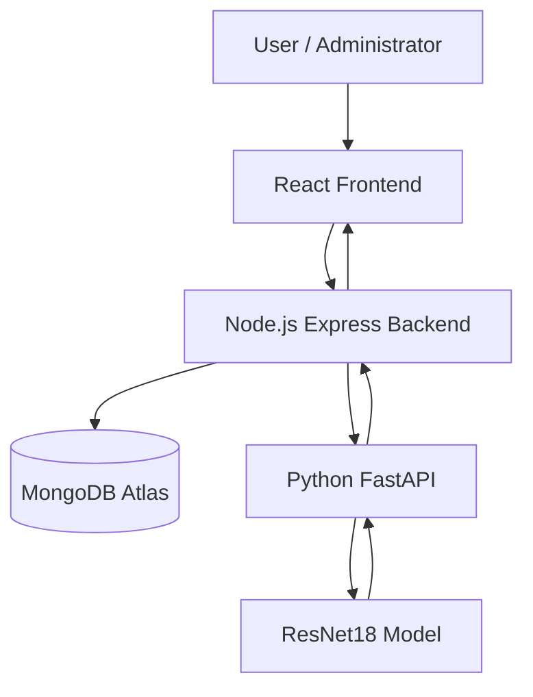
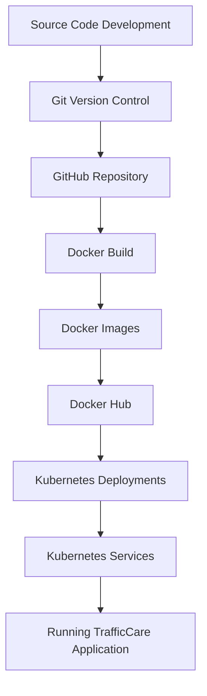

# 🚦 TrafficCare – Smart Traffic Complaint System

**An AI-powered traffic complaint management system built using React, Node.js, Python, Deep Learning, MongoDB, Docker, and Kubernetes.**

TrafficCare is a full-stack web application designed to make traffic complaint reporting and management easier. It allows users to submit traffic-related complaints along with images, uses a deep learning model to analyse uploaded images, and provides an interface for administrators to manage complaints.

The project combines full-stack development, machine learning integration, software testing, containerization, and Kubernetes orchestration.

---

## 📌 Table of Contents

- [Project Overview](#-project-overview)
- [Key Features](#-key-features)
- [System Architecture](#-system-architecture)
- [Technology Stack](#-technology-stack)
- [Project Structure](#-project-structure)
- [How the System Works](#-how-the-system-works)
- [Deep Learning Integration](#-deep-learning-integration)
- [Database](#-database)
- [Testing and Code Quality](#-testing-and-code-quality)
- [DevOps Implementation](#-devops-implementation)
- [Docker Implementation](#-docker-implementation)
- [Docker Hub Images](#-docker-hub-images)
- [Kubernetes Deployment](#-kubernetes-deployment)
- [Running the Project Locally](#-running-the-project-locally)
- [Environment Configuration](#-environment-configuration)
- [Future Improvements](#-future-improvements)
- [Author](#-author)

---

## 📖 Project Overview

TrafficCare addresses the need for a structured digital platform where people can report traffic-related problems.

The application provides three main components:

1. **Frontend:** A React-based interface for users and administrators.
2. **Backend:** A Node.js and Express API responsible for authentication, complaint management, and application logic.
3. **Deep Learning API:** A Python FastAPI service that uses a ResNet18 model to process uploaded images.

MongoDB Atlas is used for database management.

The application is containerized using Docker, and its services are deployed and managed using Kubernetes on a local Docker Desktop Kubernetes cluster.

---

## ✨ Key Features

### User Features
- User registration and authentication.
- Secure login using JWT-based authentication.
- Submit traffic-related complaints.
- Upload images as supporting evidence.
- AI-assisted image analysis.
- View submitted complaints and their status.
- Track complaint information.

### Administrator Features
- Dedicated administrator dashboard.
- View and manage submitted complaints.
- Access complaint information.
- Monitor complaint records.

### AI and Deep Learning
- Image processing using Python.
- ResNet18-based deep learning model.
- FastAPI-based prediction service.
- Image format and size validation.
- Prediction API integration with the Node.js backend.

### Infrastructure and DevOps
- Docker containerization.
- Docker Compose configuration.
- Docker Hub image publishing.
- Kubernetes deployments and services.
- Local Kubernetes orchestration.
- Service communication using Kubernetes networking.
- Port forwarding for local application access.

---

## 🏗️ System Architecture

TrafficCare follows a three-service architecture.



### Service Details

| Service | Technology | Port |
|---|---|---:|
| Frontend | React + Vite | 5173 |
| Backend | Node.js + Express | 5050 |
| Deep Learning API | Python + FastAPI | 8000 |
| Database | MongoDB Atlas | Cloud-hosted |

The frontend communicates with the backend, while the backend interacts with MongoDB and the Deep Learning API.

---

## 🛠️ Technology Stack

### Frontend
- React
- JavaScript
- Vite
- HTML
- CSS
- Axios
- Vitest
- React Testing Library

### Backend
- Node.js
- Express.js
- JavaScript
- MongoDB
- Mongoose
- JSON Web Tokens (JWT)
- Jest

### Deep Learning
- Python
- FastAPI
- PyTorch
- Torchvision
- ResNet18
- Pillow
- Python unittest (PyUnit)
- Pylint

### Database
- MongoDB Atlas
- Mongoose ODM

### DevOps and Infrastructure
- Git
- GitHub
- Docker
- Docker Compose
- Docker Hub
- Kubernetes
- kubectl
- Docker Desktop Kubernetes

---

## 📂 Project Structure

```text
smart-traffic-complaint-system/
│
├── client/
│   ├── src/
│   │   ├── test/
│   │   │   ├── App.test.jsx
│   │   │   ├── Dashboard.test.jsx
│   │   │   ├── AdminDashboard.test.jsx
│   │   │   └── setup.js
│   │   ├── App.jsx
│   │   ├── Dashboard.jsx
│   │   └── ...
│   ├── package.json
│   ├── package-lock.json
│   ├── vite.config.js
│   └── Dockerfile
│
├── server/
│   ├── tests/
│   ├── package.json
│   └── Dockerfile
│
├── dl/
│   ├── src/
│   │   ├── api.py
│   │   ├── predict.py
│   │   └── ...
│   ├── tests/
│   │   └── test_api.py
│   ├── requirements.txt
│   └── Dockerfile
│
├── kubernetes/
│   ├── frontend-deployment.yaml
│   ├── backend-deployment.yaml
│   ├── dl-deployment.yaml
│   └── ...
│
├── docker-compose.yml
├── TrafficCare_Unit_Testing_Report.pdf
├── .gitignore
└── README.md
```

*Note: The structure above highlights the main project components. Exact filenames and additional folders may vary in the repository.*

---

## ⚙️ How the System Works

1. A user accesses the TrafficCare frontend.
2. The user registers or logs in.
3. The user submits a traffic-related complaint.
4. The user uploads an image as supporting evidence.
5. The frontend sends the complaint data to the backend.
6. The backend processes the request and communicates with the Deep Learning API when image analysis is required.
7. The Python API processes the image using the ResNet18 model.
8. The prediction response is returned to the backend.
9. Complaint information is stored in MongoDB Atlas.
10. Users and administrators can access complaint information through their respective dashboards.

---

## 🧠 Deep Learning Integration

TrafficCare integrates a deep learning service built using Python and FastAPI.

### Model
- Architecture: ResNet18
- Framework: PyTorch
- Image processing: Pillow and Torchvision
- API framework: FastAPI

### API Endpoints

| Endpoint | Method | Purpose |
|---|---|---|
| `/health` | GET | Check API health |
| `/predict` | POST | Process an uploaded image and return a prediction |

### Input Validation

The API includes validation for:
- Unsupported image formats.
- Empty image uploads.
- Oversized files.
- Corrupted image files.

The prediction endpoint is tested using a mocked model in the valid-prediction unit test. This validates API processing and response behaviour, not real-world model accuracy.

---

## 🗄️ Database

TrafficCare uses MongoDB Atlas as its database.

The Node.js backend communicates with MongoDB through Mongoose.

Database functionality includes:
- User information management.
- Authentication-related records.
- Traffic complaint storage.
- Complaint retrieval and management.

Database credentials are supplied through environment variables and should never be committed to GitHub.

---

## 🧪 Testing and Code Quality

Testing has been performed separately across the frontend, backend, and deep learning API.

### 1. Frontend Testing

**Framework:** Vitest + React Testing Library

Test files:
- `App.test.jsx`
- `Dashboard.test.jsx`
- `AdminDashboard.test.jsx`

Testing covers:
- Application rendering.
- Dashboard behaviour.
- Admin dashboard behaviour.
- User interface interactions.
- Image upload validation.

### 2. Backend Testing

**Framework:** Jest

Verified results:

- 6 test suites passed.
- 40 tests passed.

Testing covers:
- Authentication.
- Complaint functionality.
- Admin functionality.
- Authentication middleware.
- MongoDB connection behaviour.
- Application-level tests.

### 3. Python Unit Testing

**Framework:** Python unittest (PyUnit)

Test file:
- `dl/tests/test_api.py`

Verified results:

- 6 tests passed.

Testing covers:
- Health endpoint.
- Unsupported file type.
- Empty image.
- Oversized image.
- Corrupted image.
- Valid prediction response.

### 4. Static Code Analysis

**Tool:** Pylint

Python code quality score:

**8.97 / 10**

Pylint was used to analyse Python code for:
- Coding standard violations.
- Potential programming errors.
- Unused imports and variables.
- Code maintainability.
- Python coding conventions.

### Testing Summary

| Component | Tool | Last verified result |
|---|---|---|
| Backend | Jest | 40 passed |
| Deep Learning API | PyUnit | 6 passed |
| Frontend | Vitest | 12 passed, 1 failing in the last reported run |
| Python Code Quality | Pylint | 8.97/10 |

**Note:** The frontend unsupported-image test was being fixed. Update this table once all 13 frontend tests pass. The valid DL prediction test uses a mocked model, so these test results should not be interpreted as model accuracy.

---

# 🚀 DevOps Implementation

TrafficCare includes practical DevOps implementation involving version control, containerization, image publishing, and Kubernetes orchestration.

## 1. Version Control Using Git and GitHub

Git was used to manage source code and track project changes.

Activities performed:
- Initialized and maintained the Git repository.
- Used the `main` branch.
- Added and committed project files.
- Managed changes using Git.
- Connected the local repository to GitHub.
- Pushed project updates to the remote repository.
- Uploaded testing-related files and reports.

## 2. Docker Containerization

Docker was used to package the application's individual services into containers.

Separate Dockerfiles were created for:

- React frontend.
- Node.js backend.
- Python Deep Learning API.

This makes the services easier to run in consistent environments.

## 3. Docker Compose

A Docker Compose configuration was created to define the application's services and their configuration.

Docker Compose provides a convenient way to manage the multi-service application.

## 4. Docker Hub

Docker images were built and pushed to Docker Hub.

Published image repositories:

| Service | Docker Hub Image |
|---|---|
| Frontend | `ansh6625/smart-traffic-complaint-system-frontend:latest` |
| Backend | `ansh6625/smart-traffic-complaint-system-backend:latest` |
| Deep Learning API | `ansh6625/smart-traffic-complaint-system-dl:latest` |

Docker Hub repositories:

- [Frontend Image](https://hub.docker.com/r/ansh6625/smart-traffic-complaint-system-frontend)
- [Backend Image](https://hub.docker.com/r/ansh6625/smart-traffic-complaint-system-backend)
- [Deep Learning Image](https://hub.docker.com/r/ansh6625/smart-traffic-complaint-system-dl)

## 5. Kubernetes Orchestration

Kubernetes was used to deploy and manage the containerized services.

The project was deployed using Docker Desktop's local Kubernetes cluster.

Kubernetes resources were configured for:
- Frontend deployment.
- Backend deployment.
- Deep Learning deployment.
- Service discovery and internal communication.

### Kubernetes Operations Performed

The following commands were used during deployment and testing:

Check cluster nodes:

```bash
kubectl get nodes
```

Check running pods:

```bash
kubectl get pods
```

Check services:

```bash
kubectl get services
```

Check deployments:

```bash
kubectl get deployments
```

Access frontend locally:

```bash
kubectl port-forward svc/frontend 5173:5173
```

Access backend locally:

```bash
kubectl port-forward svc/backend 5050:5050
```

The services were previously verified as running in the local Kubernetes cluster.

### Deployment Environment

| Component | Environment |
|---|---|
| Container Runtime | Docker Desktop |
| Orchestration | Kubernetes |
| Cluster | Local Docker Desktop Kubernetes |
| CLI | kubectl |
| Image Registry | Docker Hub |

**Deployment clarification:** This is a local Kubernetes deployment, not a public-cloud deployment. The application can be accessed locally through port forwarding.

## 6. DevOps Workflow

The implemented workflow can be represented as:



---

## 💻 Running the Project Locally

### Prerequisites

Install the following:

- Node.js and npm.
- Python 3.
- MongoDB Atlas account.
- Docker Desktop.
- Git.

### 1. Clone the repository

```bash
git clone <YOUR_GITHUB_REPOSITORY_URL>
cd smart-traffic-complaint-system
```

Replace the placeholder with your actual GitHub repository URL.

### 2. Start the Backend

```bash
cd server
npm install
```

Configure the backend environment variables before starting the server.

```bash
npm start
```

### 3. Start the Frontend

Open another terminal:

```bash
cd client
npm install
npm run dev
```

Frontend:

```text
http://localhost:5173
```

### 4. Start the Deep Learning API

Open another terminal:

```bash
cd dl
```

Activate your Python virtual environment and install the dependencies:

```bash
pip install -r requirements.txt
```

Start FastAPI using the actual API module:

```bash
uvicorn src.api:app --host 0.0.0.0 --port 8000
```

API health endpoint:

```text
http://localhost:8000/health
```

*Make sure the model files and required configuration are available before starting the API.*

---

## 🔐 Environment Configuration

The application uses environment variables for configuration.

Examples of configuration values may include:

```env
MONGO_URI=your_mongodb_connection_string
JWT_SECRET=your_jwt_secret
PORT=5050
```

Use the actual environment variable names expected by the backend and other services.

**Security practices:**
- Never upload `.env` files.
- Never expose MongoDB credentials.
- Never commit JWT secrets.
- Avoid committing private API keys.
- Use Kubernetes Secrets or an appropriate secret manager when deploying outside a local development environment.

---
