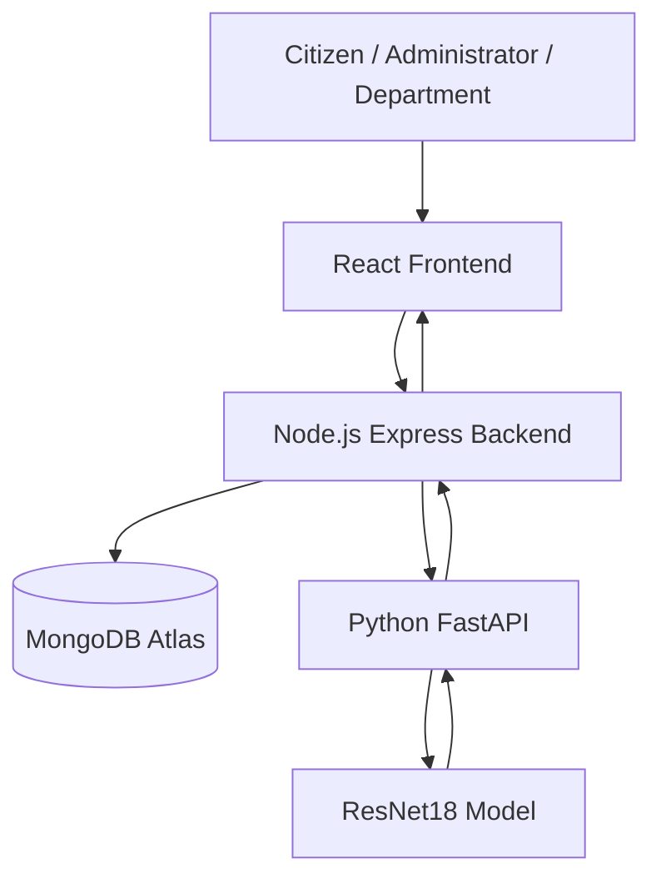
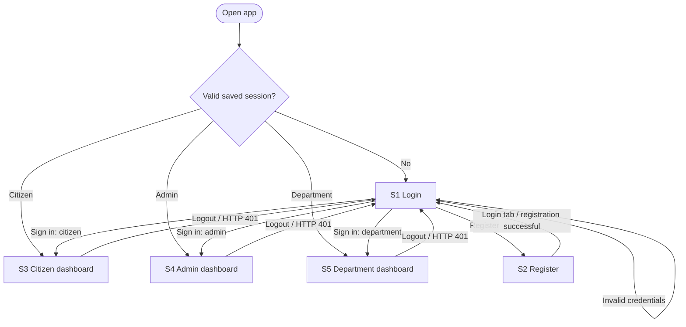
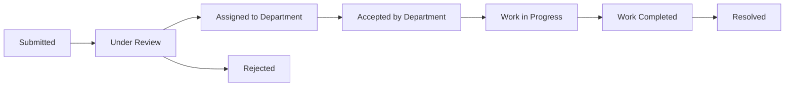
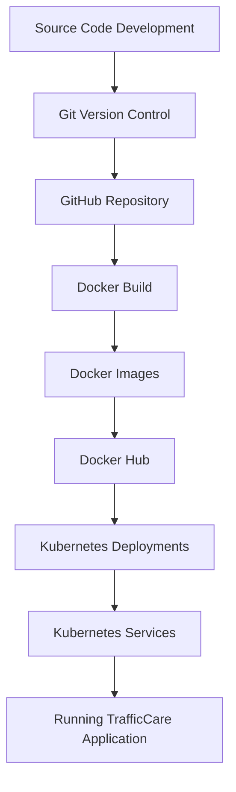

# 🚦 TrafficCare – Smart Traffic Complaint System

**An AI-powered traffic complaint management system built using React, Node.js, Python, Deep Learning, MongoDB, Docker, and Kubernetes.**

TrafficCare is a full-stack web application that makes traffic complaint reporting and management easier. Citizens submit traffic-related complaints with photo evidence, a deep learning model analyses the uploaded images, administrators review complaints and assign them to the responsible department, and departments record their progress and report completed work. Administrators then verify that work before a complaint is officially resolved.

The project combines full-stack development, machine learning integration, UX design, software testing, containerization, and Kubernetes orchestration.

---

## 📌 Table of Contents

- [Project Overview](#-project-overview)
- [Key Features](#-key-features)
- [User Roles](#-user-roles)
- [System Architecture](#-system-architecture)
- [Technology Stack](#-technology-stack)
- [Project Structure](#-project-structure)
- [Screens and Navigation](#-screens-and-navigation)
- [How the System Works](#-how-the-system-works)
- [Complaint Status Lifecycle](#-complaint-status-lifecycle)
- [Deep Learning Integration](#-deep-learning-integration)
- [Database](#-database)
- [UX Design and Evaluation](#-ux-design-and-evaluation)
- [Testing and Code Quality](#-testing-and-code-quality)
- [DevOps Implementation](#-devops-implementation)
- [Running the Project Locally](#-running-the-project-locally)
- [Environment Configuration](#-environment-configuration)
- [Future Improvements](#-future-improvements)
- [Author](#-author)

---

## 📖 Project Overview

TrafficCare addresses the need for a structured digital platform where people can report traffic-related problems and where those problems are tracked until they are fixed.

The application provides three main components:

1. **Frontend:** A React-based interface for citizens, administrators, and departments.
2. **Backend:** A Node.js and Express API responsible for authentication, role-based authorization, complaint management, and application logic.
3. **Deep Learning API:** A Python FastAPI service that uses a ResNet18 model to process uploaded images.

MongoDB Atlas is used for database management.

The application is containerized using Docker, and its services are deployed and managed using Kubernetes on a local Docker Desktop Kubernetes cluster.

---

## ✨ Key Features

### Citizen Features
- Citizen registration and authentication.
- Secure login using JWT-based authentication.
- Submit traffic-related complaints by choosing a category and entering a description and location.
- Upload an optional photo as supporting evidence.
- AI-assisted image analysis.
- View submitted complaints, dashboard statistics, and current status.
- Follow each complaint's progress history until it is fixed.

### Administrator Features
- Dedicated administrator dashboard with complaint statistics.
- View all submitted complaints as cards, including citizen information and AI analysis.
- Filter complaints by status.
- Change complaint status and priority.
- Assign or reassign a complaint to a responsible department, with category-based department suggestions.
- Monitor progress updates from departments.
- Verify completed work and officially mark complaints **Resolved**, or reject complaints.

### Department Features
- Dedicated department dashboard showing only complaints assigned to that department.
- Summary statistics: total assigned, awaiting acceptance, in progress, and work completed.
- View complaint details and progress history in a modal.
- Accept an assignment.
- Enter progress messages as work proceeds.
- Submit **Work Completed**. The complaint then waits for administrator verification.

### AI and Deep Learning
- Image processing using Python.
- ResNet18-based deep learning model.
- FastAPI-based prediction service.
- Image format and size validation.
- Prediction API integration with the Node.js backend.

### Infrastructure and DevOps
- Docker containerization.
- Docker Compose configuration.
- Docker Hub image publishing.
- Kubernetes deployments and services.
- Local Kubernetes orchestration.
- Service communication using Kubernetes networking.
- Port forwarding for local application access.

---

## 👥 User Roles

TrafficCare has three user roles. All of them use the same login system. The server determines the authenticated user's role, and the application directs the user to the matching dashboard.

| User | Main goal | What success looks like |
|---|---|---|
| **Citizen** | Report a traffic problem and track its progress | Can submit a complaint with supporting evidence and see its status and progress history |
| **Administrator** | Review complaints, assign departments, and verify resolutions | Can view all complaints, manage status and priority, assign departments, and verify completed work |
| **Department** | Handle assigned complaints and report progress | Can view only complaints assigned to its department, accept assignments, record progress, and report completed work |

- Public registration creates **citizen** accounts only.
- Administrator and department accounts are managed separately and are not created through public registration.
- The server controls authorization. Dashboard access and API operations are restricted according to the authenticated user's role.
- Department staff cannot close a complaint as **Resolved** on their own.

---

## 🏗️ System Architecture

TrafficCare follows a three-service architecture.



### Service Details

| Service | Technology | Port |
|---|---|---:|
| Frontend | React + Vite | 5173 |
| Backend | Node.js + Express | 5050 |
| Deep Learning API | Python + FastAPI | 8000 |
| Database | MongoDB Atlas | Cloud-hosted |

The frontend communicates with the backend, while the backend interacts with MongoDB and the Deep Learning API.

---

## 🛠️ Technology Stack

### Frontend
- React
- JavaScript
- Vite
- HTML
- CSS
- Axios
- Vitest
- React Testing Library

### Backend
- Node.js
- Express.js
- JavaScript
- MongoDB
- Mongoose
- JSON Web Tokens (JWT)
- Jest

### Deep Learning
- Python
- FastAPI
- PyTorch
- Torchvision
- ResNet18
- Pillow
- Python unittest (PyUnit)
- Pylint

### Database
- MongoDB Atlas
- Mongoose ODM

### Design
- Instrument Serif (display typography)
- Inter (interface typography)

### DevOps and Infrastructure
- Git
- GitHub
- Docker
- Docker Compose
- Docker Hub
- Kubernetes
- kubectl
- Docker Desktop Kubernetes

---

## 📂 Project Structure

```text
smart-traffic-complaint-system/
│
├── client/
│   ├── src/
│   │   ├── test/
│   │   │   ├── App.test.jsx
│   │   │   ├── Dashboard.test.jsx
│   │   │   ├── AdminDashboard.test.jsx
│   │   │   └── setup.js
│   │   ├── App.jsx
│   │   ├── Dashboard.jsx
│   │   └── ...        (admin and department dashboards, shared components)
│   ├── package.json
│   ├── package-lock.json
│   ├── vite.config.js
│   └── Dockerfile
│
├── server/
│   ├── tests/
│   ├── package.json
│   └── Dockerfile
│
├── dl/
│   ├── src/
│   │   ├── api.py
│   │   ├── predict.py
│   │   └── ...
│   ├── tests/
│   │   └── test_api.py
│   ├── requirements.txt
│   └── Dockerfile
│
├── kubernetes/
│   ├── frontend-deployment.yaml
│   ├── backend-deployment.yaml
│   ├── dl-deployment.yaml
│   └── ...
│
├── docker-compose.yml
├── UX_Design_and_Evaluation.md
├── TrafficCare_Unit_Testing_Report.pdf
├── .gitignore
└── README.md
```

*Note: The structure above highlights the main project components. Exact filenames and additional folders may vary in the repository.*

---

## 🖥️ Screens and Navigation

### Screen Inventory

| ID | Screen | Purpose | Key elements |
|---|---|---|---|
| **S1** | Login | Authenticate users | Email, password, validation messages, registration link |
| **S2** | Register | Create a citizen account | Name, email, password (8+ characters), validation and success messages |
| **S3** | Citizen dashboard | Submit and track complaints | Greeting, complaint statistics, complaint form, optional photo, AI analysis, complaint list and progress information |
| **S4** | Admin dashboard | Manage all complaints | Complaint statistics, complaint cards, status and priority controls, department assignment, citizen information, AI analysis |
| **S5** | Department dashboard | Handle assigned complaints | Assigned complaint list, acceptance action, progress update form, completion action |
| **S6** | Complaint details | Inspect one complaint | Description, location, citizen information, current status, progress history |

The complaint details view (S6) is presented as a **modal** within the department dashboard rather than as a separate page.

### Screen Transitions



| From | Event | To |
|---|---|---|
| App start | No saved session | S1 Login |
| App start | Citizen / Admin / Department session | S3 / S4 / S5 |
| S1 | Select Register | S2 Register |
| S2 | Select Login, or successful registration | S1 Login |
| S1 | Invalid credentials | S1 with an error message |
| S1 | Successful login | S3, S4, or S5 depending on role |
| S3, S4, S5 | Logout or session expired (401) | S1 Login |

---

## ⚙️ How the System Works

### Citizen journey
1. A citizen opens TrafficCare and registers or logs in.
2. The citizen opens the complaint form, selects a category, and enters a description and location.
3. The citizen can attach a photo as evidence.
4. The frontend sends the complaint to the backend.
5. The backend communicates with the Deep Learning API when image analysis is required, and the ResNet18 model returns a prediction.
6. The complaint is stored in MongoDB Atlas with the initial status **Submitted**.
7. The citizen follows status changes and progress updates from the dashboard.

### Administrator journey
1. The administrator logs in and opens the admin dashboard.
2. The administrator reviews submitted complaints and can change status and priority.
3. The administrator chooses the responsible department (a category-based suggestion is provided and can be overridden) and assigns the complaint.
4. The administrator monitors progress updates from the department.
5. After the department reports completion, the administrator verifies the work.
6. The administrator marks the complaint **Resolved** once satisfied that the issue has been addressed.

### Department journey
1. Department staff log in with their department account.
2. The dashboard lists complaints assigned to that department only.
3. Staff inspect a complaint and accept the assignment.
4. Staff enter progress messages as work proceeds.
5. Staff submit **Work Completed** when the work is finished.
6. The complaint stays pending until the administrator verifies it. Departments cannot resolve complaints themselves.

---

## 🔄 Complaint Status Lifecycle

The lifecycle separates administrative review, departmental responsibility, work completion, and final verification.



| Status | Meaning | Responsible role |
|---|---|---|
| **Submitted** | A citizen has successfully registered a complaint | System |
| **Under Review** | The administrator is reviewing the complaint | Administrator |
| **Assigned to Department** | The complaint has been forwarded to a responsible department | Administrator |
| **Accepted by Department** | The department has accepted responsibility | Department |
| **Work in Progress** | The department is actively working on the complaint | Department |
| **Work Completed** | The department reports that the work is finished | Department |
| **Resolved** | The administrator has verified the completion and officially closed the complaint | Administrator |
| **Rejected** | The administrator has rejected the complaint | Administrator |

> **Work Completed and Resolved are not interchangeable.** Work Completed is the department's completion report; Resolved is the administrator's final verification.

The older **In Progress** status is kept in the backend for compatibility with existing records. **Work in Progress** is the preferred status in the current workflow.

### Department Assignment Suggestions

| Complaint category | Suggested department |
|---|---|
| Pothole | Roads & Maintenance |
| Traffic Signal | Traffic Signal Department |
| Illegal Parking | Traffic Police |
| Road Blockage | Roads & Maintenance |
| Traffic Congestion | Traffic Police |
| Street Lighting | Electrical Department |
| Accident | Traffic Police |
| Pedestrian Safety | Traffic Police |
| Road Sign | Roads & Maintenance |
| Public Transport | Transport Department |

The administrator can override the suggested department before forwarding the complaint.

### Progress History

Every progress update records who submitted it, their role, the message, and the associated status. This gives citizens and administrators a clear history of what has happened since the complaint was submitted.

---

## 🧠 Deep Learning Integration

TrafficCare integrates a deep learning service built using Python and FastAPI.

### Model
- Architecture: ResNet18
- Framework: PyTorch
- Image processing: Pillow and Torchvision
- API framework: FastAPI

### API Endpoints

| Endpoint | Method | Purpose |
|---|---|---|
| `/health` | GET | Check API health |
| `/predict` | POST | Process an uploaded image and return a prediction |

### Input Validation

The API includes validation for:
- Unsupported image formats.
- Empty image uploads.
- Oversized files.
- Corrupted image files.

The prediction endpoint is tested using a mocked model in the valid-prediction unit test. This validates API processing and response behaviour, not real-world model accuracy.

---

## 🗄️ Database

TrafficCare uses MongoDB Atlas as its database.

The Node.js backend communicates with MongoDB through Mongoose.

Database functionality includes:
- User information and role management.
- Authentication-related records.
- Traffic complaint storage.
- Department assignment and complaint status.
- Progress history for each complaint.
- Complaint retrieval and management.

Database credentials are supplied through environment variables and should never be committed to GitHub.

---

## 🎨 UX Design and Evaluation

The full write-up is in [`UX_Design_and_Evaluation.md`](UX_Design_and_Evaluation.md). In short:

### Visual direction
Editorial and calm: a warm-white page, large serif headlines, and a soft purple, blue, and pink gradient aura. The goal is an interface that feels approachable and trustworthy rather than like a traditional government form.

| Role | Typeface | Use |
|---|---|---|
| Display | Instrument Serif | Hero headlines, section titles, prominent statistics |
| Interface | Inter | Labels, body text, buttons, forms, dashboard information |

| Token | Value | Use |
|---|---|---|
| `--ink` | `#121116` | Headings and body text |
| `--ink-soft` | `#3a3842` | Secondary text |
| `--muted` | `#6f6b77` | Captions and hints |
| `--lavender` | `#6655f0` | Links and accents |
| Paper | `#fbfaf8` | Main page background |

### Components
Hairline form fields, pill buttons, labelled status pills, complaint cards, progress forms, a complaint details modal, and success/error notices. The application does not use map functionality.

### Motion
Subtle page entrance, smooth Login/Register tab transitions, button and card hover feedback, and a slow decorative background aura. Reduced-motion preferences should be respected, and important actions must work without animation.

### Accessibility
Design requirements include WCAG AA text contrast, visible labels and focus indicators, keyboard access, alert semantics for errors, polite announcements for success, status shown as text (not colour alone), alternative text for evidence images, and responsive dashboards. A complete audit with keyboard and screen-reader testing is still needed to verify the current implementation.

### Heuristic evaluation highlights (Nielsen's 10)

| Heuristic | Opportunity | Severity | Recommendation |
|---|---|---|---|
| Visibility of system status | Citizens may need clearer feedback when a complaint is submitted or updated | 2 | Keep success notices visible and show clear timeline updates |
| User control and freedom | No documented withdrawal or editing workflow for citizens | 2 | Consider controlled complaint withdrawal or correction |
| Consistency and standards | Legacy "In Progress" wording can confuse | 1 | Use "Work in Progress" consistently |
| Error prevention | Wrong department assignment can delay handling | 2 | Make the assigned department clear and allow reassignment |
| Recognition rather than recall | Work Completed vs Resolved may be unclear | 2 | Explain that administrator verification is required before closure |
| Flexibility and efficiency | Search and sorting will matter as records grow | 2 | Add search by complaint ID or location and sorting by date or priority |

*Severity scale: 0 = not a problem, 1 = cosmetic, 2 = minor, 3 = major, 4 = catastrophic.*

---

## 🧪 Testing and Code Quality

Testing has been performed separately across the frontend, backend, and deep learning API.

### 1. Frontend Testing

**Framework:** Vitest + React Testing Library

Test files:
- `App.test.jsx`
- `Dashboard.test.jsx`
- `AdminDashboard.test.jsx`

Testing covers:
- Application rendering.
- Dashboard behaviour.
- Admin dashboard behaviour.
- User interface interactions.
- Image upload validation.

### 2. Backend Testing

**Framework:** Jest

Verified results:

- 6 test suites passed.
- 40 tests passed.

Testing covers:
- Authentication.
- Complaint functionality.
- Admin functionality.
- Authentication middleware.
- MongoDB connection behaviour.
- Application-level tests.

### 3. Python Unit Testing

**Framework:** Python unittest (PyUnit)

Test file:
- `dl/tests/test_api.py`

Verified results:

- 6 tests passed.

Testing covers:
- Health endpoint.
- Unsupported file type.
- Empty image.
- Oversized image.
- Corrupted image.
- Valid prediction response.

### 4. Static Code Analysis

**Tool:** Pylint

Python code quality score:

**8.97 / 10**

Pylint was used to analyse Python code for:
- Coding standard violations.
- Potential programming errors.
- Unused imports and variables.
- Code maintainability.
- Python coding conventions.

### Testing Summary

| Component | Tool | Last verified result |
|---|---|---|
| Backend | Jest | 40 passed |
| Deep Learning API | PyUnit | 6 passed |
| Frontend | Vitest | 12 passed, 1 failing in the last reported run |
| Python Code Quality | Pylint | 8.97/10 |

**Note:** The frontend unsupported-image test was being fixed. Update this table once all 13 frontend tests pass. The valid DL prediction test uses a mocked model, so these results should not be interpreted as model accuracy. Test coverage for the department workflow has not been reported yet.

---

# 🚀 DevOps Implementation

TrafficCare includes practical DevOps implementation involving version control, containerization, image publishing, and Kubernetes orchestration.

## 1. Version Control Using Git and GitHub

Git was used to manage source code and track project changes.

Activities performed:
- Initialized and maintained the Git repository.
- Used the `main` branch.
- Added and committed project files.
- Managed changes using Git.
- Connected the local repository to GitHub.
- Pushed project updates to the remote repository.
- Uploaded testing-related files and reports.

## 2. Docker Containerization

Docker was used to package the application's individual services into containers.

Separate Dockerfiles were created for:

- React frontend.
- Node.js backend.
- Python Deep Learning API.

This makes the services easier to run in consistent environments.

## 3. Docker Compose

A Docker Compose configuration was created to define the application's services and their configuration.

Docker Compose provides a convenient way to manage the multi-service application.

## 4. Docker Hub

Docker images were built and pushed to Docker Hub.

Published image repositories:

| Service | Docker Hub Image |
|---|---|
| Frontend | `ansh6625/smart-traffic-complaint-system-frontend:latest` |
| Backend | `ansh6625/smart-traffic-complaint-system-backend:latest` |
| Deep Learning API | `ansh6625/smart-traffic-complaint-system-dl:latest` |

Docker Hub repositories:

- [Frontend Image](https://hub.docker.com/r/ansh6625/smart-traffic-complaint-system-frontend)
- [Backend Image](https://hub.docker.com/r/ansh6625/smart-traffic-complaint-system-backend)
- [Deep Learning Image](https://hub.docker.com/r/ansh6625/smart-traffic-complaint-system-dl)

## 5. Kubernetes Orchestration

Kubernetes was used to deploy and manage the containerized services.

The project was deployed using Docker Desktop's local Kubernetes cluster.

Kubernetes resources were configured for:
- Frontend deployment.
- Backend deployment.
- Deep Learning deployment.
- Service discovery and internal communication.

### Kubernetes Operations Performed

The following commands were used during deployment and testing:

Check cluster nodes:

```bash
kubectl get nodes
```

Check running pods:

```bash
kubectl get pods
```

Check services:

```bash
kubectl get services
```

Check deployments:

```bash
kubectl get deployments
```

Access frontend locally:

```bash
kubectl port-forward svc/frontend 5173:5173
```

Access backend locally:

```bash
kubectl port-forward svc/backend 5050:5050
```

The services were previously verified as running in the local Kubernetes cluster.

### Deployment Environment

| Component | Environment |
|---|---|
| Container Runtime | Docker Desktop |
| Orchestration | Kubernetes |
| Cluster | Local Docker Desktop Kubernetes |
| CLI | kubectl |
| Image Registry | Docker Hub |

**Deployment clarification:** This is a local Kubernetes deployment, not a public-cloud deployment. The application can be accessed locally through port forwarding.

## 6. DevOps Workflow

The implemented workflow can be represented as:



---

## 💻 Running the Project Locally

### Prerequisites

Install the following:

- Node.js and npm.
- Python 3.
- MongoDB Atlas account.
- Docker Desktop.
- Git.

### 1. Clone the repository

```bash
git clone <YOUR_GITHUB_REPOSITORY_URL>
cd smart-traffic-complaint-system
```

Replace the placeholder with your actual GitHub repository URL.

### 2. Start the Backend

```bash
cd server
npm install
```

Configure the backend environment variables before starting the server.

```bash
npm start
```

### 3. Start the Frontend

Open another terminal:

```bash
cd client
npm install
npm run dev
```

Frontend:

```text
http://localhost:5173
```

### 4. Start the Deep Learning API

Open another terminal:

```bash
cd dl
```

Activate your Python virtual environment and install the dependencies:

```bash
pip install -r requirements.txt
```

Start FastAPI using the actual API module:

```bash
uvicorn src.api:app --host 0.0.0.0 --port 8000
```

API health endpoint:

```text
http://localhost:8000/health
```

*Make sure the model files and required configuration are available before starting the API.*

### 5. Sign in

- Register a new account from the Register screen. Public registration always creates a **citizen** account.
- Administrator and department accounts are managed separately. Use the accounts configured for your environment to try the admin and department dashboards.

---

## 🔐 Environment Configuration

The application uses environment variables for configuration.

Examples of configuration values may include:

```env
MONGO_URI=your_mongodb_connection_string
JWT_SECRET=your_jwt_secret
PORT=5050
```

Use the actual environment variable names expected by the backend and other services.

**Security practices:**
- Never upload `.env` files.
- Never expose MongoDB credentials.
- Never commit JWT secrets.
- Avoid committing private API keys.
- Keep authorization on the server: role checks must not rely on the frontend alone.
- Use Kubernetes Secrets or an appropriate secret manager when deploying outside a local development environment.

---

## 🔮 Future Improvements

- Controlled complaint withdrawal or correction for citizens.
- Search by complaint ID or location, and sorting by date or priority, in the admin and department dashboards.
- Clear in-app explanation of the difference between **Work Completed** and **Resolved**.
- Consistent category labels between AI predictions and citizen-selected categories.
- Tests for the department workflow (accept, progress update, Work Completed, admin verification).
- A full accessibility audit with keyboard and screen-reader testing.
- Fixing the remaining frontend unit test and updating the testing summary.
- Deployment beyond the local Kubernetes cluster, with proper secret management.
- Retiring the legacy **In Progress** status once existing records are migrated.

---

## 👤 Author

**Ansh Vardhan Singh**

- Docker Hub: [ansh6625](https://hub.docker.com/u/ansh6625)
- GitHub: add your profile link here

---
