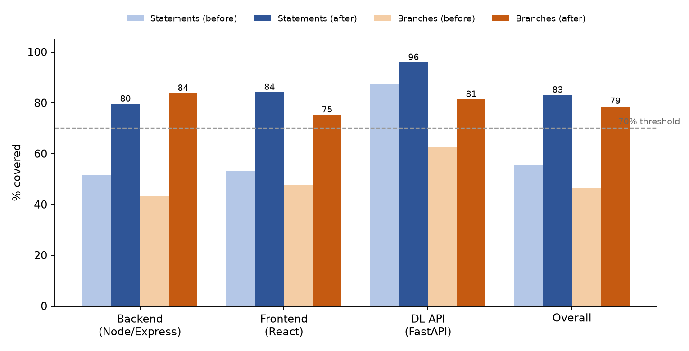

# Code and Branch Coverage Report

## TrafficCare: Smart Traffic Complaint and Monitoring System

| Item | Value |
|---|---|
| Document | Code and Branch Coverage Report |
| Version | 2.0 |
| Date | 16 November 2026 |
| Code measured | Branch `docs/update-srs-sad-stp-uml` (application code identical to `main` at commit `4afc3ff`; only tests and test configuration added) |
| Related documents | TrafficCare_STP (test plan), TrafficCare_Unit_Testing_Report.pdf |

### Revision history

| Version | Date | Description |
|---|---|---|
| 1.0 | 16 Nov 2026 | First measurement: 60 tests, 55.4 % statements, 46.4 % branches |
| 2.0 | 16 Nov 2026 | 81 new tests for the department workflow, admin management, image upload/AI path, admin and department dashboards and DL error paths. 141 tests, 83.0 % statements, 78.6 % branches |

---

## 1. Summary

All **141 automated tests pass**: 93 backend, 34 frontend and 14 DL API. Coverage was measured for **statements** (code coverage) and **branches** (every `if`/`else`, `? :`, `&&`/`||` outcome).

| Module | Tests | Statements | Branches | Functions | Lines |
|---|---|---|---|---|---|
| Backend (`server/`) | 93 / 93 passed | 79.5 % (302/380) | 83.7 % (149/178) | 85.7 % (30/35) | 79.7 % |
| Frontend (`client/src/`) | 34 / 34 passed | 84.1 % (306/364) | 75.2 % (212/282) | 88.5 % (77/87) | 85.0 % |
| DL inference API (`dl/src/api.py`) | 14 / 14 passed | 95.8 % (69/72) | 81.3 % (13/16) | none reported | 95.8 % |
| **Overall** | **141 / 141 passed** | **83.0 % (677/816)** | **78.6 % (374/476)** | | |

### 1.1 Improvement from version 1.0

| Module | Tests (v1.0 → v2.0) | Statements (v1.0 → v2.0) | Branches (v1.0 → v2.0) |
|---|---|---|---|
| Backend | 41 → 93 | 51.6 % → 79.5 % | 43.3 % → 83.7 % |
| Frontend | 13 → 34 | 53.0 % → 84.1 % | 47.5 % → 75.2 % |
| DL API | 6 → 14 | 87.5 % → 95.8 % | 62.5 % → 81.3 % |
| **Overall** | **60 → 141** | **55.4 % → 83.0 %** | **46.4 % → 78.6 %** |

**Assessment.** Every module is now above 70 % for both statements and branches. All workflow code is covered: authentication, complaints with images and AI, administration, the department workflow and all three dashboards. The remaining uncovered code is mostly server start-up (which only runs against a real database), defensive `500` handlers for database failures, and the citizen dashboard's error states (§6).

---

## 2. Scope and Method

### 2.1 What was measured

| Module | Files included | Excluded (and why) |
|---|---|---|
| Backend | Every `.js` file in `server/` | `node_modules/`, `tests/` |
| Frontend | `client/src/**/*.js(x)` | `src/test/**` (test code), `src/main.jsx` (only mounts React) |
| DL | `dl/src/api.py`, the deployed service | Offline training and analysis scripts (`train.py`, `evaluate.py`, `compare_models.py`, …), which are research scripts verified by running them (STP §7.8) |

### 2.2 Tools

| Module | Test framework | Coverage tool | Coverage type |
|---|---|---|---|
| Backend | Jest 30 + Supertest + mongodb-memory-server (MongoDB 8.2.6) | Jest built-in (Istanbul) | Statement, branch, function, line |
| Frontend | Vitest 5.0.5 + React Testing Library (jsdom) | `@vitest/coverage-v8` 5.0.5 | Statement, branch, function, line |
| DL API | pytest / unittest + FastAPI TestClient | coverage.py with `--branch` | Statement, branch |

### 2.3 Environment

macOS (Apple Silicon), Node.js 24.6, Python 3.12, PyTorch 2.12.

### 2.4 Commands to reproduce

| Module | Command |
|---|---|
| Backend | `cd server && npm run test:coverage` |
| Frontend | `cd client && npm run test:coverage` (writes to `testing/coverage-report/frontend`) |
| DL API | `cd dl && DL_MODEL_PATH=<checkpoint> python -m coverage run --branch --source=src -m pytest tests && python -m coverage report -m` |

**Note on the DL checkpoint.** The production weights (`best_model.pth`) are stored with DVC and were not available. The DL tests therefore loaded an **untrained** ResNet18 checkpoint in the same format. Coverage measures which code runs, and the prediction tests replace the model with a fake, so this does not change the results. It says nothing about model accuracy.

### 2.5 Full reports

Interactive HTML reports with line-by-line highlighting are in `testing/coverage-report/`:

| Module | HTML report | Machine-readable |
|---|---|---|
| Backend | `testing/coverage-report/backend/index.html` | `coverage-summary.json`, `cobertura-coverage.xml` |
| Frontend | `testing/coverage-report/frontend/index.html` | `coverage-summary.json`, `cobertura-coverage.xml` |
| DL API | `testing/coverage-report/dl/index.html` | `coverage.xml` |

---

## 3. Tests Added in Version 2.0

| File | Tests | What it covers | STP cases |
|---|---|---|---|
| `server/tests/department.test.js` | 18 | Role guard; list scoped to own department; accept (valid, twice, bad ID, other department); progress before acceptance; Work in Progress → Work Completed with history; message boundaries (empty, missing, 1,000 / 1,001 chars); department cannot set Resolved or use admin API | TC-DEP-01…08 |
| `server/tests/adminWorkflow.test.js` | 16 | Create department (valid, each missing field, short password, duplicate, citizen forbidden); assign, alternative field name, reassign with history, unknown department, missing department, bad ID, missing complaint; Resolved also completes department status | TC-ADM-02…06, TC-ADM-09 |
| `server/tests/complaintImage.test.js` | 18 | JPEG/PNG upload with UUID names; `DL_API_URL`; `nosniff` header; AI `Completed`; AI `Failed` when unreachable, HTTP 500, `success:false`, malformed body, timeout; GIF, > 10 MB, two files; uploaded file deleted on validation errors; malformed JSON → 400; generic 500 without leaking details | TC-CMP-06…08, TC-AI-01…03, TC-SEC-06, TC-SEC-08 |
| `client/src/test/DepartmentDashboard.test.jsx` | 11 | Loading, statistics, empty and error states with retry; accept; progress validation; progress and completion requests; failure messages; details modal with history; logout | TC-UI-01, TC-DEP |
| `client/src/test/AdminDashboardActions.test.jsx` | 10 | Reporter and AI analysis display; assign (no selection, success, server error); status and priority updates with statistics refresh; update errors; 401 logout; load error; logout | TC-UI-01, TC-ADM |
| `dl/tests/test_api_errors.py` | 8 | `load_model()`: missing file, missing keys, wrong classes, valid checkpoint; `GET /`; PNG input; all three class probabilities; model failure → 500 without leaking the error | TC-DL-01…06 |
| **Total new** | **81** | | |

The DL service is mocked in the backend tests by replacing `fetch`. Uploaded test files are removed after each test.

---

## 4. Backend Coverage (Node.js / Express)

| File | Statements | Branches | Functions | Uncovered lines |
|---|---|---|---|---|
| `app.js` | 92.9 % (26/28) | 25.0 % (1/4) | 100 % | 67–69 |
| `index.js` | 0 % (0/14) | 0 % (0/2) | 0 % | 2–28 |
| `seedDepartments.js` | 0 % (0/16) | 0 % (0/6) | 0 % | 2–72 |
| `config/db.js` | 0 % (0/11) | 0 % (0/2) | 0 % | 2–21 |
| `middleware/authMiddleware.js` | 90.6 % (29/32) | 90.9 % (20/22) | 100 % | 19, 60–62 |
| `models/Complaint.js` | 100 % (3/3) | none | none | none |
| `models/User.js` | 90.0 % (9/10) | 50.0 % (1/2) | 100 % | 45 |
| `routes/adminRoutes.js` | 88.9 % (80/90) | 95.6 % (43/45) | 100 % | 88–90, 115–117, 199–201, 288–290, 327–329 |
| `routes/authRoutes.js` | 73.7 % (28/38) | 75.0 % (21/28) | 100 % | 58–78, 115–117, 144–146 |
| `routes/complaintRoutes.js` | 94.0 % (78/83) | 90.9 % (40/44) | 90.0 % | 195–197, 255–257, 283 |
| `routes/departmentRoutes.js` | 89.1 % (49/55) | 100 % (23/23) | 100 % | 27–28, 84–85, 172–173 |
| **Total** | **79.5 %** | **83.7 %** | **85.7 %** | |

**What remains uncovered:**

- **Route `catch` blocks** (`adminRoutes` 88–90, 115–117, …; `departmentRoutes` 27–28, …; `complaintRoutes` 195–197, 255–257): these return `500` when MongoDB itself fails. Each is three lines and has the same shape as the one tested in `complaintImage.test.js`.
- **`authRoutes.js` 58–78:** the duplicate-key race and schema-validation fallbacks in registration, which normal input cannot reach because earlier checks catch it first.
- **`app.js` 67–69:** the generic 500 handler for errors that are not malformed JSON.
- **`index.js`, `config/db.js`, `seedDepartments.js`:** start-up code that connects to the real database. Unit tests import `app.js` directly, by design. These files are covered by the system and deployment checks (STP TC-AUTH-11, TC-SYS-01, TC-SYS-04). Without these three files, backend statement coverage is 89.1 % (302/339).

---

## 5. Frontend Coverage (React)

| File | Statements | Branches | Functions | Lines |
|---|---|---|---|---|
| `AdminDashboard.jsx` | 95.9 % (94/98) | 82.3 % (79/96) | 96.3 % | 97.8 % |
| `DepartmentDashboard.jsx` | 93.5 % (72/77) | 76.8 % (53/69) | 92.0 % | 94.3 % |
| `App.jsx` | 83.3 % (60/72) | 86.0 % (43/50) | 78.6 % | 82.6 % |
| `Dashboard.jsx` (citizen) | 69.8 % (74/106) | 54.0 % (34/63) | 88.2 % | 71.0 % |
| `Aura.jsx` | 54.5 % (6/11) | 75.0 % (3/4) | 50.0 % | 55.6 % |
| **Total** | **84.1 %** | **75.2 %** | **88.5 %** | **85.0 %** |

**What remains uncovered:** the citizen dashboard's submission-error and empty-list states, some fallback text branches (for example "Not provided" when a field is missing), and the mouse handlers of the decorative `Aura` animation.

---

## 6. DL Coverage (Python / FastAPI)

| Measure | Covered | Total | % |
|---|---|---|---|
| Statements | 69 | 72 | 95.8 % |
| Branches | 13 | 16 | 81.3 % |
| Combined (coverage.py) | | | 93 % |

The only uncovered lines are 32, 33 and 35: the CUDA / Apple MPS / CPU device selection. Only one of these can run on a given machine, so full coverage would need tests on several kinds of hardware.

The offline research scripts in `dl/src` (964 statements) and the `qml/` module are verified by running them and by their own self-checks (STP §7.8), not by unit tests.

---

## 7. Remaining Gaps and Next Steps

| # | Suggestion | Effect |
|---|---|---|
| 1 | Citizen dashboard tests for submission errors, image-validation messages and the empty list | Frontend branches to ≈ 82 % |
| 2 | One parameterised test that makes MongoDB fail for each route (mock `findById`/`find`) | Covers the remaining backend `catch` blocks; backend statements ≈ 86 % |
| 3 | Enforce the current level in CI: Jest `coverageThreshold` and Vitest `coverage.thresholds` at 75 % statements / 70 % branches, and add `npm run test:coverage` to the GitHub Actions workflow | Prevents coverage regressions |
| 4 | Integration test for `seedDepartments.js` with the in-memory database | Covers start-up seeding |

---

## 8. Conclusion

With 81 new tests, all 141 automated tests pass. Coverage has risen from 55.4 % to **83.0 % of statements** and from 46.4 % to **78.6 % of branches**. The department workflow, which previously had no tests on either the server or the client, now has 100 % branch coverage on the server and 77 % in the client. The image-upload and AI-fallback path is fully exercised with the DL service mocked. The code that remains uncovered is limited to start-up, database-failure handlers, device selection, and a few citizen dashboard states, each listed above.
