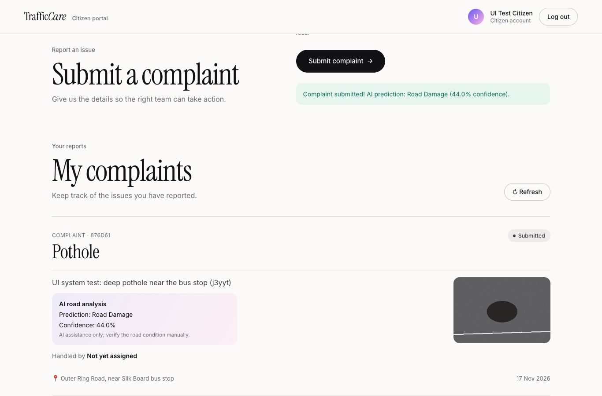
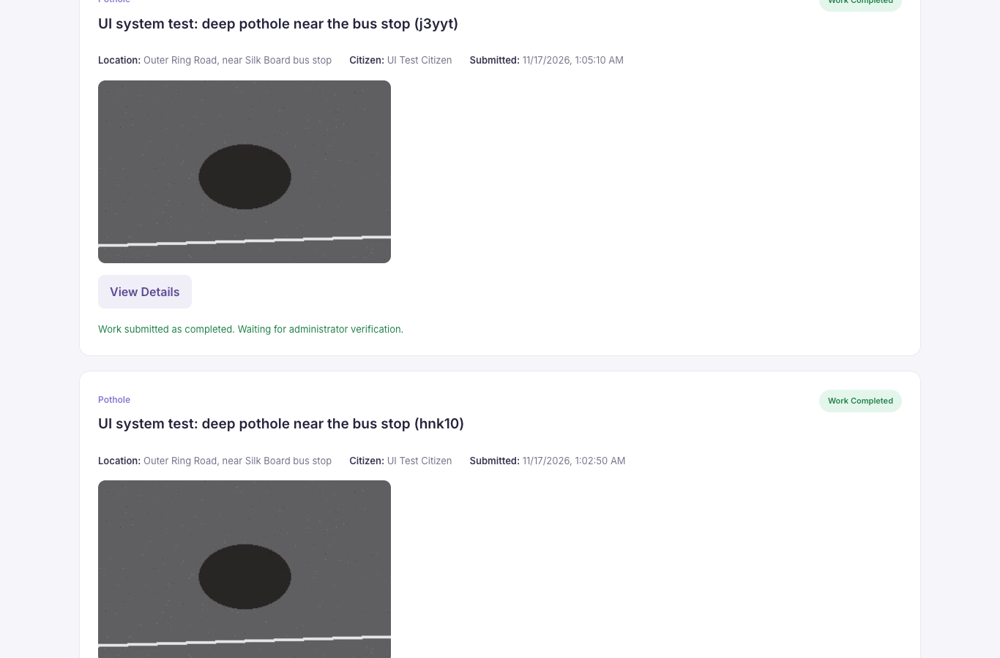
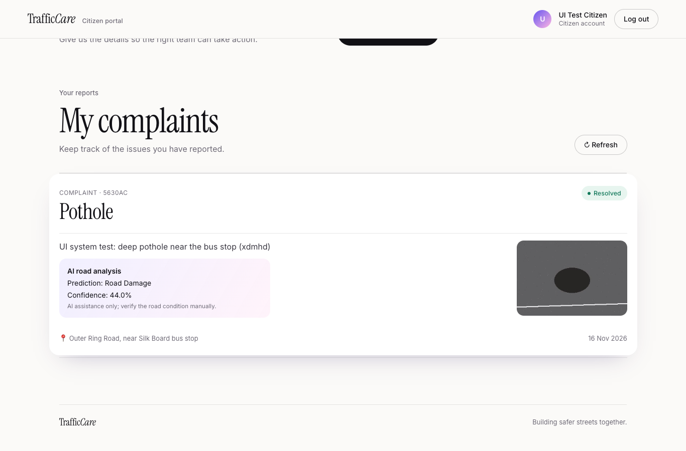
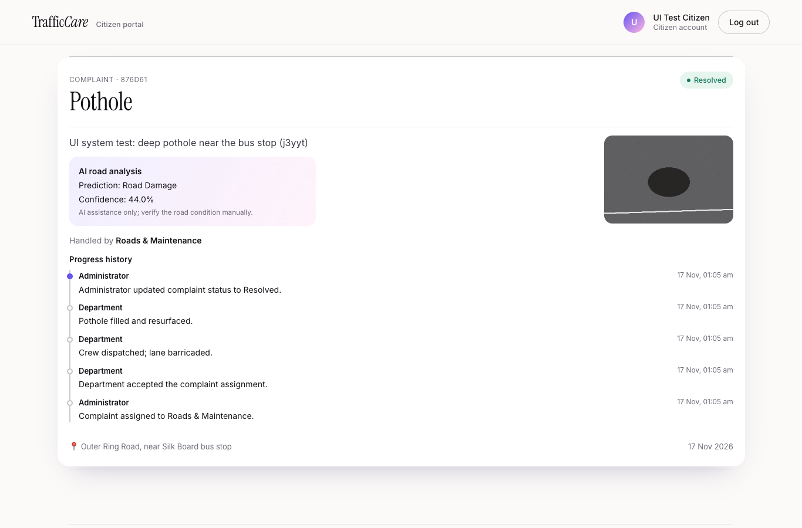
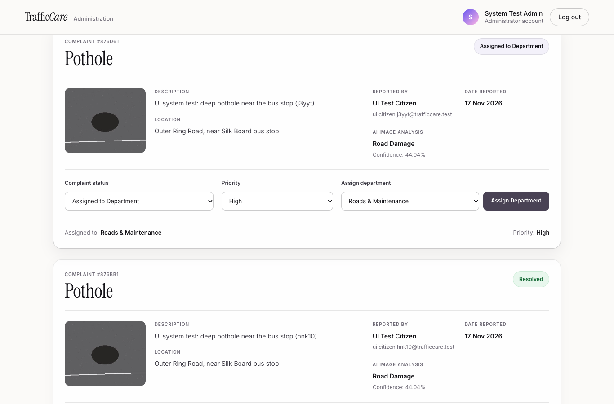

# System Test Report

## TrafficCare: Smart Traffic Complaint and Monitoring System

| Item | Value |
|---|---|
| Document | System Test Report |
| Version | 1.3 |
| Date | 17 November 2026 |
| Test period | 16–17 November 2026 |
| Build tested | Branch `docs/update-srs-sad-stp-uml` (pull request #20). First run: application code = `main`. Re-test: plus fix commit `c4ca873` |
| Test plan | TrafficCare_STP v2.0 |
| Related documents | TrafficCare_SRS, TrafficCare_Unit_Testing_Report, TrafficCare_Code_Coverage_Report |

### Revision history

| Version | Date | Description |
|---|---|---|
| 1.0 | 17 Nov 2026 | First system test execution: 104 test cases run on the complete, running system; 2 defects found |
| 1.1 | 17 Nov 2026 | BUG-007 and BUG-008 fixed (commit `c4ca873`); all executed suites re-run: 104 / 104 passed |
| 1.2 | 17 Nov 2026 | Deployment smoke tests executed: Docker Compose and Kubernetes both pass. 106 / 106 passed, nothing left unexecuted |
| 1.3 | 17 Nov 2026 | Browser end-to-end suite moved from Puppeteer to **Playwright** (`@playwright/test` 1.64.1) and re-run: 16 / 16 passed |

---

## 1. Summary

The complete TrafficCare system was tested end to end: React web client, Express API, MongoDB database and the FastAPI deep-learning service, all running together. Testing covered the full complaint lifecycle through the browser and the API, security and access control, AI integration and failure handling, start-up behaviour, and response times.

| Test suite | How it was run | Cases | Passed | Failed | Not run |
|---|---|---|---|---|---|
| A. QA API suite (TC01–TC41) | Jest + Supertest, in-memory MongoDB | 45 | 45 | 0 | 0 |
| B. Live API system tests | HTTP against the running stack | 39 | 39 | 0 | 0 |
| C. Browser end-to-end tests | Playwright driving Google Chrome, running stack | 16 | 16 | 0 | 0 |
| D. Failure and recovery tests | DL service stopped; start-up checks | 4 | 4 | 0 | 0 |
| E. Deployment smoke tests | Docker Compose, Kubernetes (Docker Desktop) | 2 | 2 | 0 | 0 |
| **Total** | | **106** | **106** | **0** | **0** |

**All 106 test cases were executed and passed (100 %) after the defect fixes.** The first execution passed 102 / 104 (98.1 %). The two failures were real defects, which were fixed and re-tested (§12).

**Result.** The core workflow works end to end through the user interface: a citizen reports with a photo, the AI classifies it, the admin assigns, the department works and completes, and the admin resolves. Every access-control and validation check passed, and an AI outage does not block complaints.

Two **user-interface defects** were found in the first run. Both were fixed in commit `c4ca873` and verified by re-test:

| Bug | Severity | Summary | Status |
|---|---|---|---|
| BUG-007 | Medium | The citizen dashboard did not show the progress history or the assigned department, although the API provides both (SRS UI-03) | **Fixed, verified** |
| BUG-008 | Low | After an admin update, the admin's complaint card showed the reporter as "Unknown" until the page was reloaded | **Fixed, verified** |

The five defects from code review (BUG-001 … BUG-005) were re-tested and are **verified fixed**. BUG-006 is verified by inspection. The Docker Compose and Kubernetes smoke tests were run on Docker Desktop and **pass** (§9).

---

## 2. Scope

### 2.1 In scope

All implemented functional requirements in the SRS (authentication, citizen complaints, image upload, AI classification, administration, department workflow), with these non-functional checks: security, privacy, reliability, performance sample, mobile layout and basic keyboard accessibility.

### 2.2 Out of scope

Features not implemented (maps, notifications, pagination, token revocation); load and penetration testing; model accuracy (reported in `dl/results/`); real quantum hardware; public-cloud deployment.

---

## 3. Test Environment

| Element | Configuration |
|---|---|
| Machine | MacBook Air (Apple Silicon), macOS 26.5.1 |
| Node.js | 24.6.0 |
| Python | 3.12.5, PyTorch with Apple MPS acceleration |
| Database | MongoDB 8.2.6, local test instance on port 27027, database `trafficcare_systemtest` (no production data) |
| Backend | `server/` started with `node index.js` on port 5050 |
| DL service | `dl/src/api.py` with Uvicorn on port 8010 (port 8000 was in use by another program on the machine) |
| Web client | Vite dev server on port 5173 |
| Browser | Google Chrome 157 (headless), 1366 × 900 desktop and 375 × 812 mobile viewports |
| Test data | Synthetic accounts created during the run: citizens, one administrator, five seeded departments, one new department |

**DL model weights.** The trained weights (`best_model.pth`) are stored in DVC and were not available on the test machine. The DL service therefore ran with an untrained ResNet18 checkpoint in exactly the production format. All service behaviour (validation, preprocessing, inference, response format, integration with the backend) is real. Only the predicted class is not meaningful, so these tests verify **integration, not accuracy**.

### 3.1 Commands

| Suite | Command |
|---|---|
| A | `bash testing/run-tests.sh` |
| Set-up for B–D | Start MongoDB, `cd server && npm start`, `cd dl && uvicorn src.api:app --port 8010`, `cd client && npm run dev`, then `node testing/system/create-admin.js` |
| B | `node testing/system/system-tests.mjs` |
| C | `cd testing/system && npm install && npx playwright test` (HTML report: `npx playwright show-report`) |
| D | Stop the DL service, then `node testing/system/system-tests.mjs --outage`; start-up checks as in §7.1 |

Test configuration (database URI, secrets, test passwords) was kept in `server/.env`, which is not committed.

---

## 4. Suite A: QA API Test Suite (TC01–TC41)

The QA team's automated suite (`testing/automated/`) ran with an in-memory database. **45 / 45 passed** in 21.4 s.

| Area | Test IDs | Result |
|---|---|---|
| Registration and login | TC01–TC03, TC07–TC09, TC13–TC16 | All pass |
| Protected routes and tokens | TC05, TC10–TC12b | All pass |
| Citizen complaints | TC04, TC17–TC27 | All pass |
| Administration | TC06, TC28–TC39 | All pass |
| Error handling | TC40, TC41 | All pass |

Defect re-tests in this suite:

| Bug | Tagged test | Previous prediction | Result now |
|---|---|---|---|
| BUG-001 any category accepted | TC20 | Fail | **Pass**: invalid category returns 400 |
| BUG-002 long description → 500 | TC25 | Fail | **Pass**: 400 with field message |
| BUG-003 long name → 500 | TC16 | Fail | **Pass**: 400 |
| BUG-004 invalid e-mail accepted | TC15 | Fail | **Pass**: 400 |
| BUG-005 malformed JSON shows stack trace | TC40 | Fail | **Pass**: JSON 400, no stack trace |

Full table: `testing/automated/latest-results.md`.

---

## 5. Suite B: Live API System Tests

These tests ran over real HTTP against the running backend, database and DL service. **39 / 39 passed.**

| ID | STP case | Test | Result | Observed |
|---|---|---|---|---|
| SYS-01 | NFR-REL-02 | Backend health | Pass | 200 ok |
| SYS-02 | TC-DL-01 | DL service health | Pass | `model_loaded: true` (MPS) |
| SYS-03 | TC-AUTH-11 | Seeded department accounts sign in | Pass | All 5 created at start-up; role department |
| SYS-04 | — | Administrator signs in | Pass | role admin |
| SYS-05 | TC-AUTH-01/06 | Register; client-sent `role: admin` ignored | Pass | 201, role citizen, no password returned |
| SYS-06 | TC-AUTH-02 | Duplicate e-mail, different case | Pass | 409 |
| SYS-07 | TC-AUTH-03/04 | Invalid e-mail, 7-char password, 101-char name | Pass | 400 each |
| SYS-08 | TC-AUTH-07 | Login; JWT lifetime | Pass | exp − iat = 3600 s |
| SYS-09 | TC-AUTH-08 | Wrong password vs unknown e-mail | Pass | Both 401 with the same message |
| SYS-10 | TC-AUTH-09 | NoSQL operator injection | Pass | 400 |
| SYS-11 | TC-SEC-01/02 | Missing, malformed, wrongly signed token | Pass | 401 each |
| SYS-12 | TC-SEC-04 | Citizen on admin and department routes | Pass | 403 |
| SYS-13 | TC-SEC-05 | Validly signed token claiming admin for a citizen | Pass | 403: role read from the database |
| SYS-14 | TC-CMP-06, TC-AI-01 | Complaint with JPEG classified by the DL service | Pass | 201 in 109 ms; AI Completed; defaults correct |
| SYS-15 | TC-SEC-08 | Uploaded image served with `nosniff` | Pass | 200 image/jpeg, nosniff |
| SYS-16 | TC-CMP-06 | PNG named `evil.html` | Pass | Stored as `<uuid>.png` |
| SYS-17 | TC-CMP-01 | Complaint without photo | Pass | AI Not Requested |
| SYS-18 | TC-CMP-03/04/05 | Invalid category, blank location, 2,001-char description | Pass | 400 each |
| SYS-19 | TC-CMP-07 | GIF; 10 MB + 1 byte | Pass | 400 with clear messages |
| SYS-20 | TC-CMP-09 | Each citizen lists only their own, newest first | Pass | A sees 3, B sees 1 |
| SYS-21 | TC-CMP-10/11 | Another citizen's complaint; malformed ID | Pass | 404; 400 |
| SYS-22 | TC-DL-02…05 | DL: text, empty, > 10 MB, corrupted | Pass | 400, 400, 413, 400 |
| SYS-23 | TC-DL-06 | DL: PNG classified | Pass | 200, three class probabilities |
| SYS-24 | TC-ADM-01 | Admin list with reporters, no passwords | Pass | Pass |
| SYS-25 | TC-ADM-10 | Dashboard counts match data | Pass | total 8, Submitted 6 |
| SYS-26 | TC-ADM-02/03 | Create department account; duplicate | Pass | 201, can sign in; duplicate 409 |
| SYS-27 | TC-ADM-04/07 | Assign Roads & Maintenance; priority High | Pass | Assigned to Department / Assigned |
| SYS-28 | TC-ADM-05/06 | Reassign; unknown department | Pass | History records previous department; 404 |
| SYS-29 | TC-ADM-08 | Invalid status / priority / empty update | Pass | 400 each |
| SYS-30 | TC-DEP-01/07 | Department scoping | Pass | Roads sees it; Police does not and gets 404 |
| SYS-31 | TC-DEP-04 | Progress before acceptance | Pass | 400 |
| SYS-32 | TC-DEP-02/03 | Accept; accept again | Pass | 200; 400 |
| SYS-33 | TC-DEP-05/06 | Progress, completion; empty message; Resolved | Pass | Work in Progress → Work Completed; 400s |
| SYS-34 | TC-DEP-08 | Department uses admin API to resolve | Pass | 403 |
| SYS-35 | TC-ADM-09 | Admin resolves | Pass | Resolved; department status Work Completed |
| SYS-36 | TC-UI-04 (API) | Citizen reads the resolved complaint | Pass | 5 history entries: admin → department ×3 → admin |
| SYS-37 | TC-SEC-06/07 | Malformed JSON; unknown route | Pass | JSON 400; JSON 404 |
| SYS-38 | CI-02 | CORS | Pass | Only `http://localhost:5173` allowed |
| SYS-39 | NFR-PRF-01/02 | Response-time sample (20 requests each) | Pass | See §8 |

Full table: `testing/system/results/system-api-results.md`.

---

## 6. Suite C: Browser End-to-End Tests

Google Chrome was driven through the real web client with **Playwright** (`testing/system/e2e/trafficcare.spec.mjs`). A screenshot was saved for each step in `testing/system/screenshots/`. **First run: 14 / 16 passed. Re-test after fixes: 16 / 16 passed.** The first run and the re-test used an equivalent Puppeteer script, and the suite was then ported step for step to Playwright, as the course toolchain requires, and re-run: 16 / 16 passed (`testing/system/results/ui-e2e-results.md`).

| ID | STP case | Test | Result | Observed |
|---|---|---|---|---|
| UI-01 | TC42 | Sign-in page loads | Pass | Login/Register tabs and fields |
| UI-02 | TC42 | Register through the UI | Pass | "Registration successful! Please log in." |
| UI-03 | TC-AUTH-08, NFR-ACC-01 | Wrong password | Pass | Error shown with `role="alert"` |
| UI-04 | TC42, TC-UI-01 | Citizen signs in | Pass | Citizen dashboard |
| UI-05 | TC-UI-03 | GIF chosen | Pass | Rejected before upload |
| UI-06 | TC43, TC-AI-01 | Submit complaint with photo | Pass | "Complaint submitted! AI prediction: …"; AI panel on the card |
| UI-07 | TC44 | Logout | Pass | Session cleared; reopening and reloading shows sign-in |
| UI-08 | TC45, TC-ADM-04/07 | Admin: priority High, assign Roads & Maintenance | Pass | Card updated |
| UI-08b | UI-04, TC-ADM-01 | Reporter still shown after the update | **Fail → Pass** | First run: "Unknown / N/A" until reload (**BUG-008**). Re-test: name and e-mail kept |
| UI-09 | TC-DEP-02/05 | Department: accept, progress, complete | Pass | All three notices; completion note |
| UI-10 | TC45, TC-ADM-09 | Admin sets Resolved | Pass | Badge Resolved; statistics refreshed |
| UI-11 | TC-UI-04 | Citizen sees Resolved | Pass | Card status Resolved |
| UI-12 | UI-03, TC-UI-04 | Citizen sees progress history and department | **Fail → Pass** | First run: neither shown (**BUG-007**). Re-test: "Handled by Roads & Maintenance" and 5-entry history |
| UI-13 | TC46 | Tampered token, page reloaded | Pass | Returned to sign-in |
| UI-14 | UI-06, TC-UI-05 | 375 px mobile width | Pass | No horizontal scrolling |
| UI-15 | NFR-ACC-01 | Keyboard-only sign-in | Pass | Tab order correct; Enter submits |

No JavaScript errors were raised in the browser during the run.

### 6.1 Key evidence

---

## 7. Suite D: Failure and Recovery Tests

| ID | STP case | Test | Result | Observed |
|---|---|---|---|---|
| SYS-40 | TC-SYS-03 | DL service stopped | Pass | Service unreachable |
| SYS-41 | TC-AI-02, NFR-REL-01 | Complaint with photo while the DL service is down | Pass | 201 in 15 ms; AI **Failed**; image stored; citizen still reports successfully |
| SYS-42 | TC-SYS-04, NFR-REL-02 | Backend started without `MONGODB_URI` | Pass | "MongoDB connection failed: MONGODB_URI is missing from .env"; exit code 1 |
| SYS-43 | FR-AUTH-09, NFR-REL-02 | Backend started with a missing department password on a new database | Pass | "Server startup failed: Missing or invalid environment variable: DEPT_ROADS_PASSWORD"; exit code 1 |

### 7.1 Start-up check commands

`MONGODB_URI="" node index.js` and `DEPT_ROADS_PASSWORD="" MONGODB_URI=<new test database> node index.js`, run from `server/`.

---

## 8. Performance Sample

20 sequential requests per operation on the local machine; times exclude browser rendering.

| Operation | Median | 95th percentile | Requirement |
|---|---|---|---|
| Citizen: list own complaints | 1.1 ms | 1.4 ms | none stated |
| Admin: list all complaints | 2.2 ms | 2.9 ms | none stated |
| DL service: classify one JPEG | 8.9 ms | 12.5 ms | NFR-PRF-02: < 100 ms ✓ |
| Submit complaint with photo, incl. DL call (single run) | 109 ms | none | NFR-PRF-01: within the 30 s timeout ✓ |

These are single-user figures on one machine with a small test database. They confirm there are no gross delays, but are **not a load test**. DL inference used Apple MPS acceleration. On a CPU-only server, expect about 50 ms per image (49 ms ResNet18 CPU benchmark in `dl/results/comparison`).

---

## 9. Suite E: Deployment Smoke Tests

Run on 17 Nov 2026 with Docker Desktop 29.8.2 and its built-in Kubernetes cluster (kubectl v1.36.1).

| ID | STP case | Test | Result | Observed |
|---|---|---|---|---|
| SYS-44 | TC-SYS-01, NFR-POR-01 | `docker compose up --build` | Pass | 3 images built; `trafficcare-frontend`, `trafficcare-backend`, `trafficcare-dl` all **Up**; backend `/api/health` ok and connected to MongoDB; DL `/health` `model_loaded: true` with the **real trained model**; web client HTTP 200 |
| SYS-45 | TC-SYS-02, NFR-POR-01 | Kubernetes deployments | Pass | `backend`, `dl`, `frontend` deployments 1/1 available; pods Running (16 days); ClusterIP services on 5050 / 8000 / 5173; images pulled from Docker Hub `ansh6625/smart-traffic-complaint-system-*`; backend pod reaches `http://dl:8000` by service name; frontend and backend reachable through `kubectl port-forward` |

Observations (not failures):

- The first Compose start stopped the DL container with "Model weights not found". The DVC-tracked `best_model.pth` was missing from the checkout because **no DVC remote is configured**. The file was recovered from the Kubernetes DL pod, where its md5 `8c2c7a72…` is identical to the DVC record, and the DL image was rebuilt. Configuring a DVC remote would prevent this.
- Calling the frontend by its in-cluster name returns HTTP 403, because the Vite development server only accepts known host names. Users reach it through port-forward, which works. A production image should serve the built files (SAD §13).

Full command output: `testing/system/results/deployment-smoke-results.md`.

---

## 10. Requirement Coverage

| SRS area | Covered by | Result |
|---|---|---|
| FR-AUTH-01 … 09 | TC01–TC16, SYS-03…13, UI-01…04, UI-07, UI-13 | Pass |
| FR-CMP-01 … 09 | TC04, TC17–TC27, SYS-14…21, UI-05, UI-06 | Pass |
| FR-AI-01 … 07 | SYS-02, SYS-14, SYS-22, SYS-23, SYS-41, UI-06 | Pass |
| FR-ADM-01 … 07 | TC28–TC39, SYS-24…29, SYS-35, UI-08, UI-08b, UI-10 | Pass (after the BUG-008 fix) |
| FR-DEP-01 … 05 | SYS-30…34, UI-09 | Pass |
| UI-01 … UI-06 | UI-01…15 | Pass (UI-03 after the BUG-007 fix, UI-04 after the BUG-008 fix) |
| NFR-SEC, NFR-PRV | TC05–TC16, TC40, SYS-09…13, SYS-15, SYS-37, SYS-38 | Pass |
| NFR-REL-01/02 | SYS-01, SYS-41…43 | Pass |
| NFR-PRF-01/02 | SYS-39, §8 | Pass |
| NFR-ACC-01 | UI-03, UI-15 | Pass (partial check, no screen-reader audit) |
| NFR-POR-01 | TC-SYS-01/02, SYS-44/45 | Pass |

---

## 11. Defects

| Bug | Severity | Status | Found / re-tested by |
|---|---|---|---|
| BUG-001 Server accepts any category | Medium | **Verified fixed** | TC20 |
| BUG-002 Long description → 500 | Low | **Verified fixed** | TC25 |
| BUG-003 Long name → 500 | Low | **Verified fixed** | TC16 |
| BUG-004 Invalid e-mail accepted | Low | **Verified fixed** | TC15 |
| BUG-005 Malformed JSON leaks stack trace | Medium | **Verified fixed** | TC40, SYS-37 |
| BUG-006 Dead duplicate set-up in `index.js` | Low | **Verified fixed** | Inspection; full suite passes |
| **BUG-007** Citizen dashboard hides progress history and department | Medium | **Verified fixed** (`c4ca873`) | Found by UI-12; re-tested by UI-12 and `DashboardTracking.test.jsx` |
| **BUG-008** Admin card shows reporter "Unknown" after an update | Low | **Verified fixed** (`c4ca873`) | Found by UI-08b; re-tested by UI-08b and `adminWorkflow.test.js` |

Details and suggested fixes: `testing/bug-reports/BUG-007-…md` and `BUG-008-…md`.

---

## 12. Defect Fixes and Re-test

| Bug | Fix (commit `c4ca873`) | Regression tests added |
|---|---|---|
| BUG-007 | `client/src/Dashboard.jsx`: the citizen card shows "Handled by <department>" (or "Not yet assigned") and a progress-history timeline, newest first, with who made each update and when. Styles in `App.css`, desktop and mobile | `client/src/test/DashboardTracking.test.jsx` (3) |
| BUG-008 | `server/routes/adminRoutes.js`: the assign and status/priority endpoints populate the reporter (name, e-mail) and progress authors before responding, matching `GET /admin/complaints` | `server/tests/adminWorkflow.test.js` (2) |

After the fixes, everything that ran before was re-run on 17 Nov 2026:

| Suite | Result |
|---|---|
| Backend unit tests | 95 / 95 passed |
| Frontend unit tests | 37 / 37 passed; production build succeeds |
| A. QA API suite | 45 / 45 passed |
| B. Live API system tests | 39 / 39 passed |
| C. Browser end-to-end tests | **16 / 16 passed** (UI-08b and UI-12 now pass; no JavaScript errors; 375 px layout still fits) |
| D. Failure and recovery (DL outage) | 2 / 2 passed |

No regressions were found.

---

## 13. Exit Criteria Assessment (STP §6)

| Criterion | Status |
|---|---|
| All Critical and High cases executed | **Met**: all 106 cases executed |
| No open Critical defects | **Met**: no open defects |
| Failures linked to defects | **Met**: both failures were logged (BUG-007, BUG-008), fixed and re-tested |
| Blocked / not-run cases documented | **Met**: none remain |
| Regression evidence recorded | **Met**: after the fixes, Suites A–D and all unit tests (138 / 138) were re-run and pass |

**Recommendation.** All exit criteria are met. The system is accepted for demonstration and release on the local Docker Compose / Kubernetes deployment. Improvements noted for a production deployment (not defects): serve the frontend as built static files instead of the Vite dev server, and configure a DVC remote so the trained model can be pulled (§9).

---

## 14. Test Deliverables

| Item | Location |
|---|---|
| This report | `TrafficCare_System_Test_Report.pdf / .docx / .md` |
| QA suite results | `testing/automated/latest-results.md` |
| Live API results | `testing/system/results/system-api-results.md / .json` |
| Browser results | `testing/system/results/ui-e2e-results.md`, `playwright-results.json` (Playwright run); `ui-e2e-results-before-fix.md` (first run) |
| DL outage results | `testing/system/results/dl-outage-results.md / .json` |
| Screenshots | `testing/system/screenshots/` (17 images, re-test) and `screenshots/before-fix/` (the 2 defects) |
| Deployment evidence | `testing/system/results/deployment-smoke-results.md` |
| Test scripts | `testing/system/system-tests.mjs`, `e2e/trafficcare.spec.mjs` + `playwright.config.mjs` (Playwright), `create-admin.js`, `fixtures/` |
| Defect reports | `testing/bug-reports/` |
| Execution log | `testing/test-results.md` |
