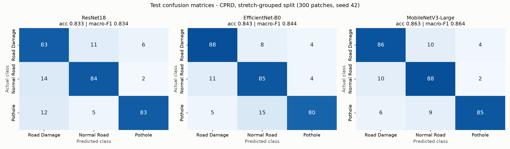
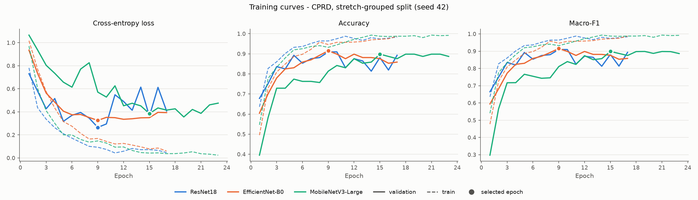
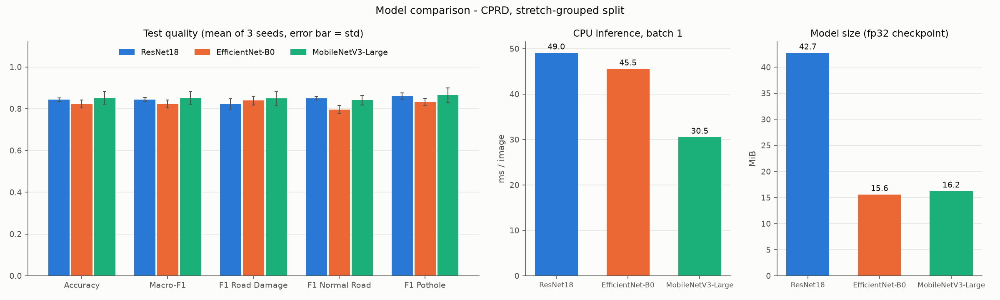
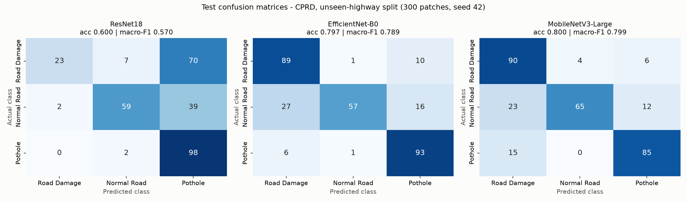
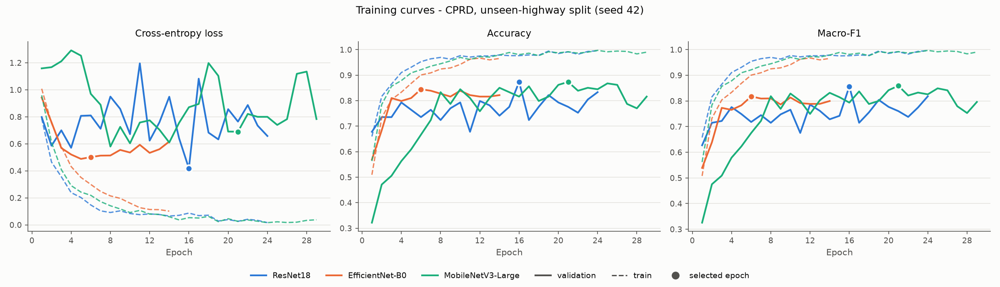
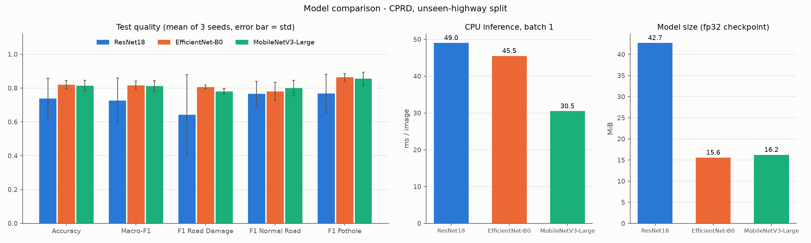

# 2. Deep-learning model comparison: ResNet18 vs EfficientNet-B0 vs MobileNetV3-Large

Owner of the DL module: Arnav. This document covers the comparison added on top of the existing
ResNet18 pipeline (`src/train.py`, `src/api.py`), as requested by the mentor ("any two DL algorithms").

## Summary

* Two new CNNs, **EfficientNet-B0** and **MobileNetV3-Large**, were trained against the existing
  **ResNet18**. All three used the same data, split, recipe and seeds. The test set is the same 300
  CPRD road patches the classical and quantum models in `qml/` are scored on.
* **Accuracy: the three CNNs are close.** On the main split (`cprd`), mean macro-F1 over 3 seeds is
  MobileNetV3 0.852, ResNet18 0.844 and EfficientNet-B0 0.822. None of the pairwise differences is
  statistically significant (McNemar p >= 0.2).
* **Robustness: the two new models are steadier on unseen highways.** On the `cprd_unseen_highway`
  split, EfficientNet-B0 scores 0.816 +- 0.026 and MobileNetV3 0.812 +- 0.032. ResNet18 averages
  0.725 +- 0.135 because one of its three seeds collapsed to 0.570.
* **Cost: MobileNetV3 is the cheapest by a wide margin.** It has 2.7x fewer parameters than ResNet18
  (4.2 M vs 11.2 M), a 2.6x smaller checkpoint (16 vs 43 MiB) and is about 1.6x faster on CPU for a
  single image (about 30 vs 49 ms).
* **All CNNs beat every classical and quantum model by a wide margin.** Against the best `qml/` model
  in each case, the gain in mean macro-F1 is +0.09 to +0.12 on `cprd` and +0.15 to +0.24 on the
  unseen-highway split.
* **Recommendation:** MobileNetV3-Large is the best candidate for the FastAPI service (same or better
  accuracy, much smaller and faster on CPU). ResNet18 stays in production until it has been checked on
  Arnav's original dataset (section 6).

## 1. What was compared and why these two architectures

All three are convolutional neural networks (CNNs) pre-trained on ImageNet (1.28 M images, 1000 classes)
and fine-tuned on road patches (transfer learning). Only the last layer is replaced by a 3-way output
(`Cracks` / `Normal` / `Pothole`, shown in the app as Road Damage / Normal Road / Pothole).
Builders: `src/model_zoo.py`.

| | ResNet18 (baseline, in production) | EfficientNet-B0 | MobileNetV3-Large |
|---|---|---|---|
| Year / authors | 2015, He et al. (Microsoft) | 2019, Tan & Le (Google) | 2019, Howard et al. (Google) |
| Core building block | residual block: two 3x3 convs + skip connection | MBConv: inverted residual with depthwise-separable conv + squeeze-and-excitation (SE) | inverted residual with depthwise-separable conv + SE + h-swish activation |
| How the architecture was found | hand-designed | neural architecture search (NAS) for the B0 base, then **compound scaling** | NAS (MnasNet-style) + NetAdapt, tuned for **mobile CPU latency** |
| Params with our 3-class head | 11.18 M | 4.01 M | 4.21 M |
| Compute per 224x224 image | 1.81 GFLOPs | 0.39 GFLOPs | 0.22 GFLOPs |
| ImageNet top-1 (torchvision weights) | 69.8 % | 77.7 % | 75.3 % |

**Why these two?** They are the two most common answers to "can we get ResNet-level accuracy at a
fraction of the cost?", and each tests a different idea:

* **Depthwise-separable convolutions (both new models).** A normal 3x3 convolution mixes space and channels
  at once: cost about `9 * C_in * C_out` per pixel. A depthwise-separable convolution splits this into a
  3x3 *depthwise* conv (one filter per channel, `9 * C_in`) and a 1x1 *pointwise* conv (`C_in * C_out`).
  That is roughly 8-9x fewer multiply-adds for the same output size. The *inverted residual* block
  first expands channels with a 1x1 conv, filters them depthwise, then projects back to a thin
  bottleneck. The skip connection sits between the thin ends.
* **Squeeze-and-excitation (both new models).** A small side branch averages each channel over the image
  and learns a per-channel weight, so the network can turn up "crack-like" channels and turn down the rest.
* **Compound scaling (EfficientNet).** Instead of making a network only deeper (ResNet18 -> ResNet50) or
  only wider, EfficientNet scales depth, width and input resolution together with fixed ratios
  (`depth = a^phi, width = b^phi, resolution = c^phi`, with `a * b^2 * c^2 ~ 2`). B0 is the smallest member
  of the family. It is the accuracy-per-FLOP choice.
* **Latency-aware design (MobileNetV3).** Its search optimised measured latency on phone CPUs, not just
  FLOPs. It also uses the cheap h-swish activation and SE only where it pays off. It is the
  deployment choice: small, fast on CPU, and what one would put in a mobile app or a cheap server.
* **Residual learning (ResNet18).** Skip connections (`y = F(x) + x`) let gradients flow through many
  layers. ResNet18 uses plain 3x3 convolutions: more parameters and FLOPs, but very GPU-friendly
  and robust to fine-tune.

All three are in `torchvision`, use the same ImageNet normalisation and input size, and load with the
same checkpoint format, so swapping one for another in the API is a one-line change.

## 2. Data and split

Arnav's original image folders (`dl/datasets/raw`, DVC-tracked) were not available on the machine used
for this experiment. We therefore used the public **CPRD** dataset ("Cracks and Potholes in Road Images",
Passos et al. 2020, MIT licence). It is the dataset the QML module uses, so all three modules are
scored on exactly the same images:

* `qml/src/preprocessing.py` cuts 128x128 road-surface patches from the 1024x640 survey photos and labels
  each from the pixel masks (details: `qml/docs/02_dataset.md`). The result is 1,200 balanced patches:
  900 train (300 per class) and 300 test (100 per class).
* `qml/src/export_patches.py` (new) saves those exact patches as PNGs plus a `manifest.csv`. As a
  check, it recomputes the 16 QML features from every saved PNG and confirms they match the QML
  feature table (max difference 1e-15). So the DL, classical, QML and QNN models all use identical
  samples and identical train/test splits.
* **Two split variants**, both grouped so that near-identical neighbouring frames (taken ~5 m apart)
  never sit on both sides of the split:
  * `cprd`: grouped by **500 m road stretch** (every highway can appear in train and test).
  * `cprd_unseen_highway`: grouped by **whole highway section**, so the test highways are never seen in
    training. This is harder (different asphalt, lighting, camera) and is the robustness check.
* **Validation set**: 20 % of the TRAIN patches, chosen with `StratifiedGroupKFold` on the same group
  column (no group shared with train). It is used only for early stopping and checkpoint selection.
  The 300 test patches are touched once, by the selected checkpoint.

| Variant | Train (patches / groups) | Validation (patches / groups) | Test (patches / groups) |
|---|---|---|---|
| `cprd` (500 m stretches) | 723 / 89 | 177 / 22 (58 / 58 / 61 per class) | 300 / 30 (100 per class) |
| `cprd_unseen_highway` (highway sections) | 726 / 17 | 174 / **3** (38 / 42 / 94 per class) | 300 / 7 (100 per class) |

In the unseen-highway variant the training split contains only 20 highway sections, so the validation
set is just 3 highways and is pothole-heavy. That makes checkpoint selection there noisy (see
section 5).

## 3. Training recipe (identical for all three models)

| Setting | Value | Note |
|---|---|---|
| Input | 128x128 patch resized to 224x224, ImageNet mean/std | same as `train.py` / `api.py` |
| Augmentation | horizontal flip, rotation +-10 deg, brightness/contrast jitter 0.15 | same ops as `train.py`; applied batch-wise on the GPU (`GpuAugment`) because the CPU was saturated by other jobs |
| Loss / optimiser | cross-entropy, Adam, lr 1e-4, constant | same as `train.py` |
| Batch size | 32 | `train.py` uses 16; 32 for all three models keeps the comparison fair and fits easily in 6 GB |
| Epochs | up to 30, early stopping when validation macro-F1 has not improved for 8 epochs | `train.py`: fixed 10 epochs, best val accuracy |
| Checkpoint | epoch with best validation macro-F1 (ties: lower val loss) | |
| Precision | mixed precision (AMP, fp16) + channels_last for training; **fp32 for all test metrics and timings** | like the API |
| Seeds | 42 (primary: saved checkpoint, curves, confusion matrix), 43, 44 | same seeds, same batch order and same augmentation draws for every model |
| Hardware | NVIDIA RTX 3050 6 GB Laptop GPU, Intel i5-12450HX, PyTorch 2.14 + CUDA 12.6 | |

Command: `python -u dl/src/compare_models.py` (full log: `results/comparison/train_log.txt`).

## 4. Results

Full tables (generated): `results/comparison/comparison_cprd.md` and
`results/comparison/comparison_cprd_unseen_highway.md`. Raw numbers, per-seed results, per-epoch
history and test predictions: `results/comparison/metrics_<variant>.json`.

### 4.1 Main split (`cprd`, grouped by 500 m stretch)

Test set: 300 patches, 100 per class. Primary seed 42 (the saved checkpoints):

| Model | Accuracy | Precision (macro) | Recall (macro) | **F1 (macro)** | F1 Road Damage | F1 Normal Road | F1 Pothole |
|---|---|---|---|---|---|---|---|
| ResNet18 | 0.833 | 0.838 | 0.833 | **0.834** | 0.794 | 0.840 | 0.869 |
| EfficientNet-B0 | 0.843 | 0.847 | 0.843 | **0.844** | 0.863 | 0.817 | 0.851 |
| MobileNetV3-Large | 0.863 | 0.867 | 0.863 | **0.864** | 0.851 | 0.850 | 0.890 |

All three seeds (42, 43, 44), mean +- standard deviation:

| Model | Accuracy | F1 (macro) | Per-seed macro-F1 |
|---|---|---|---|
| ResNet18 | 0.843 +- 0.009 | 0.844 +- 0.009 | 0.834, 0.847, 0.851 |
| EfficientNet-B0 | 0.822 +- 0.018 | 0.822 +- 0.019 | 0.844, 0.810, 0.813 |
| MobileNetV3-Large | 0.851 +- 0.030 | **0.852 +- 0.030** | 0.864, 0.817, 0.873 |

McNemar test on seed 42 (do two models make different mistakes on the same 300 patches?):
ResNet18 vs EfficientNet-B0 p = 0.74, ResNet18 vs MobileNetV3 p = 0.20, EfficientNet-B0 vs MobileNetV3
p = 0.36. **No pair is significantly different at the 5 % level.**





### 4.2 Robustness split (`cprd_unseen_highway`, test highways never seen in training)

Primary seed 42:

| Model | Accuracy | Precision (macro) | Recall (macro) | **F1 (macro)** | F1 Road Damage | F1 Normal Road | F1 Pothole |
|---|---|---|---|---|---|---|---|
| ResNet18 | 0.600 | 0.754 | 0.600 | **0.570** | 0.368 | 0.702 | 0.638 |
| EfficientNet-B0 | 0.797 | 0.826 | 0.797 | **0.789** | 0.802 | 0.717 | 0.849 |
| MobileNetV3-Large | 0.800 | 0.823 | 0.800 | **0.799** | 0.789 | 0.769 | 0.837 |

All three seeds:

| Model | Accuracy | F1 (macro) | Per-seed macro-F1 |
|---|---|---|---|
| ResNet18 | 0.738 +- 0.120 | 0.725 +- 0.135 | 0.570, 0.796, 0.809 |
| EfficientNet-B0 | 0.820 +- 0.023 | **0.816 +- 0.026** | 0.789, 0.841, 0.817 |
| MobileNetV3-Large | 0.813 +- 0.032 | 0.812 +- 0.032 | 0.799, 0.789, 0.848 |

McNemar test on seed 42: ResNet18 vs EfficientNet-B0 and ResNet18 vs MobileNetV3 p < 0.001 (only
ResNet18 right on 23-24 patches, only the other model right on 82-84). EfficientNet-B0 vs MobileNetV3
p = 1.0. For ResNet18 this significance comes from the one bad seed: its other two seeds are within a
few points of the new models.





### 4.3 Size and speed

Speed depends only on the architecture, so it is the same for both variants. Inference was measured
after training, with the machine otherwise idle (`--bench-only`). The figures are the model forward
pass only, fp32, eval mode, median over 5 interleaved rounds. "bs 1" is one image at a time, as in
the API.

| Model | Params (M) | Checkpoint (MiB) | GFLOPs | Peak training VRAM (MiB, batch 32, AMP) | CPU ms/img, bs 1 (range over rounds) | CPU ms/img, bs 64 | GPU ms/img, bs 1 | GPU ms/img, bs 64 |
|---|---|---|---|---|---|---|---|---|
| ResNet18 | 11.18 | 42.7 | 1.81 | 603 | 49.0 (19.5-55.5) | 37.6 | **5.3** | 0.90 |
| EfficientNet-B0 | 4.01 | 15.6 | 0.39 | 1472 | 45.5 (18.6-52.1) | 27.9 | 20.1 | 1.37 |
| MobileNetV3-Large | 4.21 | 16.2 | 0.22 | 795 | **30.5 (12.2-33.9)** | **14.8** | 14.7 | **0.86** |

CPU: Intel i5-12450HX (laptop, 8 threads). In one of the five rounds every model ran about 2.5x faster
(laptop power/boost state). The absolute milliseconds therefore move around, but the **ranking and the
ratios were the same in every round**: MobileNetV3 needs about 0.6x the CPU time of ResNet18.
GPU: RTX 3050 6 GB Laptop.

Training time, primary seed (wall clock incl. validation, GPU with AMP): ResNet18 225 s, EfficientNet-B0
716 s, MobileNetV3 415 s on `cprd`. Mean over 3 seeds: 276 / 567 / 412 s. The GPU and CPU were
shared with the QNN experiments that ran at the same time, so these times are only indicative,
roughly 4-5x slower than on an idle GPU. The ordering is real: EfficientNet-B0 is the slowest to
train, because of its depthwise convolutions, SE blocks, Swish activations and higher activation
memory (2.4x ResNet18's peak VRAM). No run needed the automatic out-of-memory fallback; all used
batch 32.

### 4.4 All modules on the same 300 test patches

DL rows are from this module (CNN on raw pixels, seed 42 and the 3-seed mean). The other rows are copied
from `qml/results/metrics/` (16 hand-crafted texture/colour features, or 8 PCA features for the quantum
models, see `qml/docs/05_results_and_discussion.md`).

| Model | Module | `cprd` acc | `cprd` macro-F1 | unseen-highway acc | unseen-highway macro-F1 |
|---|---|---|---|---|---|
| MobileNetV3-Large (seed 42 / 3-seed mean) | DL (`dl/`) | 0.863 / 0.851 | **0.864 / 0.852** | 0.800 / 0.813 | 0.799 / 0.812 |
| EfficientNet-B0 (seed 42 / mean) | DL (`dl/`) | 0.843 / 0.822 | 0.844 / 0.822 | 0.797 / 0.820 | 0.789 / **0.816** |
| ResNet18 (seed 42 / mean) | DL (`dl/`) | 0.833 / 0.843 | 0.834 / 0.844 | 0.600 / 0.738 | 0.570 / 0.725 |
| SVM, RBF, 16 features | Classical ML (`qml/`) | 0.737 | 0.737 | 0.540 | 0.529 |
| Random Forest, 16 features | Classical ML (`qml/`) | 0.730 | 0.732 | 0.613 | 0.575 |
| SVM, RBF, 8 PCA features | Classical ML (`qml/`) | 0.703 | 0.705 | 0.497 | 0.454 |
| QSVM, 4 qubits, 8 PCA features | Quantum ML, simulated (`qml/`) | 0.680 | 0.681 | 0.483 | 0.463 |
| VQC, 4 qubits, 8 PCA features | Quantum ML, simulated (`qml/`) | 0.593 | 0.588 | 0.497 | 0.415 |

Logistic regression and the 8-feature random forest are in the generated tables. Training/inference
times are not directly comparable across modules. The `qml/` times exclude feature extraction and are
per sample in a batch. The DL times include all the "feature extraction", because the CNN learns its
own features from pixels.

## 5. Discussion

**Who wins?** It depends on the question:

* *Best accuracy on the main split:* MobileNetV3-Large (macro-F1 0.852 mean, 0.864 on seed 42), ahead of
  ResNet18 by about 0.01-0.03 and EfficientNet-B0 by about 0.02-0.03. With only 300 test patches these
  gaps are inside the noise. One test patch is 0.33 accuracy points, the seed-to-seed spread is up
  to +-0.03, and McNemar p >= 0.2. **On this split the honest conclusion is a three-way tie.**
* *Most robust to new highways:* EfficientNet-B0 and MobileNetV3 (0.81-0.82 mean, std about 0.03).
  ResNet18 matched them on two seeds (0.80-0.81) but collapsed on one (0.570). In that run it labelled
  70 % of the crack patches and 39 % of the normal patches as "Pothole". Its checkpoint (epoch 16) was
  picked on a validation spike, and the training curves show ResNet18's validation loss jumping around
  much more than the other two models'. The validation set here is only 3 highways, so a lucky
  epoch is easy to select. The newer architectures were less sensitive to this; plausible reasons are
  stronger ImageNet features (75-78 % vs 70 % top-1), built-in dropout before the classifier, and SE
  channel re-weighting. With 3 seeds this is a tendency, not a proof.
* *Cheapest to run:* MobileNetV3-Large by far. It has the fewest FLOPs, the fastest CPU inference
  (about 1.6x faster than ResNet18 single-image, 2.5x in batches), a 16 MiB file and modest training memory.
* *Fastest on a GPU for single images:* ResNet18 (5 ms vs 15-20 ms). This is the classic FLOPs-vs-latency
  trap. Depthwise convolutions do few FLOPs but are memory-bound, and the new models have 2-3x more
  (small) layers, so on a GPU at batch 1 the time goes into launching kernels, not arithmetic. In
  batches the gap closes (0.86-1.37 ms per image for all three).
* *EfficientNet-B0* has the best ImageNet accuracy but gave no accuracy gain here. It was the slowest
  to train and the most memory-hungry, and not much faster than ResNet18 on this CPU at batch 1
  (45 vs 49 ms). Its compound scaling was tuned for ImageNet-scale problems. For small 3-class
  texture patches the extra capacity is not needed.

**Deep learning vs the classical and quantum models.** Every CNN beats the best hand-crafted-feature
model by about 0.09-0.12 macro-F1 on `cprd` and 0.15-0.24 on unseen highways. The CNNs learn their own
texture filters from the pixels, starting from ImageNet features, instead of relying on 16 fixed statistics.
The gap widens on unseen highways because hand-crafted brightness/colour features shift with
asphalt colour and lighting, while learned features transfer better. The price is hundreds of times more
compute per prediction (tens of ms against well under 1 ms for the feature-based models, not counting
their feature extraction) and a GPU for training. That is still only seconds to minutes of training
and tens of milliseconds per CPU prediction.

**What fits the FastAPI service?** The service (`src/api.py`) runs on CPU in Docker
(`python:3.11-slim`, CPU-only torch) and classifies one uploaded photo per request. For that setting
**MobileNetV3-Large is the best choice**: same accuracy as ResNet18 here, more robust on unseen roads,
about 0.6x the CPU latency, 2.6x smaller weights (faster cold start, smaller image) and lower memory.
ResNet18 is still a perfectly good model. Its advantages are GPU single-image latency (irrelevant for
the CPU container) and the fact that it is already integrated and validated on Arnav's data.
EfficientNet-B0 has no advantage that matters for this service.

How a switch would work: the checkpoint format is the same, so `api.py` would only need to build the
network with `model_zoo.load_checkpoint()` (which reads the `arch` key) instead of hard-coding
`models.resnet18`. That change was **not** made, to keep the API's behaviour unchanged. The only change
to `api.py` is an optional `DL_MODEL_PATH` environment variable (default unchanged) to serve another
ResNet18 checkpoint.

## 6. Limitations (be upfront about these in the viva)

* **Different data from the production model.** Arnav's original dataset (whole road photos, about 99.5 %
  test accuracy in `results/test_metrics.json`) was not available, so the comparison uses CPRD patches.
  The numbers here are **not comparable** with his 99.5 %. CPRD patches are small (128x128 upsampled to
  224), low-contrast survey-camera crops, and they are split by road so near-duplicates cannot leak.
  This is a much harder test. Before switching production to MobileNetV3, retrain it on
  `dl/datasets/raw` with `train.py`'s pipeline and compare on his test set.
* **Small test set.** 300 patches (100 per class) means about +-4-5 points of sampling uncertainty on
  accuracy (95 % interval). Seed-to-seed variation is of the same size. Only differences backed by several
  seeds and a significance test should be claimed.
* **Few seeds.** 3 seeds per model and variant give a mean and spread, but not a precise one.
* **Tiny validation set on the unseen-highway split** (3 highways, pothole-heavy). This makes
  checkpoint selection noisy (the ResNet18 seed-42 collapse). A cross-validated selection over
  highways would be more reliable but costs 5x the training.
* **No hyper-parameter tuning per model.** Same lr / batch / epochs for all, on purpose (fairness, and
  the ResNet18 recipe from `train.py`). Each model might gain a little from its own tuning: EfficientNet
  in particular is usually trained with a higher lr, weight decay and longer schedules.
* **Shared hardware.** Training ran next to the QNN experiments, so training times are inflated.
  Inference was re-timed on an otherwise idle laptop, but laptop CPUs change clock speed, so the
  absolute milliseconds are approximate. The ratios between models are reliable.
* **GPU augmentation vs PIL.** The augmentation ops are the same as in `train.py` but run on the GPU
  (bilinear resize in PyTorch instead of PIL; about 0.005 mean difference in normalised pixel units).
  Validation and test preprocessing are exactly the API's PIL pipeline.
* GPU results are not bit-for-bit reproducible (cuDNN/AMP). Seeds fix data order and augmentation,
  and cuDNN runs in deterministic mode, but tiny numeric differences can still change the selected epoch.

## 7. Reproduce

```bash
git clone --depth 1 https://github.com/biankatpas/Cracks-and-Potholes-in-Road-Images-Dataset.git qml/data/cprd
python qml/src/export_patches.py                 # ~2 min, PNG patches + manifests, verified against the QML features
python -u dl/src/compare_models.py               # ~2 h on a shared RTX 3050 (18 runs; much faster on an idle GPU)
python -u dl/src/compare_models.py --bench-only  # re-time inference when the machine is idle
python dl/src/compare_models.py --report-only    # rebuild tables/figures from metrics_*.json
```

Checkpoints: `dl/models/comparison/<model>_<variant>.pth` (git-ignored), format
`{"model_state_dict", "class_to_idx", "arch", ...}`, the same keys `train.py` writes plus `arch`.

## 8. Viva-style questions and answers

**Q: Why did you pick EfficientNet-B0 and MobileNetV3 and not, say, VGG16 or ResNet50?**
A: Both are modern, efficient architectures built on a different idea from ResNet (depthwise-separable
inverted residuals + squeeze-excitation), so the comparison says something beyond "a bigger ResNet".
EfficientNet represents accuracy-per-FLOP (compound scaling). MobileNetV3 represents
latency-on-CPU (hardware-aware NAS), which is what our CPU-only API needs. VGG16 (138 M params) and
ResNet50 (25 M) would be much heavier for a 3-class problem with about 900 training images.

**Q: What is a depthwise-separable convolution, and why is it cheaper?**
A: It splits a k x k convolution into a per-channel k x k filter (depthwise) followed by a 1x1
convolution that mixes channels (pointwise). The cost per pixel drops from `k^2 * C_in * C_out` to
`k^2 * C_in + C_in * C_out`, about 8-9x less for 3x3 kernels. That is why MobileNetV3 needs 0.22
GFLOPs against ResNet18's 1.81.

**Q: Fewer FLOPs, so why is MobileNetV3 slower than ResNet18 on the GPU?**
A: FLOPs are not latency. Depthwise convolutions do little arithmetic per byte of memory they read,
and the network has many small layers. At batch size 1 the GPU mostly waits for kernel launches and
memory, not maths. ResNet18's few large 3x3 convolutions suit the GPU's matrix units. In batches of 64
all three take about 1 ms per image. On the CPU, which is what the API uses, MobileNetV3 is the fastest.

**Q: What is compound scaling?**
A: EfficientNet scales network depth, width (channels) and input resolution together using fixed
ratios found by a small grid search (`d = 1.2^phi, w = 1.1^phi, r = 1.15^phi`). Scaling only one
dimension gives diminishing returns. B0 is the base network (phi = 0), and B1-B7 are scaled-up versions.

**Q: How do you know the comparison is fair?**
A: Same 1,200 patches and the same train/test split as the QML module (exported and verified feature by
feature). Same validation split, which is grouped and taken from train only. Identical preprocessing,
augmentation, optimiser, learning rate, batch size, epoch budget, early-stopping rule and seeds (the
seed also fixes batch order and augmentation draws). The test set was used once, after the
checkpoint was chosen on validation.

**Q: Why macro-F1 and not just accuracy?**
A: Macro-F1 averages the F1 of each class, so a model that ignores one class is punished even if overall
accuracy looks fine. Our test set is balanced, so accuracy and macro-F1 are close for good models.
They diverge for broken runs, like ResNet18 seed 42 on unseen highways: accuracy 0.600, macro-F1 0.570.

**Q: Why is the score on CPRD (about 85 %) so much lower than Arnav's 99.5 %?**
A: Different and harder data. These are small, low-contrast 128 px crops from a survey camera,
including faint hairline cracks. The split is by road, so neighbouring near-identical frames
cannot appear in both train and test. A random split of such data would inflate every score. The
99.5 % comes from whole photos in his own dataset and split, so the two numbers measure different things.

**Q: Is MobileNetV3 really better than ResNet18?**
A: On the main split, no statistically significant difference (McNemar p = 0.20, overlapping seed ranges).
On unseen highways it was more consistent across seeds. The clear, solid advantages are size and CPU
speed. So the claim is "as accurate, more robust in our runs, and much cheaper", not "more accurate".

**Q: What is the McNemar test?**
A: It compares two classifiers on the same test set by looking only at the patches where they
disagree. If model A alone is right on 15 patches and model B alone on 24, would a 50/50 coin
easily produce such a split? A binomial test gives p = 0.20 for that case, so the difference is not
significant.

**Q: What does early stopping on validation macro-F1 do?**
A: After every epoch the model is scored on the validation patches, and the best epoch's weights are
kept. If 8 epochs pass without improvement, training stops. This prevents over-fitting: training
accuracy reaches about 98-99 %, while validation peaks much earlier (see the training curves).

**Q: Why AMP and channels_last?**
A: Mixed precision (fp16 matrix maths with an fp32 master copy and loss scaling) roughly halves memory
and speeds up training on RTX tensor cores. channels_last is the memory layout those kernels prefer.
Neither changes the model. All test metrics and timings are computed in normal fp32, like the API.

**Q: What would you do next?**
A: 1) Retrain MobileNetV3 on Arnav's original dataset and compare it with the production ResNet18 on his
test set. 2) If it holds up, switch the API to `model_zoo.load_checkpoint` and the MobileNetV3
checkpoint. Optionally export to ONNX or quantise to int8 for another 2-4x CPU speed-up. 3) Use more
seeds or cross-validation over highways for model selection, and a larger test set.
