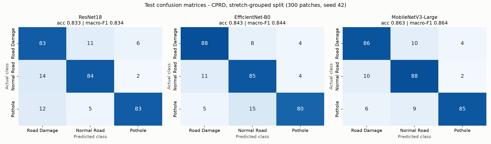
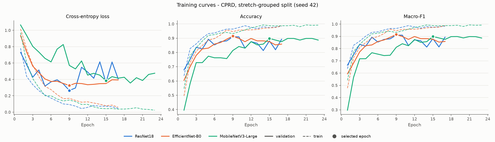
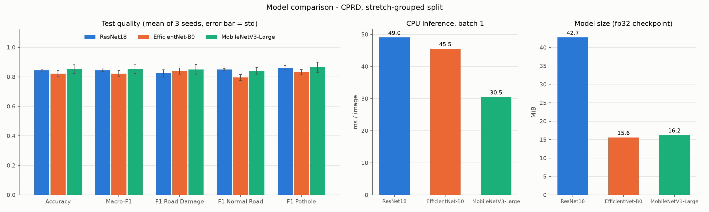

# DL model comparison - CPRD, stretch-grouped split

Data: `qml/data/patches/cprd/manifest.csv` (exported by `qml/src/export_patches.py`). Train 723 / validation 177 / test 300 patches (89 / 22 / 30 road groups). Validation is taken from the training split only; the test set is the same 300 patches the `qml/` models are scored on.

Recipe (all models): Resize 224, HFlip, Rotation 10, ColorJitter(0.15, 0.15) (batched on GPU), Adam lr 0.0001 (constant), batch 32, max 30 epochs, early stopping on val macro-F1, patience 8, AMP True. Device: NVIDIA GeForce RTX 3050 6GB Laptop GPU.

## Test results, primary seed 42 (saved checkpoints)

| Model | Accuracy | Precision (macro) | Recall (macro) | F1 (macro) | F1 Road Damage | F1 Normal Road | F1 Pothole | Best epoch / run |
|---|---|---|---|---|---|---|---|---|
| ResNet18 | 0.833 | 0.838 | 0.833 | 0.834 | 0.794 | 0.840 | 0.869 | 9 / 17 |
| EfficientNet-B0 | 0.843 | 0.847 | 0.843 | 0.844 | 0.863 | 0.817 | 0.851 | 9 / 17 |
| MobileNetV3-Large | 0.863 | 0.867 | 0.863 | 0.864 | 0.851 | 0.850 | 0.890 | 15 / 23 |

## Across seeds 42, 43, 44 (mean +- std)

| Model | Accuracy | F1 (macro) | Per-seed macro-F1 | Mean train time (s) |
|---|---|---|---|---|
| ResNet18 | 0.843 +- 0.009 | 0.844 +- 0.009 | 0.834, 0.847, 0.851 | 276 |
| EfficientNet-B0 | 0.822 +- 0.018 | 0.822 +- 0.019 | 0.844, 0.810, 0.813 | 567 |
| MobileNetV3-Large | 0.851 +- 0.030 | 0.852 +- 0.030 | 0.864, 0.817, 0.873 | 412 |

## Size and speed (primary seed)

| Model | Params (M) | Checkpoint (MiB) | Train time (s) | Epochs | Batch | Peak VRAM (MiB) | CPU ms/img (bs 1) | CPU ms/img (bs 64) | GPU ms/img (bs 1) | GPU ms/img (bs 64) |
|---|---|---|---|---|---|---|---|---|---|---|
| ResNet18 | 11.18 | 42.7 | 225 | 17 | 32 | 603 | 49.0 | 37.6 | 5.28 | 0.90 |
| EfficientNet-B0 | 4.01 | 15.6 | 716 | 17 | 32 | 1472 | 45.5 | 27.9 | 20.12 | 1.37 |
| MobileNetV3-Large | 4.21 | 16.2 | 415 | 23 | 32 | 795 | 30.5 | 14.8 | 14.72 | 0.86 |

train_time_s = wall time of the training loop incl. per-epoch validation (GPU, AMP); the GPU and CPU were shared with the QNN experiments during training, so train times are indicative only. Inference was re-measured on 2026-11-04 14:47:21 with the machine otherwise idle (`--bench-only`): model forward pass only (no image decoding/resizing), fp32, eval mode, batch 1 as in the API (bs 64 = per-image time inside a batch of 64); median over 5 interleaved rounds of 60 CPU / 100 GPU runs, 8 CPU threads. Speed depends only on the architecture, so the same numbers are reported for both split variants.

## Are the differences significant? (exact McNemar test, primary seed)

| Pair | only first right | only second right | p-value |
|---|---|---|---|
| ResNet18 vs EfficientNet-B0 | 17 | 20 | 0.743 |
| ResNet18 vs MobileNetV3-Large | 15 | 24 | 0.200 |
| EfficientNet-B0 vs MobileNetV3-Large | 12 | 18 | 0.362 |

## All modules on the same 300 test patches

DL rows: this module (`dl/`), primary seed, CNN on raw pixels. Other rows are copied from `qml/results/metrics/` (hand-crafted 16 texture/colour features, or 8 PCA features for QML). Inference time for the `qml/` rows excludes feature extraction and is per sample in a batch; DL inference is single-image CPU time. Times are not directly comparable across modules.

| Model | Module / type | Accuracy | Precision (macro) | Recall (macro) | F1 (macro) | Train time (s) | Inference (ms/sample) |
|---|---|---|---|---|---|---|---|
| MobileNetV3-Large | Deep learning, CNN (dl/) | 0.863 | 0.867 | 0.863 | 0.864 | 415.08 | 30.495 |
| EfficientNet-B0 | Deep learning, CNN (dl/) | 0.843 | 0.847 | 0.843 | 0.844 | 716.05 | 45.521 |
| ResNet18 | Deep learning, CNN (dl/) | 0.833 | 0.838 | 0.833 | 0.834 | 224.91 | 49.045 |
| SVM, RBF (16 features) | Classical ML (qml/) | 0.737 | 0.749 | 0.737 | 0.737 | 0.02 | 0.019 |
| Random Forest (16 features) | Classical ML (qml/) | 0.730 | 0.746 | 0.730 | 0.732 | 0.44 | 0.181 |
| SVM, RBF (8 PCA features) | Classical ML (qml/) | 0.703 | 0.714 | 0.703 | 0.705 | 0.02 | 0.020 |
| Logistic Regression (16 features) | Classical ML (qml/) | 0.683 | 0.684 | 0.683 | 0.683 | 0.02 | 0.001 |
| QSVM, quantum kernel, 4 qubits (8 PCA features) | Quantum ML, simulated (qml/) | 0.680 | 0.689 | 0.680 | 0.681 | 0.06 | 0.043 |
| Random Forest (8 PCA features) | Classical ML (qml/) | 0.677 | 0.683 | 0.677 | 0.678 | 0.40 | 0.185 |
| Logistic Regression (8 PCA features) | Classical ML (qml/) | 0.650 | 0.651 | 0.650 | 0.650 | 0.01 | 0.003 |
| VQC, 4 qubits (8 PCA features) | Quantum ML, simulated (qml/) | 0.593 | 0.609 | 0.593 | 0.588 | 128.71 | 0.028 |

## Figures

