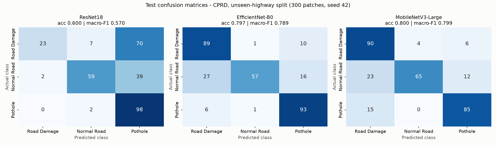
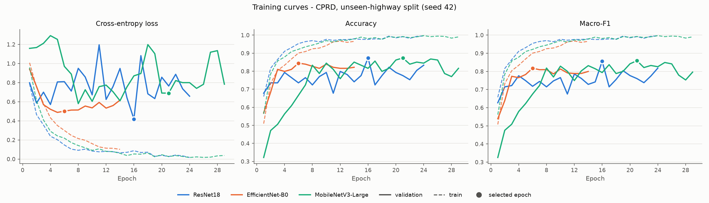
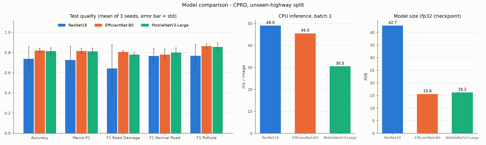

# DL model comparison - CPRD, unseen-highway split

Data: `qml/data/patches/cprd_unseen_highway/manifest.csv` (exported by `qml/src/export_patches.py`). Train 726 / validation 174 / test 300 patches (17 / 3 / 7 road groups). Validation is taken from the training split only; the test set is the same 300 patches the `qml/` models are scored on.

Recipe (all models): Resize 224, HFlip, Rotation 10, ColorJitter(0.15, 0.15) (batched on GPU), Adam lr 0.0001 (constant), batch 32, max 30 epochs, early stopping on val macro-F1, patience 8, AMP True. Device: NVIDIA GeForce RTX 3050 6GB Laptop GPU.

## Test results, primary seed 42 (saved checkpoints)

| Model | Accuracy | Precision (macro) | Recall (macro) | F1 (macro) | F1 Road Damage | F1 Normal Road | F1 Pothole | Best epoch / run |
|---|---|---|---|---|---|---|---|---|
| ResNet18 | 0.600 | 0.754 | 0.600 | 0.570 | 0.368 | 0.702 | 0.638 | 16 / 24 |
| EfficientNet-B0 | 0.797 | 0.826 | 0.797 | 0.789 | 0.802 | 0.717 | 0.849 | 6 / 14 |
| MobileNetV3-Large | 0.800 | 0.823 | 0.800 | 0.799 | 0.789 | 0.769 | 0.837 | 21 / 29 |

## Across seeds 42, 43, 44 (mean +- std)

| Model | Accuracy | F1 (macro) | Per-seed macro-F1 | Mean train time (s) |
|---|---|---|---|---|
| ResNet18 | 0.738 +- 0.120 | 0.725 +- 0.135 | 0.570, 0.796, 0.809 | 267 |
| EfficientNet-B0 | 0.820 +- 0.023 | 0.816 +- 0.026 | 0.789, 0.841, 0.817 | 508 |
| MobileNetV3-Large | 0.813 +- 0.032 | 0.812 +- 0.032 | 0.799, 0.789, 0.848 | 437 |

## Size and speed (primary seed)

| Model | Params (M) | Checkpoint (MiB) | Train time (s) | Epochs | Batch | Peak VRAM (MiB) | CPU ms/img (bs 1) | CPU ms/img (bs 64) | GPU ms/img (bs 1) | GPU ms/img (bs 64) |
|---|---|---|---|---|---|---|---|---|---|---|
| ResNet18 | 11.18 | 42.7 | 294 | 24 | 32 | 603 | 49.0 | 37.6 | 5.28 | 0.90 |
| EfficientNet-B0 | 4.01 | 15.6 | 416 | 14 | 32 | 1473 | 45.5 | 27.9 | 20.12 | 1.37 |
| MobileNetV3-Large | 4.21 | 16.2 | 528 | 29 | 32 | 795 | 30.5 | 14.8 | 14.72 | 0.86 |

train_time_s = wall time of the training loop incl. per-epoch validation (GPU, AMP); the GPU and CPU were shared with the QNN experiments during training, so train times are indicative only. Inference was re-measured on 2026-11-04 14:47:21 with the machine otherwise idle (`--bench-only`): model forward pass only (no image decoding/resizing), fp32, eval mode, batch 1 as in the API (bs 64 = per-image time inside a batch of 64); median over 5 interleaved rounds of 60 CPU / 100 GPU runs, 8 CPU threads. Speed depends only on the architecture, so the same numbers are reported for both split variants.

## Are the differences significant? (exact McNemar test, primary seed)

| Pair | only first right | only second right | p-value |
|---|---|---|---|
| ResNet18 vs EfficientNet-B0 | 23 | 82 | 0.000 |
| ResNet18 vs MobileNetV3-Large | 24 | 84 | 0.000 |
| EfficientNet-B0 vs MobileNetV3-Large | 27 | 28 | 1.000 |

## All modules on the same 300 test patches

DL rows: this module (`dl/`), primary seed, CNN on raw pixels. Other rows are copied from `qml/results/metrics/` (hand-crafted 16 texture/colour features, or 8 PCA features for QML). Inference time for the `qml/` rows excludes feature extraction and is per sample in a batch; DL inference is single-image CPU time. Times are not directly comparable across modules.

| Model | Module / type | Accuracy | Precision (macro) | Recall (macro) | F1 (macro) | Train time (s) | Inference (ms/sample) |
|---|---|---|---|---|---|---|---|
| MobileNetV3-Large | Deep learning, CNN (dl/) | 0.800 | 0.823 | 0.800 | 0.799 | 528.40 | 30.495 |
| EfficientNet-B0 | Deep learning, CNN (dl/) | 0.797 | 0.826 | 0.797 | 0.789 | 416.03 | 45.521 |
| Random Forest (16 features) | Classical ML (qml/) | 0.613 | 0.643 | 0.613 | 0.575 | 0.36 | 0.080 |
| ResNet18 | Deep learning, CNN (dl/) | 0.600 | 0.754 | 0.600 | 0.570 | 293.52 | 49.045 |
| SVM, RBF (16 features) | Classical ML (qml/) | 0.540 | 0.628 | 0.540 | 0.529 | 0.02 | 0.025 |
| QSVM, quantum kernel, 4 qubits (8 PCA features) | Quantum ML, simulated (qml/) | 0.483 | 0.608 | 0.483 | 0.463 | 0.05 | 0.039 |
| SVM, RBF (8 PCA features) | Classical ML (qml/) | 0.497 | 0.547 | 0.497 | 0.454 | 0.02 | 0.019 |
| VQC, 4 qubits (8 PCA features) | Quantum ML, simulated (qml/) | 0.497 | 0.383 | 0.497 | 0.415 | 136.72 | 0.022 |
| Random Forest (8 PCA features) | Classical ML (qml/) | 0.453 | 0.502 | 0.453 | 0.412 | 0.33 | 0.089 |
| Logistic Regression (16 features) | Classical ML (qml/) | 0.467 | 0.480 | 0.467 | 0.411 | 0.03 | 0.002 |
| Logistic Regression (8 PCA features) | Classical ML (qml/) | 0.463 | 0.490 | 0.463 | 0.409 | 0.03 | 0.004 |

## Figures

