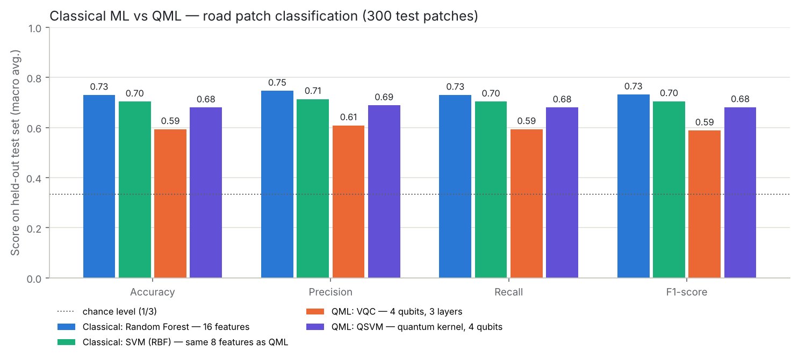
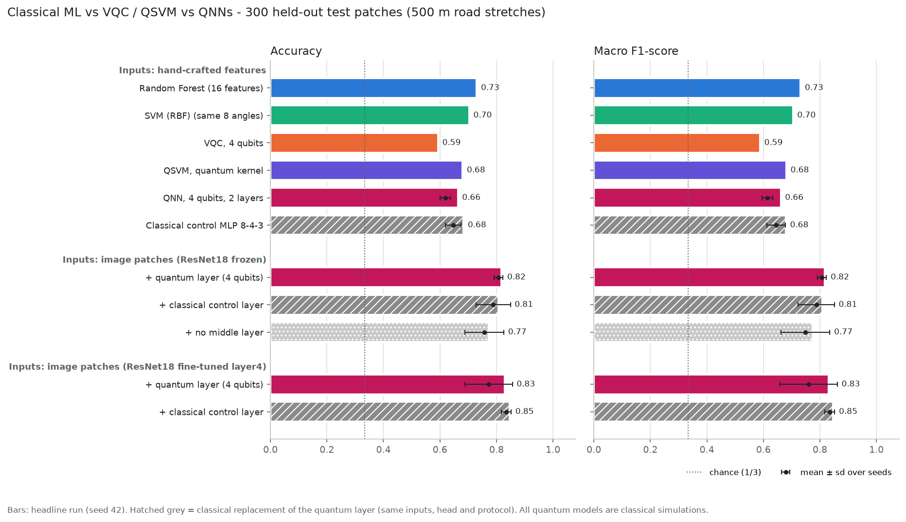

# QML — Quantum vs classical classification of road damage

Part of the **Smart Traffic Complaint and Monitoring System**. Owner: Avyukt.

A small, honest experiment: can a 4-qubit **Variational Quantum Classifier** tell *road damage (cracks)*, *normal road* and *potholes* apart, and how does it compare with classical ML on the **same inputs**? Classes match Arnav's DL module (`dl/`).

## Result in one table

300 held-out test patches, split by road stretch (no stretch in both train and test). Macro averages.

| | Classical: Random Forest (16 features) | Classical: SVM-RBF (same 8 features as QML) | **QML: VQC** (4 qubits, 3 layers) | **QML: QSVM** (quantum kernel) |
|---|---|---|---|---|
| Accuracy | **0.730** | 0.703 | 0.593 | 0.680 |
| Precision | **0.746** | 0.714 | 0.609 | 0.689 |
| Recall | **0.730** | 0.703 | 0.593 | 0.680 |
| F1 | **0.732** | 0.705 | 0.588 | 0.681 |
| Training time | 0.44 s | 0.02 s | 129 s | 0.06 s |
| Inference | 0.18 ms/sample | 0.02 ms/sample | 0.03 ms/sample | 0.04 ms/sample |

**Classical ML wins.** The quantum-kernel SVM is close (−2 to −3 points vs the classical SVM on identical inputs); the VQC learns (chance = 0.33) but trails by ~12 points. Quantum models run on a classical simulator; **no quantum advantage is claimed**. Discussion and limitations: [`docs/05_results_and_discussion.md`](docs/05_results_and_discussion.md).



### Added: Quantum Neural Networks (QNN)

Two QNNs built with PennyLane `TorchLayer` in PyTorch, each next to a **classical control** that has the quantum layer swapped for a classical layer of similar size (same inputs, head, split and protocol). The existing numbers above are unchanged. Same 300 test patches, macro averages, headline seed 42; ± = sd over repeat seeds. Details: [`docs/06_qnn.md`](docs/06_qnn.md).

| Inputs | Model | Accuracy | Precision | Recall | F1 | F1 over seeds | Training time | Inference |
|---|---|---|---|---|---|---|---|---|
| 8 feature angles (as VQC) | **QNN**, 4 qubits, 2 StronglyEntangling layers | 0.663 | 0.661 | 0.663 | 0.662 | 0.613 ± 0.019 | 21 s | 0.04 ms/sample |
| 8 feature angles | Classical control MLP 8-4-3 | 0.683 | 0.694 | 0.683 | 0.679 | 0.645 ± 0.033 | 0.5 s | 0.001 ms/sample |
| image patches | **Hybrid** ResNet18 (frozen) + 4-qubit layer | 0.817 | 0.818 | 0.817 | 0.817 | 0.807 ± 0.016 | 46 s | 1.8 ms/sample |
| image patches | ResNet18 (frozen) + classical control layer | 0.807 | 0.811 | 0.807 | 0.808 | 0.787 ± 0.064 | 3.7 s | 1.7 ms/sample |
| image patches | **Hybrid** ResNet18 (fine-tuned layer4) + 4-qubit layer | 0.830 | 0.840 | 0.830 | 0.830 | 0.761 ± 0.101 | 83 s | 1.9 ms/sample |
| image patches | ResNet18 (fine-tuned layer4) + classical control layer | **0.847** | **0.848** | **0.847** | **0.847** | 0.835 ± 0.017 | 64 s | 1.4 ms/sample |

The feature QNN beats the VQC (F1 0.66 vs 0.59) but not classical ML on the same inputs. The hybrid reaches 0.82–0.83 because the pretrained CNN sees the pixels. Its classical twin is just as good (frozen) or better (fine-tuned), so **the quantum layer adds no measurable accuracy**. On unseen highways the image models hold up far better than every feature model (F1 0.70–0.82 vs ≤ 0.58), and the classical control is again ahead of the quantum layer ([`comparison_with_qnn_unseen_highway.md`](results/metrics/comparison_with_qnn_unseen_highway.md)). Simulator only; no quantum advantage claimed. Hybrid: ResNet18 on an RTX 3050 Laptop GPU (AMP, ≤ 0.65 GB VRAM), quantum layer simulated on the CPU.



## Documents

| # | Document | Brief deliverable |
|---|---|---|
| 1 | [`docs/01_algorithm_research.md`](docs/01_algorithm_research.md) | VQC vs QSVM vs hybrid QNN; why VQC |
| 2 | [`docs/02_dataset.md`](docs/02_dataset.md) | dataset name, link, samples, classes, features, preprocessing, split |
| 3 | [`docs/03_implementation_plan.md`](docs/03_implementation_plan.md) | architecture, tools, plan, open points for team review |
| 4 | [`docs/04_quantum_circuit_explained.md`](docs/04_quantum_circuit_explained.md) | qubits, gates, encoding, variational circuit, learning, prediction (viva notes) |
| 5 | [`docs/05_results_and_discussion.md`](docs/05_results_and_discussion.md) | comparison, competitiveness, limitations, improvements |
| 6 | [`docs/06_qnn.md`](docs/06_qnn.md) | **QNN**: feature QNN + hybrid ResNet18 + quantum layer, classical-control ablation, results, viva notes |

Notebooks (outputs saved, open on GitHub or Colab): [`notebooks/classical_baseline.ipynb`](notebooks/classical_baseline.ipynb), [`notebooks/quantum_classifier.ipynb`](notebooks/quantum_classifier.ipynb), [`notebooks/qnn.ipynb`](notebooks/qnn.ipynb) (reloads the saved QNN / hybrid weights and reproduces their test results).

## Structure

```
qml/
├── notebooks/            classical_baseline.ipynb, quantum_classifier.ipynb, qnn.ipynb
├── src/
│   ├── preprocessing.py  patches + labels from masks, 16 features, group split, PCA->angles
│   ├── classical_model.py  LR / SVM / RF, GroupKFold CV, 16 vs 8 features
│   ├── quantum_model.py    VQC (NumPy simulator + PennyLane backend), parameter shift, QSVM, self-tests
│   ├── evaluation.py       metrics, confusion matrices, comparison tables and graphs
│   ├── qnn_features.py     QNN (PennyLane TorchLayer) on the same 8 angles + classical-control MLP
│   ├── qnn_hybrid.py       ResNet18 + 4-qubit quantum layer on the image patches + classical controls
│   └── qnn_compare.py      comparison table/graph of every model incl. the QNNs
├── data/                 features_cprd*.csv (committed, 0.5 MB each); raw images and patches/ git-ignored
├── results/
│   ├── metrics/          one JSON per model + comparison*.md (QNN files: qnn_*)
│   ├── graphs/           all figures
│   └── checkpoints/      fine-tuned hybrid checkpoints (git-ignored)
├── docs/
├── requirements.txt
└── README.md
```

## Run it

```bash
pip install -r qml/requirements.txt

# Optional - only needed to rebuild the feature CSV or draw sample patches (489 MB):
git clone --depth 1 https://github.com/biankatpas/Cracks-and-Potholes-in-Road-Images-Dataset.git qml/data/cprd
python qml/src/preprocessing.py                 # -> qml/data/features_cprd.csv

python qml/src/classical_model.py               # ~30 s
python qml/src/quantum_model.py --self-test     # checks the simulator + gradients
python qml/src/quantum_model.py                 # ~25 min CPU: VQC selection, final VQC, QSVM
python qml/src/evaluation.py --samples          # comparison tables + graphs

# PennyLane (e.g. Google Colab):
pip install pennylane
python qml/src/quantum_model.py --check-pennylane          # NumPy simulator == PennyLane
python qml/src/quantum_model.py --backend pennylane --layers 3 --lrs 0.1   # same experiment on PennyLane

# QNN (needs PyTorch + PennyLane; see docs/06_qnn.md):
python qml/src/qnn_features.py --check                    # QNN encoding == VQC simulator
python qml/src/qnn_features.py                            # ~10 min CPU: sweep, final QNN, classical control, 5 seeds
python qml/src/qnn_features.py --csv qml/data/features_cprd_unseen_highway.csv --tag unseen_highway --config qnn_features_selection
python qml/src/qnn_hybrid.py                              # needs qml/data/patches/cprd (image patches); GPU recommended
python qml/src/qnn_hybrid.py --variant cprd_unseen_highway
python qml/src/qnn_compare.py && python qml/src/qnn_compare.py --unseen-highway

# Arnav's images instead of CPRD:
python qml/src/preprocessing.py --source dl --dl-root dl/datasets/raw --out qml/data/features_dl.csv
python qml/src/classical_model.py --csv qml/data/features_dl.csv --tag dl_classical
python qml/src/quantum_model.py  --csv qml/data/features_dl.csv --tag dl_quantum
```

Rules followed: test data is never used for fitting, scaling, PCA, model selection or early stopping; every model gets identical splits; random seed 42 everywhere.
