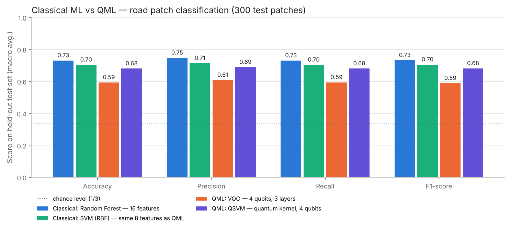

# QML — Quantum vs classical classification of road damage

Part of the **Smart Traffic Complaint and Monitoring System**. Owner: Avyukt.

A small, honest experiment: can a 4-qubit **Variational Quantum Classifier** tell *road damage (cracks)*, *normal road* and *potholes* apart, and how does it compare with classical ML on the **same inputs**? Classes match Arnav's DL module (`dl/`).

## Result in one table

300 held-out test patches, split by road stretch (no stretch in both train and test). Macro averages.

| | Classical: Random Forest (16 features) | Classical: SVM-RBF (same 8 features as QML) | **QML: VQC** (4 qubits, 3 layers) | **QML: QSVM** (quantum kernel) |
|---|---|---|---|---|
| Accuracy | **0.730** | 0.703 | 0.593 | 0.680 |
| Precision | **0.746** | 0.714 | 0.609 | 0.689 |
| Recall | **0.730** | 0.703 | 0.593 | 0.680 |
| F1 | **0.732** | 0.705 | 0.588 | 0.681 |
| Training time | 0.44 s | 0.02 s | 129 s | 0.06 s |
| Inference | 0.18 ms/sample | 0.02 ms/sample | 0.03 ms/sample | 0.04 ms/sample |

**Classical ML wins.** The quantum-kernel SVM is close (−2 to −3 points vs the classical SVM on identical inputs); the VQC learns (chance = 0.33) but trails by ~12 points. Quantum models run on a classical simulator; **no quantum advantage is claimed**. Discussion and limitations: [`docs/05_results_and_discussion.md`](docs/05_results_and_discussion.md).



## Documents

| # | Document | Brief deliverable |
|---|---|---|
| 1 | [`docs/01_algorithm_research.md`](docs/01_algorithm_research.md) | VQC vs QSVM vs hybrid QNN; why VQC |
| 2 | [`docs/02_dataset.md`](docs/02_dataset.md) | dataset name, link, samples, classes, features, preprocessing, split |
| 3 | [`docs/03_implementation_plan.md`](docs/03_implementation_plan.md) | architecture, tools, plan, open points for team review |
| 4 | [`docs/04_quantum_circuit_explained.md`](docs/04_quantum_circuit_explained.md) | qubits, gates, encoding, variational circuit, learning, prediction (viva notes) |
| 5 | [`docs/05_results_and_discussion.md`](docs/05_results_and_discussion.md) | comparison, competitiveness, limitations, improvements |

Notebooks (outputs saved, open on GitHub or Colab): [`notebooks/classical_baseline.ipynb`](notebooks/classical_baseline.ipynb), [`notebooks/quantum_classifier.ipynb`](notebooks/quantum_classifier.ipynb).

## Structure

```
qml/
├── notebooks/            classical_baseline.ipynb, quantum_classifier.ipynb
├── src/
│   ├── preprocessing.py  patches + labels from masks, 16 features, group split, PCA->angles
│   ├── classical_model.py  LR / SVM / RF, GroupKFold CV, 16 vs 8 features
│   ├── quantum_model.py    VQC (NumPy simulator + PennyLane backend), parameter shift, QSVM, self-tests
│   └── evaluation.py       metrics, confusion matrices, comparison tables and graphs
├── data/                 features_cprd*.csv (committed, 0.5 MB each); raw images git-ignored
├── results/
│   ├── metrics/          one JSON per model + comparison*.md
│   └── graphs/           all figures
├── docs/
├── requirements.txt
└── README.md
```

## Run it

```bash
pip install -r qml/requirements.txt

# Optional - only needed to rebuild the feature CSV or draw sample patches (489 MB):
git clone --depth 1 https://github.com/biankatpas/Cracks-and-Potholes-in-Road-Images-Dataset.git qml/data/cprd
python qml/src/preprocessing.py                 # -> qml/data/features_cprd.csv

python qml/src/classical_model.py               # ~30 s
python qml/src/quantum_model.py --self-test     # checks the simulator + gradients
python qml/src/quantum_model.py                 # ~25 min CPU: VQC selection, final VQC, QSVM
python qml/src/evaluation.py --samples          # comparison tables + graphs

# PennyLane (e.g. Google Colab):
pip install pennylane
python qml/src/quantum_model.py --check-pennylane          # NumPy simulator == PennyLane
python qml/src/quantum_model.py --backend pennylane --layers 3 --lrs 0.1   # same experiment on PennyLane

# Arnav's images instead of CPRD:
python qml/src/preprocessing.py --source dl --dl-root dl/datasets/raw --out qml/data/features_dl.csv
python qml/src/classical_model.py --csv qml/data/features_dl.csv --tag dl_classical
python qml/src/quantum_model.py  --csv qml/data/features_dl.csv --tag dl_quantum
```

Rules followed: test data is never used for fitting, scaling, PCA, model selection or early stopping; every model gets identical splits; random seed 42 everywhere.
