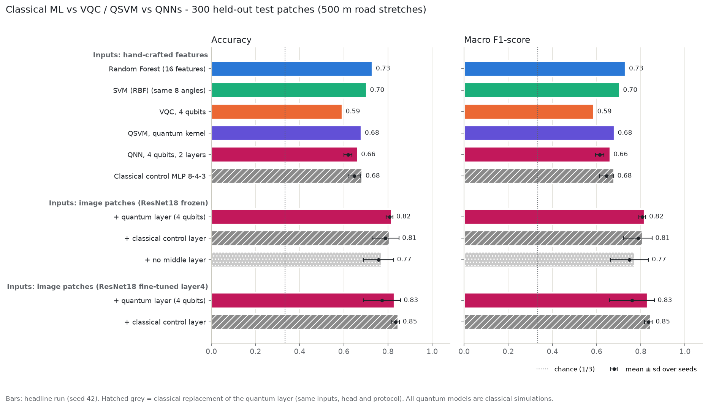
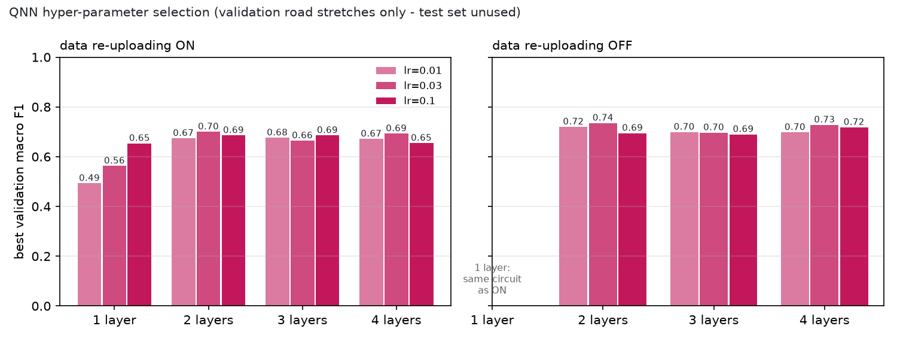

# 6. Quantum Neural Networks (QNN): feature QNN and hybrid ResNet18 + quantum layer

Code: `qml/src/qnn_features.py` (Part A), `qml/src/qnn_hybrid.py` (Part B), `qml/src/qnn_compare.py` (comparison); notebook `qml/notebooks/qnn.ipynb` (reloads the saved weights and reproduces the test results, outputs saved). Results: `qml/results/metrics/qnn_*`, `qml/results/graphs/*qnn*`. Everything was produced on 4 Nov 2026 with PyTorch 2.14 + PennyLane 0.45.1 (`default.qubit`, backprop) on a laptop (CPU for the quantum simulation, RTX 3050 6 GB Laptop GPU for ResNet18).

Like the VQC and the QSVM, every quantum layer here is an **exact classical simulation** of a 4-qubit circuit. **No quantum advantage is claimed or shown.**

## 6.0 Results in one table

Main split (500 m road stretches; the same 300 test patches as docs 05). Macro F1. The "seeds" column repeats the same configuration with other random initialisations.

| Inputs | Model | Test F1 (headline, seed 42) | F1 mean ± sd over seeds |
|---|---|---|---|
| 16 hand-crafted features | Random Forest *(existing)* | **0.732** | – |
| 8 feature angles | SVM-RBF *(existing)* | 0.705 | – |
| 8 feature angles | VQC, 4 qubits *(existing)* | 0.588 | – |
| 8 feature angles | QSVM, quantum kernel *(existing)* | 0.681 | – |
| 8 feature angles | **QNN, 4 qubits, 2 layers (Part A)** | 0.662 | 0.613 ± 0.019 (5 seeds) |
| 8 feature angles | Classical control MLP 8-4-3 | 0.679 | 0.645 ± 0.033 (5 seeds) |
| image patches, ResNet18 frozen | **+ quantum layer (Part B)** | 0.817 | 0.807 ± 0.016 (5 seeds) |
| image patches, ResNet18 frozen | + classical control layer | 0.808 | 0.787 ± 0.064 (5 seeds) |
| image patches, ResNet18 frozen | + no middle layer | 0.774 | 0.749 ± 0.086 (5 seeds) |
| image patches, ResNet18 fine-tuned layer4 | **+ quantum layer (Part B)** | 0.830 | 0.761 ± 0.101 (3 seeds) |
| image patches, ResNet18 fine-tuned layer4 | + classical control layer | **0.847** | **0.835 ± 0.017** (3 seeds) |



**In one sentence:** the feature QNN improves on the VQC (+7 F1 points) but does not beat the classical models on the same inputs. The hybrid network is much better (≈0.82) only because the ResNet18 sees the pixels. Swapping its quantum layer for an equally small classical layer gives the same accuracy within seed noise, so the quantum layer adds no measurable accuracy.

---

## 6.1 What a QNN is, and how it differs from the existing VQC

A **quantum neural network** is a parameterised quantum circuit used as a *layer* inside an ordinary neural network. Data goes in as rotation angles, trainable gates process it, measured expectation values come out as numbers in [−1, 1], and those numbers feed into the next (classical) layer. The whole stack is trained end-to-end with backpropagation and a standard optimiser.

The VQC from docs 04 is already the smallest QNN. What changes here:

| | VQC (`quantum_model.py`) | QNN, Part A (`qnn_features.py`) | Hybrid QNN, Part B (`qnn_hybrid.py`) |
|---|---|---|---|
| Inputs | 8 PCA angles | same 8 angles (same reducer, same split) | raw 128×128 image patch |
| Framework | own NumPy simulator | PennyLane `TorchLayer` in PyTorch | PennyLane `TorchLayer` inside a PyTorch CNN |
| Trainable gates | RY+RZ per qubit + CNOT ring | `StronglyEntanglingLayers` (Rot(φ,θ,ω) per qubit + CNOT ring with changing range) | same template |
| Read-out | ⟨Z⟩ of qubits 0–2, one per class, × scale + bias | ⟨Z⟩ of **all 4** qubits → learned `Linear(4,3)` | ⟨Z⟩ of all 4 qubits → `Linear(4,3)` |
| Gradients | parameter-shift rule (hardware-compatible) | automatic differentiation through the simulator (backprop) | backprop through CNN **and** simulator |
| Classical parts | 6 parameters | 15 (head) | ResNet18 (11 M, frozen or partly trained) + 2,052 (512→4 projection) + 15 (head) |

Parameter shift and backprop give the same gradients for these gates. Backprop is faster in simulation but impossible on hardware, where the parameter-shift rule would be needed again (PennyLane switches with `diff_method="parameter-shift"`).

`python qml/src/qnn_features.py --check` confirms that the PennyLane-torch encoding and wire conventions used here reproduce the VQC's NumPy simulator (max difference 3·10⁻¹⁶). As a by-product, `python qml/src/quantum_model.py --check-pennylane` (still open in docs 03/05) now passes: max |NumPy − PennyLane| = 5·10⁻¹⁶.

## 6.2 Part A: QNN on the 8 feature angles

### Architecture

```
16 features → StandardScaler → PCA(8) → MinMax to [0, π]       (identical to the VQC/QSVM, fitted on train only)
  → TorchLayer, 4 qubits:
       encode   RY(x₂q) RZ(x₂q₊₁) on qubit q                    (dense angle encoding, as in the VQC)
       L × StronglyEntanglingLayers block                       (re-upload the encoding before every block: optional)
       measure ⟨Z₀⟩ ⟨Z₁⟩ ⟨Z₂⟩ ⟨Z₃⟩
  → Linear(4 → 3) → softmax, cross-entropy
```

Selected circuit (2 layers, re-uploading off). Gate-level diagram from `qml.draw(..., level="device")` (`results/metrics/qnn_circuits.txt`). `Rot` = RZ(ω)·RY(θ)·RZ(φ), with all three angles trainable:

```
0: ──RY──RZ──Rot─╭●───────╭X──Rot─╭●────╭X────┤  <Z>
1: ──RY──RZ──Rot─╰X─╭●────│───Rot─│──╭●─│──╭X─┤  <Z>
2: ──RY──RZ──Rot────╰X─╭●─│───Rot─╰X─│──╰●─│──┤  <Z>
3: ──RY──RZ──Rot───────╰X─╰●──Rot────╰X────╰●─┤  <Z>
   └ encoding ┘└──── layer 1 ────┘└──── layer 2 ────┘
```

Layer 1 entangles neighbours (CNOT 0→1→2→3→0). Layer 2 uses range 2 (0→2, 1→3, 2→0, 3→1), so after two layers every qubit has interacted with every other. Parameters: 2 × 4 × 3 = **24 quantum + 15 classical = 39**.

**Why this encoding?** It is the VQC's encoding, so the only differences from the VQC are the ansatz, the read-out and the optimiser. Two angles per qubit fit 8 features on 4 qubits, and [0, π] keeps feature values distinguishable (rotations are 2π-periodic).

### Training and model selection

- Adam, cross-entropy, batch 32, seed 42 (`torch.manual_seed` + NumPy RNG for batch order).
- Validation = the same 20 % **group** split of the training road stretches the VQC uses (682 fit / 218 val). The test set is never used for any choice.
- Early stopping on validation macro F1 (patience 15, max 100 epochs), best epoch restored.
- **Sweep** (24 runs, 6 in parallel, 6 min wall clock): layers {1, 2, 3, 4} × re-uploading {on, off} × lr {0.01, 0.03, 0.1}. One layer with and without re-uploading is the same circuit, so it ran once. Full results: `results/metrics/qnn_features_selection.json`, `results/graphs/qnn_features_selection.png`.
- Then, exactly as for the VQC: **re-fit on all 900 training patches** for the chosen number of epochs, and evaluate once on the test set.



Chosen: **2 layers, re-uploading off, lr 0.03, 32 epochs** (validation F1 0.735). Validation F1 ranged 0.49–0.74. With ≥ 2 layers every configuration landed in a 0.65–0.74 band, which is about the validation noise level (± 0.03–0.05 from epoch to epoch, `qnn_features_training_curve.png`). Re-uploading did *not* help on this data (its best was 0.70 vs 0.74), unlike in the VQC study where it was always on.

### Classical control for Part A

Same inputs, head, optimiser and protocol, with the quantum layer replaced by `Linear(8,4) + tanh` (a 4-wide classical bottleneck in place of the 4 qubits): **MLP 8-4-3, 51 parameters** (the QNN has 39). Its learning rate was picked on the same validation split (0.03, 22 epochs).

## 6.3 Part B: hybrid ResNet18 + quantum layer on the image patches

### Architecture

```
128×128 RGB patch → resize 224, ImageNet normalisation
  → ResNet18 (torchvision, ImageNet-pretrained), fc removed          512-d      GPU, AMP fp16
  → Linear(512 → 4)
  → angles = π/2 · (tanh(z) + 1)  ∈ [0, π]                          (same range as every other quantum model here)
  → MIDDLE LAYER on 4 numbers                                                    CPU, float32
        quantum   : TorchLayer, 4 qubits, RY(aq) re-uploaded before each of 3
                    StronglyEntanglingLayers blocks, ⟨Z⟩ on all 4 qubits       36 parameters
        classical : Linear(4,4)+tanh+Linear(4,4)+tanh   = classical control     40 parameters
        identity  : nothing (just the 4-number bottleneck)                       0 parameters
  → Linear(4 → 3) → softmax, cross-entropy
```

Quantum layer, gate level:

```
0: ──RY──Rot─╭●───────╭X──RY──Rot─╭●────╭X──RY──Rot──────╭●─╭X───────┤  <Z>
1: ──RY──Rot─╰X─╭●────│───RY──Rot─│──╭●─│──╭X───RY───Rot─│──╰●─╭X────┤  <Z>
2: ──RY──Rot────╰X─╭●─│───RY──Rot─╰X─│──╰●─│────RY───Rot─│─────╰●─╭X─┤  <Z>
3: ──RY──Rot───────╰X─╰●──RY──Rot────╰X────╰●───RY───Rot─╰X───────╰●─┤  <Z>
```

**Why this design?**
- A 4-qubit circuit cannot take 50,000 pixels. The CNN compresses the image, and `Linear(512→4)` learns *which* 4 numbers to send to the qubits. This is a *trainable* encoding, unlike the fixed PCA in Part A.
- With one learned angle per qubit, an RY encoding is enough (the projection can put any information into those 4 numbers). Re-uploading the angles before each of the 3 blocks makes the output a richer (higher-frequency) function of each angle. This was fixed in advance (not tuned), because each hybrid run is expensive compared with Part A.
- tanh keeps the angles inside [0, π], the same convention as the VQC/QSVM/QNN.

The quantum layer sits at a 4-number bottleneck, so the **controls must keep that bottleneck**. Otherwise one would be comparing "4 numbers" with "512 numbers", not "quantum" with "classical". The classical control (40 parameters vs 36) replaces only the circuit. The identity variant shows what the bottleneck alone achieves.

### Two training settings

| | Frozen backbone | Fine-tune last block |
|---|---|---|
| Trained | Linear(512,4) + middle + head (≈2.1 k parameters) | the same + ResNet18 `layer4` (8.4 M parameters) |
| How | 512-d features computed **once** on the GPU for each patch and its 3 flipped copies (h, v, hv), cached (8 s). Training samples a random flip per patch per epoch. | Backbone run every step with AMP (fp16). Random flip per batch. GradScaler. |
| Learning rates | head lr ∈ {0.003, 0.01, 0.03} chosen on validation, **separately for each middle layer** | head lr = the one chosen in the frozen setting; layer4 lr 1e-4 |
| Epochs | max 100, patience 15 | max 30, patience 8 |
| BatchNorm | frozen (eval mode) | frozen (eval mode) |
| Seeds | 42 (headline), 0, 1, 2, 3 | 42 (headline), 0, 1 |

Common to both settings: Adam, batch 32, the same 682/218 group fit/validation split as Part A, early stopping on validation macro F1 with the best checkpoint restored, then **one evaluation on the 300 test patches**. Unlike the VQC/Part A, the hybrid models are *not* re-fitted on all 900 training patches (standard practice for CNNs, and a disadvantage for the hybrid: 682 vs 900 training images). The patches are the exact crops behind the feature CSVs (`qml/data/patches/<variant>/manifest.csv`, row-aligned with `features_<variant>.csv`, checked pixel-for-pixel against the raw photos).

Chosen head learning rates (frozen): quantum 0.003, classical 0.01, identity 0.01. At lr 0.03 the **quantum** variant collapsed: it predicted one class from epoch 1 and never recovered (validation F1 0.18). The classical variants trained normally at that rate. A likely cause: large steps saturate the tanh, which pushes the angles to 0 or π, where the circuit's gradients become very small.

## 6.4 Results: main split (500 m road stretches)

Full table with precision/recall/time: `results/metrics/comparison_with_qnn.md` (JSON alongside).

| Model | Accuracy | Precision | Recall | F1 | F1 mean ± sd | Train time | Inference |
|---|---|---|---|---|---|---|---|
| Random Forest, 16 features *(existing)* | 0.730 | 0.746 | 0.730 | 0.732 | – | 0.44 s | 0.18 ms |
| SVM-RBF, 8 angles *(existing)* | 0.703 | 0.714 | 0.703 | 0.705 | – | 0.02 s | 0.02 ms |
| VQC, 4 qubits, 3 layers *(existing)* | 0.593 | 0.609 | 0.593 | 0.588 | – | 129 s | 0.03 ms |
| QSVM, 4 qubits *(existing)* | 0.680 | 0.689 | 0.680 | 0.681 | – | 0.06 s | 0.04 ms |
| **QNN on features**, 4 qubits, 2 layers | 0.663 | 0.661 | 0.663 | 0.662 | 0.613 ± 0.019 | 21 s | 0.04 ms |
| Classical control MLP 8-4-3 | 0.683 | 0.694 | 0.683 | 0.679 | 0.645 ± 0.033 | 0.5 s | 0.001 ms |
| **Hybrid, frozen + quantum layer** | 0.817 | 0.818 | 0.817 | 0.817 | 0.807 ± 0.016 | 46 s | 1.8 ms |
| Hybrid, frozen + classical control | 0.807 | 0.811 | 0.807 | 0.808 | 0.787 ± 0.064 | 3.7 s | 1.7 ms |
| Hybrid, frozen + no middle layer | 0.773 | 0.778 | 0.773 | 0.774 | 0.749 ± 0.086 | 3.7 s | 1.7 ms |
| **Hybrid, fine-tuned + quantum layer** | 0.830 | 0.840 | 0.830 | 0.830 | 0.761 ± 0.101 | 83 s | 1.9 ms |
| Hybrid, fine-tuned + classical control | **0.847** | **0.848** | **0.847** | **0.847** | 0.835 ± 0.017 | 64 s | 1.4 ms |

Per-class F1, headline runs:

| Class | QNN features | Control MLP | Hybrid frozen quantum | Hybrid frozen classical | Hybrid fine-tuned quantum | Hybrid fine-tuned classical |
|---|---|---|---|---|---|---|
| Cracks (Road Damage) | 0.61 | 0.68 | 0.76 | 0.76 | 0.80 | 0.84 |
| Normal Road | 0.75 | 0.76 | 0.83 | 0.82 | 0.83 | 0.84 |
| Pothole | 0.63 | 0.60 | 0.86 | 0.84 | 0.86 | 0.87 |

The image models largely fix the weakness of every feature model, *pothole predicted as cracks* (27 of 100 potholes for the feature QNN, 5–13 for the hybrids). Confusion matrices: `results/graphs/cm_qnn_*.png`. Training curves: `qnn_features_training_curve.png`, `qnn_hybrid_frozen_training_curve.png`, `qnn_hybrid_finetune_training_curve.png`.

## 6.5 Results: unseen highways (robustness check)

Same code and protocol on the stricter split (whole highway sections held out). As with the VQC, Part A reuses the configuration chosen on the main split (`--config qnn_features_selection`). Only the epoch count is picked on this split's own validation stretches.

| Model | Accuracy | Precision | F1 | F1 mean ± sd | Train time |
|---|---|---|---|---|---|
| Random Forest, 16 features *(existing)* | 0.613 | 0.643 | 0.575 | – | 0.36 s |
| SVM-RBF, 8 angles *(existing)* | 0.497 | 0.547 | 0.454 | – | 0.02 s |
| VQC *(existing)* | 0.497 | 0.383 | 0.415 | – | 137 s |
| QSVM *(existing)* | 0.483 | 0.608 | 0.463 | – | 0.05 s |
| **QNN on features** | 0.410 | 0.453 | 0.353 | 0.315 ± 0.069 | 14 s |
| Classical control MLP 8-4-3 | 0.493 | 0.402 | 0.412 | 0.356 ± 0.051 | 0.2 s |
| **Hybrid, frozen + quantum layer** | 0.720 | 0.755 | 0.701 | 0.750 ± 0.030 | 25 s |
| Hybrid, frozen + classical control | 0.770 | 0.800 | 0.763 | 0.773 ± 0.034 | 5.4 s |
| Hybrid, frozen + no middle layer | 0.720 | 0.757 | 0.703 | 0.700 ± 0.083 | 1.9 s |
| **Hybrid, fine-tuned + quantum layer** | 0.810 | 0.815 | 0.803 | 0.757 ± 0.058 | 87 s |
| Hybrid, fine-tuned + classical control | **0.817** | **0.836** | **0.818** | **0.827 ± 0.016** | 39 s |

Full table: `results/metrics/comparison_with_qnn_unseen_highway.md`. Graph: `results/graphs/comparison_with_qnn_unseen_highway.png`.

- **Feature models collapse on new highways**, and the QNN worst of all (F1 0.35). Like the VQC it almost never predicts *Cracks* (4 of 100), and so does the classical control (0 of 100). On this split the 8 hand-crafted angles simply don't carry over to new asphalt, lighting and cameras. The classical control is only marginally better.
- **Image models hold up much better:** 0.70–0.82 F1 versus 0.35–0.58 for every feature model. Learned CNN features transfer across highways far better than hand-crafted texture statistics. This is the clearest practical result of Part B.
- **Ablation:** on this split the classical control is ahead in both settings (frozen 0.773 ± 0.034 vs 0.750 ± 0.030; fine-tuned 0.827 ± 0.016 vs 0.757 ± 0.058). The quantum layer is ahead of "no middle layer" only on the mean (0.750 vs 0.700), and that difference comes from one bad identity seed. Head learning rates were again chosen on validation: quantum 0.003, classical 0.01, identity 0.01.
- Inference times on this split vary between 0.6 and 1.8 ms/patch for models that are equally heavy. The GPU was shared with the DL training, so per-patch inference times are only accurate to roughly ±1 ms.

## 6.6 What the classical-control ablation shows

1. **Part A (features):** the QNN (0.662; 0.613 ± 0.019 over seeds) is slightly *below* a 51-parameter classical MLP with the same 4-wide bottleneck (0.679; 0.645 ± 0.033), and below the SVM on the same 8 angles (0.705). The QNN beats the VQC (0.588). The gain comes from the learned read-out of all 4 qubits, the richer `Rot` gates and the tuning, not from anything specifically quantum: the classical model with the same head does as well or better.
2. **Part B, frozen backbone:** quantum layer 0.817 vs classical control 0.808 vs no middle layer 0.774 (headline seeds). Averaged over 5 seeds: 0.807 ± 0.016 vs 0.787 ± 0.064 vs 0.749 ± 0.086. The differences are inside the seed-to-seed spread. The classical control's lower mean comes from one bad seed (0.66), and without it the classical control averages 0.819. The one thing the quantum layer did consistently in this setting is **lower variance across seeds** (all five runs 0.78–0.82). With 5 seeds and 300 test patches, that is an observation, not a significant effect.
3. **Part B, fine-tuned backbone:** the classical control wins: 0.847 vs 0.830 (headline), 0.835 ± 0.017 vs 0.761 ± 0.101 (3 seeds). One quantum seed stopped at epoch 10 with validation F1 0.63. Its validation loss was still falling, but the slower-starting quantum layer had not yet separated the third class when the patience-8 early stopping on F1 fired. The other two quantum seeds (0.830, 0.834) match the classical control within ~1–2 points.
4. **Where the accuracy comes from:** going from 8 hand-crafted angles to ResNet18 features moves every model from ~0.66 to ~0.80+. Replacing the quantum layer moves it by ±0.02. The CNN does the work, which docs 01 predicted ("the CNN does almost all the work, so it is hard to tell what the quantum part contributes"). The ablation is what makes that visible.

5. **Unseen highways** (6.5) give the same picture: the classical control is ahead in both settings (frozen 0.773 vs 0.750, fine-tuned 0.827 vs 0.757, seed means).

**Conclusion:** at 4 qubits, on this dataset, the quantum layer is a *working* trainable layer (it learns, and the hybrid reaches 0.82–0.83 F1), but it is not better than a classical layer of the same size. It is also slower and somewhat harder to train: it needs a smaller learning rate and occasionally gets stuck. **No quantum advantage.**

## 6.7 Runtimes and hardware

Main split unless noted.

| Step | Time | Where |
|---|---|---|
| Part A sweep (24 configs × early stopping) | 6.2 min wall clock (31 min summed over 6 parallel workers) | CPU, 2 threads per worker |
| Part A final QNN re-fit (900 patches, 32 epochs) | 21 s (≈0.66 s/epoch) | CPU |
| Part A classical control re-fit | 0.5 s | CPU |
| Part B feature cache (4 flips × 1,200 patches through ResNet18) | 8 s | GPU, AMP |
| Part B frozen head training, quantum / classical | 28–77 s / 2–7 s per seed | quantum layer CPU, rest GPU |
| Part B fine-tune, quantum / classical | 38–83 s / 37–64 s per seed (≈3.5 s/epoch) | backbone GPU (AMP), quantum layer CPU |
| Inference, hybrid end-to-end (resize + ResNet18 + middle + head) | 1.4–1.9 ms/patch (batch 64) | GPU + CPU |
| of which the quantum layer alone | 0.29–0.33 ms/patch | CPU simulator |

- **Device:** NVIDIA GeForce RTX 3050 6 GB Laptop GPU for ResNet18 (AMP fp16). The PennyLane quantum layer ran on the CPU in float32 (`default.qubit`, backprop). Tensors were moved explicitly CPU↔GPU around the `TorchLayer`. `lightning.qubit` (adjoint) was benchmarked and was 5× *slower* than `default.qubit` with backprop for 4 qubits and batch 32 (309 vs 56 ms per forward+backward), so it was not used.
- **Peak VRAM** (PyTorch allocator, `torch.cuda.max_memory_allocated`): 343 MiB for the feature cache, 358 MiB for frozen training, **≤ 649 MiB** for fine-tuning (both splits) (plus the CUDA context, a few hundred MiB). That is well below the 2.5 GB budget left for the parallel DL training. `torch.cuda.empty_cache()` was called between runs.
- Quantum training times are **simulator** times. On real hardware every circuit evaluation would need thousands of shots, and gradients would need the parameter-shift rule (2 circuits per parameter), so training would be orders of magnitude slower.

## 6.8 Honest discussion

- **Did the QNN help?** On features: better than our VQC, not better than classical ML. On images: the hybrid is the best quantum-containing model in the project (F1 0.83), but only because it contains a pretrained CNN. Its own classical twin is as good or better.
- **Is the comparison fair?** Within each block, yes: identical inputs, identical split, validation-only choices, identical optimiser and early stopping, similar parameter counts (39 vs 51 for Part A, 36 vs 40 for Part B), and seeds repeated. Across blocks, the image models have a pretrained 11 M-parameter network the feature models do not, so they are not comparable as "quantum vs classical".
- **Variance matters more than the headline.** The headline numbers are single seed-42 runs, to be comparable with the existing single-run VQC/QSVM results. The seed-averaged numbers are the more reliable ones. Part A's seed 42 happened to be better than all five repeat seeds (0.662 vs 0.589–0.643, mean 0.613).
- **Validation is a weak guide here.** With 218 validation patches from a handful of road stretches, the validation ranking is noisy. In the frozen setting the identity variant had the *highest* validation F1 (0.833) and the *lowest* test F1 (0.774).

## 6.9 Limitations

1. **Simulator only, noiseless, 4 qubits.** Exact state-vector simulation, no shot noise, no gate errors. A 4-qubit circuit is trivially simulable, so by construction there is nothing a classical computer cannot do here.
2. **Small data.** 900 training patches (682 used for the hybrid fits), 300 test patches. Differences of ±0.02 F1 are within noise.
3. **Few seeds for fine-tuning** (3). The quantum fine-tune mean is dragged down by one early-stopped run (see 6.6, point 3). Early stopping on validation loss, or a longer patience, would probably avoid this. That was not run, so as not to change the protocol after seeing results.
4. **No hyper-parameter search for the hybrid circuit** (3 layers, RY encoding and re-uploading were fixed in advance). Only the head learning rate was chosen on validation.
5. **Backprop gradients** are a simulator luxury. On hardware, parameter-shift (or SPSA) would be needed.
6. **Bottleneck design.** Placing the quantum layer at a 4-number bottleneck is the standard hybrid design, but it caps what the network can pass through. That is why the identity/bottleneck control is reported.
7. **Domain shift** (unseen highways) hurts every model, quantum or not (6.5).

## 6.10 Future work

- More qubits (6–8) with the 512→n projection; at 4–8 qubits simulation stays cheap.
- Shot-based and noisy simulation (`default.mixed`, finite `shots`) to see how the hybrid degrades on realistic hardware. Then run inference for a handful of patches on a free IBM Quantum device via the PennyLane-Qiskit plugin.
- Parameter-shift training of the hybrid on a small subset, to measure the real cost.
- More seeds (≥ 10) and repeated group splits for proper confidence intervals and a paired test between the quantum layer and the classical control.
- Early stopping on validation loss, plus a learning-rate warm-up for the quantum layer (it starts slower than the classical layer).
- Run the hybrid on Arnav's DL dataset (`dl/`) for a direct comparison with his full ResNet18.

## 6.11 Viva Q&A

| Question | Short answer |
|---|---|
| What is the difference between your VQC and your QNN? | Both are variational circuits. The VQC is a stand-alone model (own simulator, parameter-shift, one qubit per class). The QNN is the circuit as a PyTorch layer (`TorchLayer`) with a learned read-out of all qubits, trained by backprop, and it can be placed inside a CNN. |
| What does "hybrid" mean here? | Classical and quantum layers in one network, trained together: ResNet18 (classical) → 4 angles → quantum circuit → classical linear head. Gradients flow through both. |
| How are images put into 4 qubits? | Not directly. ResNet18 turns the patch into 512 numbers, a trainable `Linear(512→4)` compresses them to 4, and tanh maps them to angles in [0, π]. Each angle is an RY rotation on one qubit. |
| How does it learn? | Cross-entropy loss, Adam. PyTorch backpropagates through the head, the simulated circuit (PennyLane computes the exact derivative of each ⟨Z⟩ with respect to every gate angle) and the CNN. On hardware, the circuit part would use the parameter-shift rule instead. |
| Why `StronglyEntanglingLayers`? | It is PennyLane's standard expressive template: a general single-qubit rotation per qubit plus entangling CNOTs whose range changes per layer, so all qubits interact after a few layers. |
| What is data re-uploading and did it help? | Repeating the encoding before every layer, which lets the circuit represent higher-frequency functions of the input. On the 8 feature angles it did *not* help (best validation F1 0.70 with vs 0.74 without). In the hybrid it was fixed on. |
| How do you know the quantum layer contributes anything? | The classical-control ablation: the same network with the circuit replaced by a classical layer of similar size (40 vs 36 parameters), plus a version with no middle layer. Frozen: 0.817 vs 0.808 vs 0.774, all within seed noise. Fine-tuned: the classical control is better. So the quantum layer contributes no measurable accuracy. |
| Why keep the 4-number bottleneck in the controls? | Otherwise the comparison would be "4 numbers vs 512 numbers", not "quantum vs classical". The bottleneck is part of the hybrid design, so every control keeps it. |
| Is there a quantum advantage? | No. Four qubits are simulated exactly on a laptop CPU, and the classical twin matches or beats it. |
| Why was the GPU used only for part of the model? | The quantum simulator runs on the CPU (4 qubits = 16 amplitudes, so GPU transfer overhead would dominate). ResNet18 runs on the GPU with mixed precision. Tensors move between the two around the quantum layer. |
| Why did the quantum model need a smaller learning rate? | At lr 0.03 it collapsed to one class. Big steps saturate the tanh, so the angles get stuck near 0 or π, where the circuit's output barely changes. That is a small-scale example of the trainability problems (flat gradients) that variational circuits are known for. |
| What would you do with more time? | More qubits, shot/noise simulation, a real-hardware inference demo, more seeds, and running on Arnav's dataset (6.10). |

## 6.12 Reproduce

```bash
# environment used: Python 3.11, torch 2.14 + CUDA 12.6, torchvision 0.29, pennylane 0.45.1, scikit-learn 1.9
python qml/src/qnn_features.py --check                    # QNN encoding == VQC NumPy simulator
python qml/src/qnn_features.py --draw                     # gate-level circuit diagrams -> results/metrics/qnn_circuits.txt
python qml/src/qnn_features.py                            # Part A, main split: sweep, final QNN, control, 5 seeds (~10 min CPU)
python qml/src/qnn_features.py --csv qml/data/features_cprd_unseen_highway.csv --tag unseen_highway --config qnn_features_selection
python qml/src/qnn_hybrid.py                              # Part B, main split (~15 min with an RTX 3050)
python qml/src/qnn_hybrid.py --variant cprd_unseen_highway
python qml/src/qnn_compare.py && python qml/src/qnn_compare.py --unseen-highway
```

Part B needs the image patches in `qml/data/patches/<variant>/` (git-ignored: PNGs + `manifest.csv`, exported from the CPRD photos with the same crops as `preprocessing.py`). Fine-tuned checkpoints are written to `qml/results/checkpoints/` (git-ignored, 32 MB each). The small head and quantum weights are in `results/metrics/qnn_*_weights.json`.

### Files

| File | Content |
|---|---|
| `results/metrics/qnn_features{,_unseen_highway}.json` | final QNN metrics (+ `_weights.json`, `_history.json`, `_selection.json`, `_seeds.json`, `_circuit.txt`) |
| `results/metrics/qnn_features{,_unseen_highway}_classical_control.json` | classical control MLP |
| `results/metrics/qnn_hybrid{,_unseen_highway}_{frozen,finetune}_{quantum,classical,identity}.json` | hybrid runs (seed 42 + per-seed results, lr selection, VRAM, timings), `_history.json`, `_weights.json` |
| `results/metrics/qnn_hybrid{,_unseen_highway}_summary.json` | compact summary per setting |
| `results/metrics/comparison_with_qnn{,_unseen_highway}.{md,json}` | every model in one table |
| `results/graphs/comparison_with_qnn{,_unseen_highway}.png` | comparison chart |
| `results/graphs/cm_qnn_*.png`, `qnn_*_training_curve.png`, `qnn_features_selection.png` | confusion matrices, curves, sweep |
