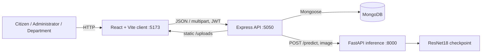
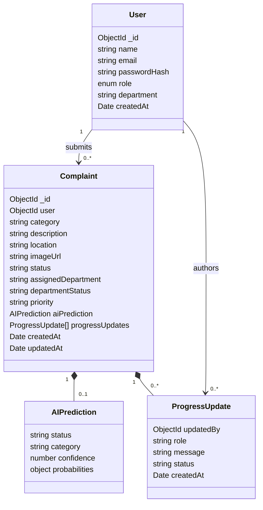

# Software Architecture and Design

## TrafficCare — Smart Traffic Complaint and Monitoring System

**Version:** 1.0 · **Date:** 14 November 2026

## 1. Architectural overview

TrafficCare uses a three-tier, service-oriented design. A React/Vite single-page client calls a Node.js/Express REST API. The API persists accounts and complaint workflows in MongoDB through Mongoose. For complaints with images, the API calls a separate Python/FastAPI inference service running a PyTorch ResNet18 model. Docker Compose and Kubernetes manifests package and run the services.

## 2. Components and responsibilities

| Component | Responsibilities | Main implementation |
|---|---|---|
| Web client | Authentication UI, role selection, citizen/admin/department dashboards, complaint forms and status display. | `client/src/App.jsx`, `Dashboard.jsx`, `AdminDashboard.jsx`, `DepartmentDashboard.jsx` |
| API application | CORS, JSON parsing, static upload delivery, routing, health/error responses. | `server/app.js` |
| Authentication | Registration, login, bcrypt verification, JWT issuance, loading current account and role authorization. | `server/routes/authRoutes.js`, `server/middleware/authMiddleware.js` |
| Complaint service | Validation, image persistence, optional prediction call, citizen-scoped reads. | `server/routes/complaintRoutes.js` |
| Admin service | Complaint overview, department account creation, assignment/reassignment, status and priority updates, aggregate counts. | `server/routes/adminRoutes.js` |
| Department service | Department-scoped complaint list, accept assignment, progress and completion. | `server/routes/departmentRoutes.js` |
| Persistence | User and complaint documents, validation, timestamps, references. | `server/models/User.js`, `server/models/Complaint.js` |
| Inference service | Image validation, resize/normalization, model inference, class probabilities and health. | `dl/src/api.py`, `dl/src/predict.py` |

## 3. Runtime flows

### Complaint with image

1. The citizen submits multipart complaint fields and an optional JPG/PNG image with a bearer token.
2. Express authentication resolves the user. Multer enforces one file and 10 MB; the route validates required fields and category.
3. The server writes the image using a random UUID filename. If present, it sends the image to the DL API with a 30-second timeout.
4. The DL service checks media type, size, and image integrity; it resizes to 224×224, normalizes using ImageNet values, and performs ResNet18 inference.
5. Prediction success or failure is recorded. The complaint is created in MongoDB with the default workflow state. The API returns 201.

### Assignment and resolution

An administrator selects a department account and assigns a complaint. The API updates assignment fields and appends a progress record. The department account sees only matching department records, accepts the assignment, then posts progress or marks work complete. An administrator can set the final complaint status to Resolved.

## 4. Data model

The physical schema uses MongoDB documents; `passwordHash` above corresponds to the `password` field, which is bcrypt-hashed by a Mongoose pre-save hook and excluded by default from queries.

## 5. API surface

| Method and path | Access | Purpose |
|---|---|---|
| `POST /api/auth/register` | Public | Create citizen account |
| `POST /api/auth/login` | Public | Authenticate and issue JWT |
| `GET /api/health` | Public | API health check |
| `POST /api/complaints` | Citizen | Submit complaint (multipart optional image) |
| `GET /api/complaints` | Citizen | List own complaints |
| `GET /api/complaints/:id` | Citizen | Read own complaint |
| `POST /api/admin/departments` | Admin | Create department account |
| `GET /api/admin/complaints` | Admin | List all complaints |
| `PATCH /api/admin/complaints/:id/assign` | Admin | Assign/reassign department |
| `PATCH /api/admin/complaints/:id` | Admin | Update status and/or priority |
| `GET /api/admin/dashboard` | Admin | Aggregate complaint counts |
| `GET /api/department/complaints` | Department | List assigned complaints |
| `PATCH /api/department/complaints/:id/accept` | Department | Accept assignment |
| `PATCH /api/department/complaints/:id/progress` | Department | Post progress / completion |
| `GET /health`, `POST /predict` | Backend service | DL readiness and image inference |

## 6. Security and failure design

- Role and ownership are checked on the server; the client role only selects a dashboard.
- Passwords are hashed with bcrypt; JWTs are signed using `JWT_SECRET`, identify the user in the subject, and expire after one hour.
- Uploaded names are generated by the server, only JPEG/PNG are accepted, file size is capped, and static image responses set `nosniff`.
- Malformed JSON and unknown routes return JSON errors; route-level errors return controlled status and message responses.
- DL request errors, invalid responses, and timeout are captured as prediction failure; the complaint can still be recorded.
- MongoDB failure prevents backend startup. DL model loading failure prevents the inference service from starting.

## 7. Deployment view

The repository includes Dockerfiles for client, API, and DL service, a Compose definition, and Kubernetes manifests in `k8s/`. Compose exposes 5173, 5050, and 8000. The API connects to MongoDB by configured URI; local development/deployment should provide secrets through environment configuration. Kubernetes service names provide internal routing where configured. Current README describes local Docker Desktop Kubernetes.

## 8. Design limits and evolution points

The current API returns full lists without pagination and stores uploaded evidence on the API container volume. The client API URL is local-development oriented. Production hardening could add managed object storage, pagination/filtering, request rate limits, token revocation, centralized logs/metrics, and documented SLOs. These are evolution items, not current requirements.
