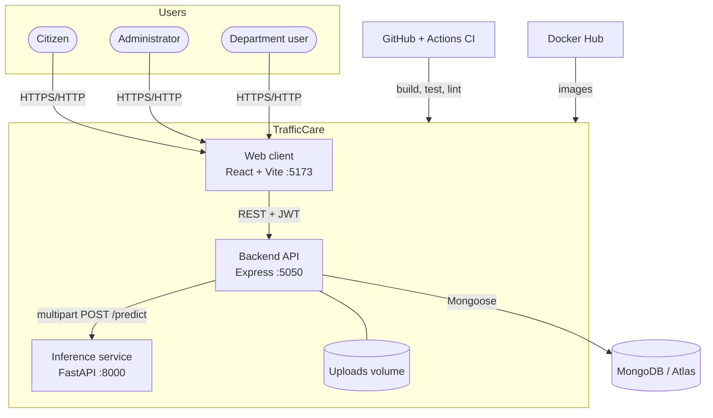
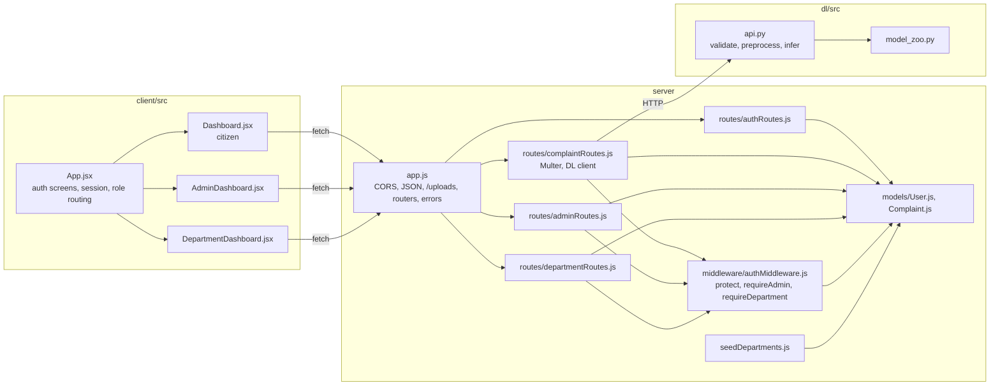
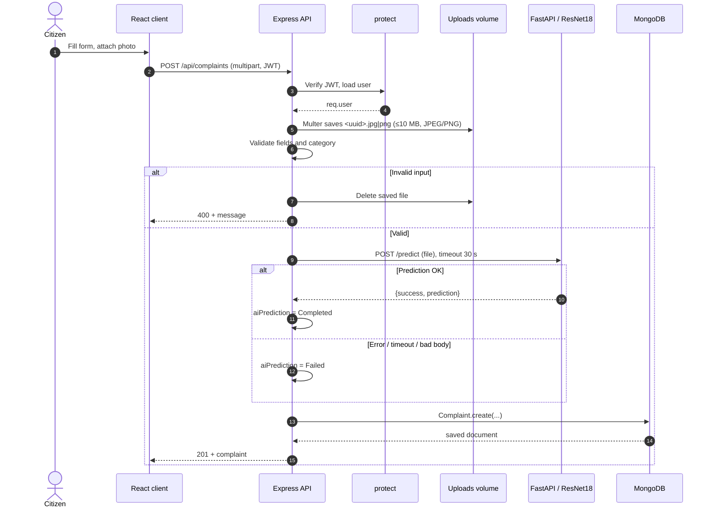
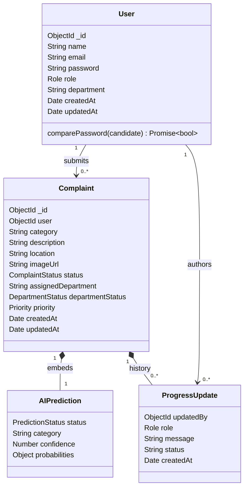
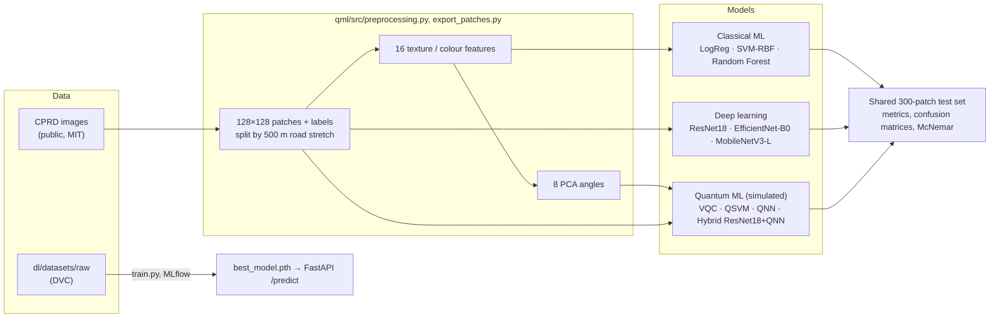
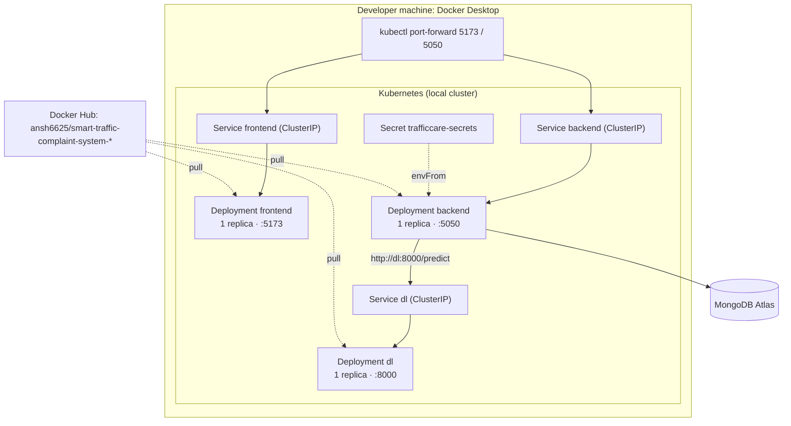

# Software Architecture and Design

## TrafficCare: Smart Traffic Complaint and Monitoring System

| Item | Value |
|---|---|
| Document | Software Architecture and Design (SAD) |
| Version | 2.0 |
| Date | 16 November 2026 |
| Status | Describes the `main` branch of the repository |
| Standard followed | ISO/IEC/IEEE 42010:2022 viewpoints; design content per IEEE 1016-2009; "4+1" view model |
| Related documents | TrafficCare_SRS, TrafficCare_STP, TrafficCare_UML |

### Revision history

| Version | Date | Description |
|---|---|---|
| 1.0 | 14 Nov 2026 | First implementation-aligned architecture description |
| 2.0 | 16 Nov 2026 | Reorganised into stakeholder concerns and views (context, logical, process, data, interface, deployment, development). Added the AI/ML architecture (DL, classical ML, QML), configuration, design decisions, quality scenarios and technical debt |

---

## 1. Introduction

### 1.1 Purpose

This document describes the architecture of TrafficCare: its components, how they interact, how data is stored, how the system is deployed, and why the main design decisions were made. It is the reference for developers changing the system and for evaluators checking that the design meets the SRS.

### 1.2 Scope

The architecture covers the React web client, the Node.js/Express backend, the MongoDB database, the Python/FastAPI deep learning inference service, the offline ML/DL/QML research module, and the Docker/Kubernetes deployment.

### 1.3 Stakeholders and concerns

| Stakeholder | Main concerns | Views that answer them |
|---|---|---|
| Citizens, administrators, department staff | Correct workflow, privacy, responsiveness | Context, process |
| Developers | Module boundaries, APIs, data model, how to extend | Logical, interface, data, development |
| QA team | Testable interfaces, failure behaviour | Interface, process, §9 |
| Data-science team | How models are trained, compared and served | AI/ML (§8) |
| DevOps | Containers, configuration, secrets, scaling | Deployment, §10 |
| Evaluators | Requirement coverage, justified decisions | §11, §12 |

### 1.4 References

TrafficCare_SRS v2.0; TrafficCare_UML v2.0; root `README.md`; `dl/README.md`; `dl/docs/02_model_comparison.md`; `qml/README.md`; `qml/docs/01`–`06`.

---

## 2. Architectural Drivers

### 2.1 Key functional drivers

1. Role-separated workflow: citizen → administrator → department → administrator (SRS §3.2).
2. Photo evidence classified automatically, without blocking submission when AI is down (FR-AI-03).
3. Full audit trail of every status change (FR-ADM-06, FR-DEP-02/03).

### 2.2 Quality attribute drivers

| Quality | Driver | Architectural response |
|---|---|---|
| Security | Strict role and ownership boundaries | Server-side JWT verification, role loaded from DB, query scoping by owner/department |
| Availability | AI outage must not stop reports | Inference isolated in its own service; timeout + fallback status |
| Modifiability | Model can be retrained or replaced | Inference behind a stable REST contract; checkpoint path is configurable |
| Deployability | Run the stack anywhere | One container per service; Compose and Kubernetes manifests |
| Testability | Automated tests per tier | Express `app` exported separately from server start-up; in-memory MongoDB for tests; mocked model for API tests |

### 2.3 Constraints

Stateless backend; secrets only from environment; JPEG/PNG ≤ 10 MB; quantum models only on simulators; local Kubernetes only (see SRS §2.5).

---

## 3. Architectural Overview

TrafficCare uses a **three-tier architecture with a separate inference microservice**:

- **Presentation tier:** React 19 single-page application built with Vite.
- **Application tier:** stateless Express 5 REST API with route modules per role.
- **Data tier:** MongoDB accessed through Mongoose; uploaded images on a file volume.
- **Inference service:** FastAPI application serving a fine-tuned ResNet18.
- **Research module (offline):** Python scripts and notebooks that build the dataset, train and compare 3 classical ML, 3 DL and 4 quantum/hybrid models, and produce the checkpoint the inference service can load.

### 3.1 Context view

---

## 4. Logical View

### 4.1 Component decomposition

### 4.2 Component responsibilities

| Component | Responsibility | Key files |
|---|---|---|
| Session & routing | Sign-in/registration forms, token and user in `localStorage`, choose dashboard by server role | `client/src/App.jsx` |
| Citizen dashboard | Complaint form with image preview and client-side checks; list of own complaints with AI result and progress | `client/src/Dashboard.jsx` |
| Admin dashboard | Statistics, complaint cards, status/priority controls, department selector, assignment | `client/src/AdminDashboard.jsx` |
| Department dashboard | Assigned complaints, accept, progress form | `client/src/DepartmentDashboard.jsx` |
| HTTP shell | CORS (client origin only), JSON body parser, static `/uploads` with `nosniff`, router mounting, JSON 404 and error handler | `server/app.js` |
| Bootstrap | Load `.env`, connect MongoDB, seed department accounts, listen | `server/index.js`, `config/db.js`, `seedDepartments.js` |
| Authentication | Register, login, bcrypt check, JWT issue | `routes/authRoutes.js` |
| Authorisation | Verify JWT, load user from DB, enforce role | `middleware/authMiddleware.js` |
| Complaint service | Validate, store image, call DL, create complaint, owner-scoped reads | `routes/complaintRoutes.js` |
| Admin service | List all, create department, assign, update status/priority, statistics | `routes/adminRoutes.js` |
| Department service | Department-scoped list, accept, progress | `routes/departmentRoutes.js` |
| Domain model | Schemas, enums, limits, password hashing hook | `models/User.js`, `models/Complaint.js` |
| Inference service | File checks, preprocessing, ResNet18 forward pass, softmax, response | `dl/src/api.py` |

### 4.3 Design patterns used

| Pattern | Where | Benefit |
|---|---|---|
| Layered architecture | Client / API / data | Clear separation of concerns |
| Middleware chain (Chain of Responsibility) | `protect` → role guard → handler | Reusable security checks |
| Router per bounded context | auth, complaints, admin, department | Small, focused modules |
| Active Record (Mongoose models) | `User`, `Complaint` | Validation and persistence together |
| Microservice / remote façade | DL service behind `/predict` | Independent language, scaling and release |
| Graceful degradation / fallback | AI status `Failed` | AI outage does not block reports |
| Factory | `model_zoo.build_model(name)` | One place to create any of the three CNNs |
| Audit log (append-only array) | `progressUpdates` | Traceable history |

---

## 5. Process (Runtime) View

### 5.1 Sign-in and dashboard selection

1. Client sends `POST /api/auth/login` with e-mail and password.
2. Server finds the user (lower-cased e-mail), compares the bcrypt hash and signs a JWT (`sub` = user id, `role`, 1 h).
3. Client stores the token and user, then renders the dashboard for `user.role`.
4. Every later request carries the token; `protect` verifies it and reloads the user from MongoDB, so a deleted user or changed role takes effect immediately.

### 5.2 Complaint submission with image

### 5.3 Assignment, department work and resolution

1. Admin selects a department and calls `PATCH /api/admin/complaints/:id/assign`. The server checks that a department account exists, sets `departmentStatus = Assigned`, `status = Assigned to Department`, and appends a progress entry (mentioning the previous department on reassignment).
2. Department user calls `PATCH /api/department/complaints/:id/accept`; allowed only from `Assigned`.
3. Department user posts progress with `PATCH …/progress`; allowed only from `Accepted` or `Work in Progress`; sets both statuses to `Work in Progress` or `Work Completed`.
4. Admin verifies and calls `PATCH /api/admin/complaints/:id` with `status = Resolved`, which also sets `departmentStatus = Work Completed`.

Both status fields and the progress entry are written in one `complaint.save()`, so a single document update keeps them consistent without multi-document transactions.

### 5.4 Concurrency

The API is stateless and can run several replicas. Concurrent updates to the same complaint use last-write-wins on the document; there is no optimistic locking (see §13).

---

## 6. Data View

### 6.1 Class model

### 6.2 Storage decisions

- **Embedding vs referencing:** `aiPrediction` and `progressUpdates` are embedded because they are always read with their complaint and never shared. `user` and `progressUpdates.updatedBy` are references, populated on admin and department reads.
- **Indexes:** unique index on `users.email`; index on `complaints.user` for the citizen's list.
- **Password:** hashed in a Mongoose `pre('save')` hook (bcrypt cost 12) and `select: false`.
- **Images:** stored on disk (`server/uploads`, a Docker volume), only the relative URL is stored in MongoDB.

Field-level rules are in SRS §3.3.2.

---

## 7. Interface View

### 7.1 REST API (backend, base `/api`)

| Method | Path | Guard | Request | Success | Errors |
|---|---|---|---|---|---|
| GET | `/health` | none | none | 200 `{status:"ok"}` | none |
| POST | `/auth/register` | none | `{name, email, password}` | 201 `{user}` | 400, 409, 500 |
| POST | `/auth/login` | none | `{email, password}` | 200 `{token, user}` | 400, 401, 500 |
| POST | `/complaints` | protect | multipart `category, description, location, image?` | 201 `{complaint}` | 400, 401, 500 |
| GET | `/complaints` | protect | none | 200 `{count, complaints}` | 401, 500 |
| GET | `/complaints/:id` | protect | none | 200 `{complaint}` | 400, 401, 404 |
| POST | `/admin/departments` | admin | `{name, email, password, department}` | 201 `{user}` | 400, 403, 409 |
| GET | `/admin/complaints` | admin | none | 200 `{complaints}` | 401, 403 |
| PATCH | `/admin/complaints/:id/assign` | admin | `{department}` | 200 `{complaint}` | 400, 403, 404 |
| PATCH | `/admin/complaints/:id` | admin | `{status?, priority?}` | 200 `{complaint}` | 400, 403, 404 |
| GET | `/admin/dashboard` | admin | none | 200 `{total, byStatus}` | 401, 403 |
| GET | `/department/complaints` | department | none | 200 `{complaints}` | 401, 403 |
| PATCH | `/department/complaints/:id/accept` | department | none | 200 `{complaint}` | 400, 403, 404 |
| PATCH | `/department/complaints/:id/progress` | department | `{message, status?}` | 200 `{complaint}` | 400, 403, 404 |

All responses are JSON with `status: "success" | "error"` and a human-readable `message`. Unknown routes return 404 `Route not found`; malformed JSON returns 400 `Malformed JSON in request body`; unexpected errors return a generic 500 without internal details.

### 7.2 Inference service

| Method | Path | Response |
|---|---|---|
| GET | `/` | Service information |
| GET | `/health` | Health and model status |
| POST | `/predict` | `{success: true, prediction: {category, confidence, probabilities}}`; 400 for wrong type, empty or corrupted image; 413 for > 10 MB; 500 for inference failure |

---

## 8. AI / ML Architecture

### 8.1 Overview

### 8.2 Production model (serving path)

| Aspect | Design |
|---|---|
| Model | ResNet18, ImageNet-pretrained, final layer replaced by 3 outputs |
| Training | `dl/src/train.py` on `dl/datasets/raw/{Training,Validation,Testing}`; runs logged to MLflow (`mlflow.db`) |
| Artefact | `dl/models/best_model.pth`, versioned with DVC |
| Preprocessing at inference | Resize 224×224 → tensor → ImageNet normalisation |
| Output | Softmax over {Road Damage, Normal Road, Pothole}; arg-max class + confidence + all probabilities |
| Device | CUDA or Apple MPS if available, else CPU |
| Swap model | Set `DL_MODEL_PATH` to another ResNet18 checkpoint |

### 8.3 Model comparison (research module)

All models below are scored on the same 300 held-out CPRD patches; seed 42; macro averages.

| Family | Model | Inputs | Accuracy | Macro-F1 |
|---|---|---|---|---|
| Classical ML | Logistic Regression | 16 features | 0.683 | 0.683 |
| Classical ML | SVM (RBF) | 16 features | 0.737 | 0.737 |
| Classical ML | Random Forest | 16 features | 0.730 | 0.732 |
| Deep learning | ResNet18 | image | 0.833 | 0.834 |
| Deep learning | EfficientNet-B0 | image | 0.843 | 0.844 |
| Deep learning | MobileNetV3-Large | image | 0.863 | 0.864 |
| Quantum ML | VQC, 4 qubits, 3 layers | 8 PCA angles | 0.593 | 0.588 |
| Quantum ML | QSVM, fidelity kernel | 8 PCA angles | 0.680 | 0.681 |
| Quantum ML | QNN, 4 qubits, 2 layers | 8 PCA angles | 0.663 | 0.662 |
| Hybrid QML | ResNet18 (frozen) + 4-qubit layer | image | 0.817 | 0.817 |
| Hybrid QML | ResNet18 (fine-tuned layer4) + 4-qubit layer | image | 0.830 | 0.830 |

**Architectural conclusion.** CNNs on raw pixels clearly beat hand-crafted-feature models. Differences among the three CNNs are not statistically significant (McNemar p ≥ 0.20). Quantum models run on a simulator and do not beat their classical controls, so they stay in the research module and are not served. ResNet18 remains the served model because it was already integrated and validated; MobileNetV3-Large is the strongest candidate for a future swap (smaller and faster on CPU).

### 8.4 Quantum model design (summary)

- **VQC:** 4 qubits; angle encoding (RY/RZ) of 8 PCA features, re-uploaded before each of 3 variational layers (RY, RZ, CNOT ring); ⟨Z⟩ read-out → softmax over 3 classes; trained with parameter-shift gradients on an exact NumPy statevector simulator (checked against PennyLane).
- **QSVM:** quantum feature map (encoding + CNOT ring, 2 repetitions); kernel = |⟨φ(x)|φ(x′)⟩|²; scikit-learn SVC on the precomputed kernel, C chosen by grid search.
- **QNN:** PennyLane `TorchLayer` with `StronglyEntanglingLayers`, trained with Adam in PyTorch.
- **Hybrid:** ResNet18 backbone → linear down to 4 → quantum layer (3 entangling blocks, 36 weights) → linear head; compared with an identical network whose quantum layer is replaced by a classical layer.

---

## 9. Security Architecture

| Threat | Control |
|---|---|
| Credential theft from DB | bcrypt hashes, cost 12; password field never selected by default |
| Token forgery / tampering | HS256 JWT signed with `JWT_SECRET`; 1 h expiry |
| Privilege escalation via token claim | Role re-read from DB on every request; registration forces `citizen` |
| Horizontal access (IDOR) | Queries filter by `user` (citizen) or `assignedDepartment` (department); return 404, not 403 |
| NoSQL injection | `typeof` checks before any query; enum validation |
| Malicious upload | MIME allow-list, size/count limits, server-generated UUID name, extension from MIME, `nosniff` |
| Information leakage | Generic login error; JSON error handler without stack traces |
| Cross-origin abuse | CORS restricted to the client origin |
| Secret leakage | `.env` / Kubernetes Secret `trafficcare-secrets`; `.gitignore` excludes them |

Known gaps are listed in §13.

---

## 10. Deployment View

| Unit | Image base | Port | Configuration |
|---|---|---|---|
| frontend | `node:24-alpine`, Vite dev server | 5173 | API URL constant in `App.jsx` |
| backend | `node:24-alpine` | 5050 | `MONGODB_URI`, `JWT_SECRET`, `PORT`, `DL_API_URL`, `DEPT_ROADS_PASSWORD`, `DEPT_POLICE_PASSWORD`, `DEPT_ELECTRICAL_PASSWORD`, `DEPT_TRANSPORT_PASSWORD`, `DEPT_SIGNALS_PASSWORD` |
| dl | `python:3.11-slim`, Uvicorn | 8000 | `DL_MODEL_PATH` (optional) |

Docker Compose runs the same three services, mounts `./server/uploads` and wires `DL_API_URL=http://dl:8000/predict`.

---

## 11. Development View

| Area | Tooling |
|---|---|
| Repository layout | `client/`, `server/`, `dl/`, `qml/`, `k8s/`, `testing/`, `updated-docs/` |
| Version control | Git + GitHub; feature branches (e.g. `feature/deep-learning`, `feature/mlops-cicd`) |
| CI | GitHub Actions: backend Jest tests and frontend build (`main.yml`); Python compile + Pylint (`ci.yml`) |
| Data / model versioning | DVC for `dl/datasets/raw` and `best_model.pth`; MLflow for training runs |
| Tests | Jest + Supertest + mongodb-memory-server (backend), Vitest + React Testing Library (client), unittest (DL API) |

---

## 12. Design Decisions

| ID | Decision | Alternatives | Rationale |
|---|---|---|---|
| AD-01 | Separate Python inference service | Run the model inside Node (ONNX) | PyTorch ecosystem; independent scaling and deployment; failures isolated |
| AD-02 | Stateless JWT authentication | Server sessions | Easy horizontal scaling; simple for SPA |
| AD-03 | Re-load user and role from DB on each request | Trust JWT role claim | Role changes and deletions apply immediately; blocks forged claims |
| AD-04 | MongoDB with embedded history | Relational DB with history table | Complaint and its history are read together; flexible AI probabilities |
| AD-05 | Two status fields (complaint, department) | Single status | Separates the department's view from the citizen-visible status; supports BR-03 |
| AD-06 | AI failure → `Failed` status, not error | Reject the complaint | Reporting must not depend on AI (NFR-REL-01) |
| AD-07 | Serve ResNet18 | MobileNetV3-Large (best F1) | Already integrated and tested; CNN differences not significant |
| AD-08 | Keep QML offline | Serve a quantum/hybrid model | No accuracy gain over classical controls; simulator is slower |
| AD-09 | Images on local volume | Object storage (S3) | Simplicity for local deployment; noted as debt |

---

## 13. Risks and Technical Debt

| Item | Impact | Proposed mitigation |
|---|---|---|
| Client API URL is hard-coded to `localhost:5050` | Breaks non-local deployment | Read from `VITE_API_URL` at build time |
| Frontend container runs the Vite dev server | Not production-grade | Build static files and serve with Nginx |
| No pagination or server-side filtering | Slow lists at scale | Add `limit`/`cursor` and filters |
| JWT stored in `localStorage`; no revocation | Token theft via XSS stays valid up to 1 h | HttpOnly cookies, refresh tokens, deny-list |
| No rate limiting | Brute-force login | `express-rate-limit` on auth routes |
| Admin can set any status in any order | Workflow can be skipped | Enforce a transition table on the server |
| No optimistic locking | Concurrent edits may overwrite | Use document version (`__v`) checks |
| Uploads on a single volume | Not shared across replicas | Object storage |
| No admin-account API | Admins created manually in DB | Secure admin provisioning script |
| Category suggestion only documented, not in UI | Admin chooses manually | Pre-select from SRS Appendix B mapping |
| Production model trained on a different dataset than the comparison | Reported 0.995 accuracy on its own test set does not transfer | Re-evaluate on CPRD test set; consider MobileNetV3-Large |
