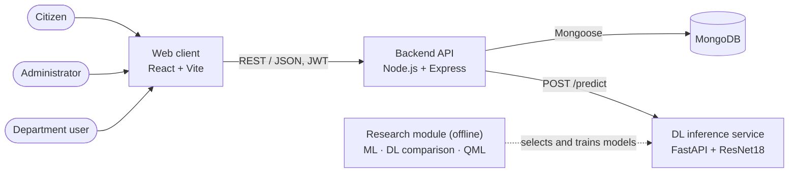
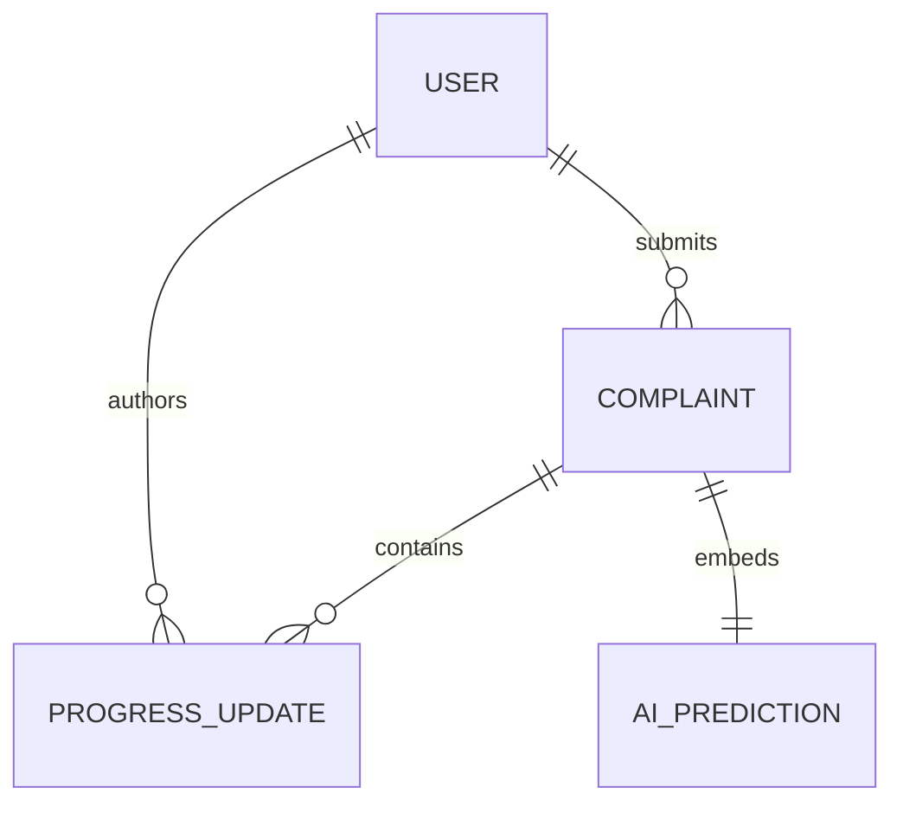

# Software Requirements Specification

## TrafficCare: Smart Traffic Complaint and Monitoring System

| Item | Value |
|---|---|
| Document | Software Requirements Specification (SRS) |
| Version | 2.0 |
| Date | 16 November 2026 |
| Status | Baselined against the `main` branch of the repository |
| Standard followed | ISO/IEC/IEEE 29148:2018 (structure adapted from IEEE 830) |
| Related documents | TrafficCare_SAD, TrafficCare_STP, TrafficCare_UML |

### Revision history

| Version | Date | Description |
|---|---|---|
| 1.0 | 14 Nov 2026 | First implementation-aligned baseline |
| 2.0 | 16 Nov 2026 | Restructured to ISO/IEC/IEEE 29148. Added requirement priorities, verification methods, AI/ML requirements (DL, classical ML, QML), business rules, data dictionary and traceability matrix |

---

## 1. Introduction

### 1.1 Purpose

This document specifies the software requirements of TrafficCare, a web system through which citizens report traffic and road-condition problems and the responsible authorities handle them. It is written for the development team, the QA team, the project evaluators and anyone maintaining the system. Every requirement here describes behaviour present in the repository unless it is explicitly marked as *Future*.

### 1.2 Scope

TrafficCare provides:

- Citizen registration, sign-in and complaint submission with an optional photo.
- Automatic road-condition classification of the photo by a deep learning (DL) model.
- An administrator workflow to review, prioritise, assign, verify and resolve complaints.
- A department workflow to accept assigned complaints and report progress and completion.
- A research module that compares classical machine learning (ML), deep learning and quantum machine learning (QML) classifiers on the same road-image test set.

The system does **not** provide: geolocation or maps, e-mail/SMS notifications, assignment to individual officers, public-cloud hosting, pagination, token revocation, or a guarantee of model accuracy on real-world photos.

### 1.3 Definitions, acronyms and abbreviations

| Term | Meaning |
|---|---|
| Citizen | A member of the public who registers and reports complaints |
| Administrator (Admin) | Staff member who reviews and manages all complaints |
| Department user | Account belonging to a municipal department (e.g. Roads & Maintenance) |
| Complaint | A report of a traffic/road problem with category, description, location and optional image |
| Complaint status | Overall lifecycle state visible to all roles (e.g. Submitted, Resolved) |
| Department status | Department-side state of a complaint (e.g. Assigned, Accepted) |
| Progress update | Timestamped audit entry on a complaint (actor, role, message, status) |
| AI prediction | Output of the DL classifier: class, confidence and per-class probabilities |
| JWT | JSON Web Token used for stateless authentication |
| DL | Deep learning (convolutional neural networks) |
| ML | Classical machine learning (Logistic Regression, SVM, Random Forest) |
| QML | Quantum machine learning (VQC, QSVM, QNN), run on a classical simulator |
| VQC / QSVM / QNN | Variational Quantum Classifier / Quantum-kernel Support Vector Machine / Quantum Neural Network |
| CPRD | Public "Cracks and Potholes in Road Images" dataset (MIT licence) |
| SPA | Single-page application |
| MoSCoW | Priority scale: Must, Should, Could, Won't |

### 1.4 References

1. ISO/IEC/IEEE 29148:2018, *Systems and software engineering: Life cycle processes, Requirements engineering*.
2. TrafficCare repository README (root `README.md`), `dl/README.md`, `qml/README.md`.
3. TrafficCare Software Architecture and Design (TrafficCare_SAD).
4. TrafficCare Software Test Plan (TrafficCare_STP).
5. TrafficCare UML Diagrams (TrafficCare_UML) and UX design document (`ux/UX_Design_and_Evaluation.md`).
6. B. T. Passos et al., Cracks and Potholes in Road Images dataset, GitHub `biankatpas/Cracks-and-Potholes-in-Road-Images-Dataset`.

### 1.5 Document overview

Section 2 describes the product as a whole. Section 3 lists the specific, testable requirements. Section 4 maps requirements to their verification. Appendices hold reference tables.

---

## 2. Overall Description

### 2.1 Product perspective

TrafficCare is a new, self-contained system made of three runtime services and one offline research module.

### 2.2 Product functions

| ID | Function | Primary actor |
|---|---|---|
| PF-1 | Account registration and sign-in | Citizen, Admin, Department |
| PF-2 | Complaint submission with optional photo | Citizen |
| PF-3 | Automatic image classification of the photo | System (DL service) |
| PF-4 | Complaint tracking with progress history | Citizen |
| PF-5 | Complaint review, prioritisation and status management | Administrator |
| PF-6 | Department assignment / reassignment | Administrator |
| PF-7 | Department account creation | Administrator |
| PF-8 | Dashboard statistics | Administrator |
| PF-9 | Accept assignment, report progress and completion | Department user |
| PF-10 | Verification and final resolution | Administrator |
| PF-11 | Offline ML / DL / QML model comparison and reporting | Data-science team |

### 2.3 User classes and characteristics

| User class | Characteristics | Access |
|---|---|---|
| Citizen | General public; low technical skill; mostly mobile browsers | Own complaints only |
| Administrator | Trained municipal staff; uses a desktop browser daily | All complaints and statistics |
| Department user | Departmental staff; moderate skill | Only complaints assigned to their department |
| Data-science team | Developers running experiments from the command line or notebooks | Research module and model files |

Public registration creates citizen accounts only. Department accounts are seeded at server start-up or created by an administrator. Administrator accounts are provisioned directly in the database.

### 2.4 Operating environment

| Component | Environment |
|---|---|
| Client | Current desktop and mobile browsers (Chrome, Edge, Firefox, Safari); React 19, Vite 8 |
| Backend | Node.js 24, Express 5, Mongoose 9 |
| Database | MongoDB (MongoDB Atlas or a self-hosted instance) |
| DL service | Python 3.11 (container image; CI checks with 3.12), PyTorch, torchvision, FastAPI, Uvicorn; uses CUDA or Apple MPS when present, otherwise CPU |
| Research module | Python 3.10+, scikit-learn, PyTorch, PennyLane; a CUDA GPU is recommended for training |
| Deployment | Docker, Docker Compose, Kubernetes (Docker Desktop local cluster) |

### 2.5 Design and implementation constraints

- C-1: The backend must be stateless; sessions are carried by JWT only.
- C-2: Secrets (MongoDB URI, JWT secret, department passwords) must be supplied through environment variables, never committed.
- C-3: The DL service must expose a REST endpoint so it can be scaled and replaced independently of the backend.
- C-4: Image evidence is limited to JPEG/PNG, one file, at most 10 MB.
- C-5: Quantum models run on a classical simulator (no quantum hardware is available).
- C-6: The production classifier must be loadable from a single PyTorch checkpoint file.

### 2.6 Assumptions and dependencies

- A-1: MongoDB is reachable at start-up; without it the backend exits.
- A-2: The five department passwords (`DEPT_*_PASSWORD`) are configured; the server refuses to start if a missing department account cannot be created.
- A-3: The DL checkpoint (`dl/models/best_model.pth`, tracked with DVC) is available to the DL service.
- A-4: Users have a stable internet connection and a modern browser.
- A-5: The AI prediction is advisory; staff make the final decision.

### 2.7 Out of scope (Won't, this release)

Geolocation and maps, notifications, officer-level assignment, citizen withdrawal/edit of complaints, search/filter/pagination on the server, token revocation, public-cloud deployment, and certified model accuracy.

---

## 3. Specific Requirements

Priority uses MoSCoW. Verification: **T** = test, **I** = inspection, **D** = demonstration, **A** = analysis.

### 3.1 External interface requirements

#### 3.1.1 User interfaces

| ID | Requirement | Priority | Verif. |
|---|---|---|---|
| UI-01 | The client shall provide sign-in and registration screens with inline error messages announced to assistive technology (`role="alert"`). | Must | D |
| UI-02 | After sign-in the client shall open the dashboard that matches the server-returned role: citizen, admin or department. | Must | T |
| UI-03 | The citizen dashboard shall show a complaint form, the citizen's complaints, their status, AI result and progress history. | Must | D |
| UI-04 | The admin dashboard shall show statistics, every complaint, status/priority controls, a department selector listing the five departments, citizen details and AI analysis. | Must | D |
| UI-05 | The department dashboard shall show only assigned complaints, an Accept action and a progress form with a Work Completed option. | Must | D |
| UI-06 | Layouts shall be usable at mobile width (≈375 px) without horizontal scrolling. | Should | D |

Screen designs are in `ux/` (screens S1–S5, M1, M3).

#### 3.1.2 Software interfaces

| ID | Interface | Contract |
|---|---|---|
| SI-01 | Client → Backend | JSON over HTTP; `multipart/form-data` for complaint images; header `Authorization: Bearer <JWT>` on protected routes |
| SI-02 | Backend → MongoDB | Mongoose ODM; collections `users` and `complaints` |
| SI-03 | Backend → DL service | `POST {DL_API_URL}` (default `http://127.0.0.1:8000/predict`), multipart field `file`, 30 s timeout. Expected response `{success: true, prediction: {category, confidence, probabilities}}` |
| SI-04 | DL service | `GET /` (info), `GET /health`, `POST /predict` |
| SI-05 | Static files | Backend serves uploaded images at `/uploads/<uuid>.<jpg|png>` with `X-Content-Type-Options: nosniff` |

#### 3.1.3 Communication interfaces

- CI-01: HTTP between all services; HTTPS is required for any deployment outside a local machine (*Future*).
- CI-02: CORS on the backend shall allow only the configured client origin (currently `http://localhost:5173`).

#### 3.1.4 Hardware interfaces

None specific. Model training benefits from an NVIDIA GPU (results were produced on an RTX 3050 6 GB laptop GPU); inference runs on CPU.

### 3.2 Functional requirements

#### 3.2.1 Authentication and authorisation (AUTH)

| ID | Requirement | Priority | Verif. |
|---|---|---|---|
| FR-AUTH-01 | The system shall register a citizen with name, e-mail and password. The name must be non-blank and ≤ 100 characters, the e-mail must match a valid format and is stored trimmed and lower-case, and the password must be at least 8 characters. | Must | T |
| FR-AUTH-02 | Registration shall always assign the role `citizen`, ignoring any role sent by the client. | Must | T |
| FR-AUTH-03 | Registration with an e-mail that already exists (case-insensitive) shall be rejected with HTTP 409. | Must | T |
| FR-AUTH-04 | The system shall authenticate a user by e-mail and password and return a JWT signed with `JWT_SECRET`, subject = user id, valid for 1 hour, plus the user's id, name, e-mail and role. | Must | T |
| FR-AUTH-05 | A failed login shall return HTTP 401 with the same message for an unknown e-mail and a wrong password. | Must | T |
| FR-AUTH-06 | Every protected request shall require a valid, unexpired bearer token whose user still exists; otherwise HTTP 401. | Must | T |
| FR-AUTH-07 | Authorisation shall use the role loaded from the database, not the role claim in the token. Admin routes require `admin`; department routes require `department`; otherwise HTTP 403. | Must | T |
| FR-AUTH-08 | The client shall keep the token and basic user data in local storage and clear them on logout. | Must | T |
| FR-AUTH-09 | On start-up the backend shall create any missing account among the five default departments (Roads & Maintenance, Traffic Police, Electrical Department, Transport Department, Traffic Signal Department) using passwords from environment variables. | Should | T |

#### 3.2.2 Citizen complaints (CMP)

| ID | Requirement | Priority | Verif. |
|---|---|---|---|
| FR-CMP-01 | An authenticated user shall submit a complaint with a category, description and location; all three are required and non-blank. | Must | T |
| FR-CMP-02 | The category shall be one of: Pothole, Traffic Signal, Illegal Parking, Road Blockage, Traffic Congestion, Street Lighting, Accident, Pedestrian Safety, Road Sign, Public Transport, Other. | Must | T |
| FR-CMP-03 | Description shall be ≤ 2,000 characters and location ≤ 200 characters; longer values return HTTP 400 with a field message. | Must | T |
| FR-CMP-04 | A new complaint shall be linked to its author and start with status `Submitted`, priority `Medium`, department status `Not Assigned` and AI status `Not Requested`. | Must | T |
| FR-CMP-05 | The citizen may attach one JPEG or PNG image ≤ 10 MB. Other types or larger files return HTTP 400 and nothing is stored. | Must | T |
| FR-CMP-06 | The server shall store the image under a random UUID name with an extension derived from the validated MIME type, and expose it at `/uploads/<name>`. | Must | T |
| FR-CMP-07 | If validation fails after an image was saved, the saved file shall be deleted. | Should | T |
| FR-CMP-08 | A citizen shall list only their own complaints, newest first. | Must | T |
| FR-CMP-09 | A citizen shall read a single complaint only if they own it; malformed id → 400, missing or not owned → 404. | Must | T |

#### 3.2.3 AI image classification (AI)

| ID | Requirement | Priority | Verif. |
|---|---|---|---|
| FR-AI-01 | When an image is attached, the backend shall send it to the DL service and wait at most 30 seconds. | Must | T |
| FR-AI-02 | A valid DL response shall be stored as AI status `Completed` with category, confidence and probabilities. | Must | T |
| FR-AI-03 | A DL error, timeout, non-2xx response or malformed body shall be stored as AI status `Failed`; the complaint shall still be created. | Must | T |
| FR-AI-04 | The DL service shall classify an image into Road Damage, Normal Road or Pothole and return the confidence and the probability of each class. | Must | T |
| FR-AI-05 | The DL service shall reject unsupported types and empty or corrupted images with HTTP 400, and files over 10 MB with HTTP 413. | Must | T |
| FR-AI-06 | The DL service shall resize images to 224×224 and normalise them with ImageNet mean/std before inference. | Must | I |
| FR-AI-07 | The model checkpoint path shall be configurable with `DL_MODEL_PATH`. | Should | I |

#### 3.2.4 Administration (ADM)

| ID | Requirement | Priority | Verif. |
|---|---|---|---|
| FR-ADM-01 | An admin shall list all complaints with the reporter's name and e-mail and the authors of progress entries, never passwords. | Must | T |
| FR-ADM-02 | An admin shall create a department account (name, e-mail, password ≥ 8, department name). Missing fields → 400; duplicate e-mail → 409. | Must | T |
| FR-ADM-03 | An admin shall assign or reassign a complaint to a department that has an account; unknown department → 404. Assignment sets department status `Assigned`, complaint status `Assigned to Department` and appends a progress entry naming the previous department on reassignment. | Must | T |
| FR-ADM-04 | *Future:* the admin UI should pre-select a suggested department from the complaint category (Appendix B), which the admin may override. Not implemented yet: the selector currently starts empty. | Could | D |
| FR-ADM-05 | An admin shall update status and/or priority. Status must be one of the nine values in Appendix A; priority must be Low, Medium or High. An empty update or invalid value → 400 with the record unchanged. | Must | T |
| FR-ADM-06 | Every status change by an admin shall append a progress entry. Setting `Resolved` shall also set department status to `Work Completed`. | Must | T |
| FR-ADM-07 | An admin shall view the total complaint count and counts per status. | Must | T |

#### 3.2.5 Department workflow (DEP)

| ID | Requirement | Priority | Verif. |
|---|---|---|---|
| FR-DEP-01 | A department user shall list only complaints assigned to their department, most recently updated first, including reporter and progress authors. | Must | T |
| FR-DEP-02 | A department user shall accept a complaint only while its department status is `Assigned`; acceptance sets `Accepted` / `Accepted by Department` and appends a progress entry. | Must | T |
| FR-DEP-03 | A department user shall post progress only after acceptance. The message is required and ≤ 1,000 characters. Optional status is `Work in Progress` (default) or `Work Completed`; both statuses are updated together. | Must | T |
| FR-DEP-04 | A department user shall not read or change complaints of another department; such requests return 404. | Must | T |
| FR-DEP-05 | Department users shall not be able to set a complaint to `Resolved`; only an admin can. | Must | T |

#### 3.2.6 Research module: ML, DL and QML comparison (RES)

These requirements cover the offline module in `dl/` and `qml/`. They are verified by inspecting committed code and result files.

| ID | Requirement | Priority | Verif. |
|---|---|---|---|
| FR-RES-01 | The module shall build a labelled 3-class dataset (Road Damage, Normal Road, Pothole) of 128×128 patches from CPRD, split by 500 m road stretch so no stretch appears in both train and test (900 train / 300 test patches). | Must | I |
| FR-RES-02 | The module shall extract 16 hand-crafted texture/colour features per patch and an 8-dimensional PCA projection scaled to rotation angles for the quantum models. | Must | I |
| FR-RES-03 | **Classical ML:** the module shall train and evaluate Logistic Regression, SVM (RBF kernel) and Random Forest with GroupKFold cross-validation on both 16 and 8 features. | Must | I |
| FR-RES-04 | **Deep learning:** the module shall fine-tune ImageNet-pretrained ResNet18, EfficientNet-B0 and MobileNetV3-Large with an identical recipe over three seeds and report accuracy, macro precision/recall/F1, training time, inference latency and McNemar significance tests. | Must | I |
| FR-RES-05 | **Quantum ML:** the module shall implement a 4-qubit VQC (data re-uploading, parameter-shift gradients), a QSVM with a fidelity quantum kernel, a feature QNN (PennyLane TorchLayer) and a hybrid ResNet18 + 4-qubit quantum layer, each with a classical control of similar size. | Must | I |
| FR-RES-06 | All models shall be scored on the same 300 held-out patches; test data shall never be used for fitting, scaling, PCA, model selection or early stopping. Random seed 42 is used for headline runs. | Must | I |
| FR-RES-07 | The module shall also report an "unseen highway" split to measure generalisation. | Should | I |
| FR-RES-08 | Results shall be saved as JSON/Markdown tables, confusion matrices and training curves under `dl/results/` and `qml/results/`. | Must | I |
| FR-RES-09 | DL training runs shall be logged with MLflow; datasets and the production checkpoint shall be versioned with DVC. | Should | I |

### 3.3 Data requirements

#### 3.3.1 Logical data model

#### 3.3.2 Data dictionary

**User**

| Field | Type | Rules |
|---|---|---|
| `_id` | ObjectId | Primary key |
| `name` | String | Required, trimmed, ≤ 100 |
| `email` | String | Required, unique, lower-case, trimmed |
| `password` | String | Required, ≥ 8 before hashing; stored as bcrypt hash (cost 12); excluded from queries by default |
| `role` | Enum | `citizen` (default), `admin`, `department` |
| `department` | String | Department name for department users, otherwise null |
| `createdAt`, `updatedAt` | Date | Automatic |

**Complaint**

| Field | Type | Rules |
|---|---|---|
| `_id` | ObjectId | Primary key |
| `user` | ObjectId → User | Required, indexed |
| `category` | String | Required, one of 11 categories |
| `description` | String | Required, ≤ 2,000 |
| `location` | String | Required, ≤ 200 |
| `imageUrl` | String | `/uploads/<uuid>.<ext>` or null |
| `aiPrediction.status` | Enum | `Not Requested` (default), `Completed`, `Failed` |
| `aiPrediction.category` | String | Predicted class or null |
| `aiPrediction.confidence` | Number | 0–1 or null |
| `aiPrediction.probabilities` | Object | Class → probability, or null |
| `status` | Enum | Appendix A, default `Submitted` |
| `assignedDepartment` | String | Department name or null |
| `departmentStatus` | Enum | `Not Assigned` (default), `Assigned`, `Accepted`, `Work in Progress`, `Work Completed` |
| `priority` | Enum | `Low`, `Medium` (default), `High` |
| `progressUpdates[]` | Array | `updatedBy` (User), `role`, `message` (≤ 1,000), `status`, `createdAt` |
| `createdAt`, `updatedAt` | Date | Automatic |

#### 3.3.3 Data retention

- DR-01: Complaints and progress history are kept indefinitely; there is no delete API.
- DR-02: Uploaded images are kept on the backend volume (`server/uploads`).

### 3.4 Non-functional requirements

| ID | Category | Requirement | Priority | Verif. |
|---|---|---|---|---|
| NFR-SEC-01 | Security | Passwords shall be hashed with bcrypt (cost 12) and never returned by any API. | Must | T |
| NFR-SEC-02 | Security | JWTs shall be signed with a secret from the environment and expire after 1 hour. | Must | T |
| NFR-SEC-03 | Security | All inputs shall be validated on the server with type checks, which also blocks NoSQL operator injection (e.g. `{"$gt": ""}`). | Must | T |
| NFR-SEC-04 | Security | Uploaded files shall never keep the client's file name or extension; only `.jpg`/`.png` derived from the checked MIME type are served, with `nosniff`. | Must | T |
| NFR-SEC-05 | Security | Error responses shall be JSON and shall not reveal stack traces; malformed JSON → 400, unknown route → 404. | Must | T |
| NFR-PRV-01 | Privacy | A citizen shall never see another citizen's complaint; department users see only their department's complaints. | Must | T |
| NFR-PRV-02 | Privacy | Login errors shall not reveal whether an e-mail is registered. | Must | T |
| NFR-REL-01 | Reliability | DL service unavailability shall not prevent complaint submission. | Must | T |
| NFR-REL-02 | Reliability | The backend shall stop at start-up with a clear log message if MongoDB or required configuration is missing. | Should | T |
| NFR-PRF-01 | Performance | The backend shall wait at most 30 s for a prediction. | Must | T |
| NFR-PRF-02 | Performance | Single-image CPU inference of the production ResNet18 should take under 100 ms on a laptop CPU (measured ≈ 49 ms forward pass). | Should | A |
| NFR-USA-01 | Usability | Each role shall reach its main task from its dashboard in one screen without navigation menus. | Should | D |
| NFR-USA-02 | Usability | Status labels shall distinguish `Work Completed` (department report) from `Resolved` (admin verification). | Must | D |
| NFR-ACC-01 | Accessibility | Form controls shall have labels, errors shall use `role="alert"`, and text contrast should meet WCAG 2.1 AA. | Should | I |
| NFR-MNT-01 | Maintainability | Client, backend and DL service shall be separately buildable and deployable units, each with its own automated tests. | Must | I |
| NFR-MNT-02 | Maintainability | Python code shall pass Pylint in CI (current score 8.97/10). | Should | T |
| NFR-POR-01 | Portability | Each service shall have a Dockerfile; Docker Compose and Kubernetes manifests shall run the stack. | Must | D |
| NFR-ML-01 | ML quality | The production classifier's macro-F1 on the shared 300-patch CPRD test set shall be at least 0.80 (measured 0.834 for ResNet18). | Should | A |
| NFR-ML-02 | ML integrity | Reported model results shall come from held-out test data only and state the seed(s) used. | Must | I |
| NFR-ML-03 | ML honesty | Quantum results shall be labelled as simulated, and no quantum advantage shall be claimed without evidence. | Must | I |

### 3.5 Business rules

- BR-01: Only an administrator can set `Resolved` or `Rejected`.
- BR-02: A department must accept a complaint before posting progress.
- BR-03: `Work Completed` is a department report; `Resolved` is the administrator's verification. They are not interchangeable.
- BR-04: Reassignment resets department status to `Assigned` and is recorded in progress history.
- BR-05: The legacy status `In Progress` is retained for older records; new workflow uses `Work in Progress`.
- BR-06: The AI prediction never changes the citizen-selected category automatically.

---

## 4. Verification and Traceability

| Requirement group | API / component | STP test cases |
|---|---|---|
| FR-AUTH-01 … 03 | `POST /api/auth/register` | TC-AUTH-01 … 06 |
| FR-AUTH-04, 05 | `POST /api/auth/login` | TC-AUTH-07 … 10 |
| FR-AUTH-06, 07 | `protect`, `requireAdmin`, `requireDepartment` | TC-SEC-01 … 05 |
| FR-AUTH-08, UI-02 | `client/src/App.jsx` | TC-UI-01, TC-UI-02 |
| FR-CMP-01 … 07 | `POST /api/complaints` | TC-CMP-01 … 08 |
| FR-CMP-08, 09 | `GET /api/complaints`, `GET /api/complaints/:id` | TC-CMP-09 … 11 |
| FR-AI-01 … 03 | `complaintRoutes.js` → DL service | TC-AI-01 … 03 |
| FR-AI-04 … 07 | `dl/src/api.py` | TC-DL-01 … 06 |
| FR-ADM-01 … 07 | `/api/admin/*` | TC-ADM-01 … 10 |
| FR-DEP-01 … 05 | `/api/department/*` | TC-DEP-01 … 08 |
| FR-RES-01 … 09 | `dl/src`, `qml/src` | TC-ML-01 … 08 |
| NFR-SEC, NFR-PRV | All routes | TC-SEC-01 … 08 |
| NFR-REL, NFR-POR | Docker / Kubernetes | TC-SYS-01 … 04 |

---

## Appendix A: Complaint status values

| Status | Set by | Meaning |
|---|---|---|
| Submitted | System | Complaint created |
| Under Review | Admin | Admin is reviewing |
| Assigned to Department | Admin | Forwarded to a department |
| Accepted by Department | Department | Department took responsibility |
| In Progress | Admin | Legacy value, kept for compatibility |
| Work in Progress | Department / Admin | Work is ongoing |
| Work Completed | Department / Admin | Department reports the work finished |
| Resolved | Admin | Admin verified completion and closed the complaint |
| Rejected | Admin | Complaint rejected |

## Appendix B: Recommended department per category

This is the routing policy the administrator follows. The UI does not yet pre-select it (see FR-ADM-04).

| Category | Suggested department |
|---|---|
| Pothole, Road Blockage, Road Sign | Roads & Maintenance |
| Traffic Signal | Traffic Signal Department |
| Illegal Parking, Traffic Congestion, Accident, Pedestrian Safety | Traffic Police |
| Street Lighting | Electrical Department |
| Public Transport | Transport Department |
| Other | No suggestion; admin chooses |

## Appendix C: Implemented algorithms (research module)

| Family | Algorithm | Code | Test macro-F1 (300 patches) |
|---|---|---|---|
| Classical ML | Logistic Regression | `qml/src/classical_model.py` | 0.683 |
| Classical ML | SVM (RBF) | `qml/src/classical_model.py` | 0.737 |
| Classical ML | Random Forest | `qml/src/classical_model.py` | 0.732 |
| Deep learning | ResNet18 (production) | `dl/src/model_zoo.py`, `train.py` | 0.834 |
| Deep learning | EfficientNet-B0 | `dl/src/model_zoo.py` | 0.844 |
| Deep learning | MobileNetV3-Large | `dl/src/model_zoo.py` | 0.864 |
| Quantum ML | VQC (4 qubits) | `qml/src/quantum_model.py` | 0.588 |
| Quantum ML | QSVM (quantum kernel) | `qml/src/quantum_model.py` | 0.681 |
| Quantum ML | QNN (PennyLane TorchLayer) | `qml/src/qnn_features.py` | 0.662 |
| Hybrid QML | ResNet18 + 4-qubit layer | `qml/src/qnn_hybrid.py` | 0.817 (frozen) / 0.830 (fine-tuned) |
