# UML Diagrams

## TrafficCare: Smart Traffic Complaint and Monitoring System

| Item | Value |
|---|---|
| Document | UML Design Diagrams |
| Version | 2.0 |
| Date | 16 November 2026 |
| Notation | UML 2.5 semantics, drawn with Mermaid (editable sources in `uml/`) |
| Related documents | TrafficCare_SRS, TrafficCare_SAD, TrafficCare_STP |

### Revision history

| Version | Date | Description |
|---|---|---|
| 1.0 | 14 Nov 2026 | Use case, one sequence, state and class diagrams |
| 2.0 | 16 Nov 2026 | Full set of structural and behavioural diagrams: use case with descriptions, class, component, deployment, five sequence diagrams, activity, two state machines and the ML pipeline |

### Diagram index

| # | Diagram | UML type | Source file |
|---|---|---|---|
| 1 | Use case diagram | Behavioural | `uml/use-case.png` (Mermaid: `uml/use-case.mmd`) |
| 2 | Domain class diagram | Structural | `uml/domain-class.mmd` |
| 3 | Backend design class diagram | Structural | `uml/backend-class.mmd` |
| 4 | Component diagram | Structural | `uml/component.mmd` |
| 5 | Deployment diagram | Structural | `uml/deployment.mmd` |
| 6 | Sequence: login | Interaction | `uml/login-sequence.mmd` |
| 7 | Sequence: submit complaint with image | Interaction | `uml/complaint-sequence.mmd` |
| 8 | Sequence: assign complaint | Interaction | `uml/assign-sequence.mmd` |
| 9 | Sequence: department progress and admin resolution | Interaction | `uml/department-sequence.mmd` |
| 10 | Sequence: DL prediction | Interaction | `uml/prediction-sequence.mmd` |
| 11 | Activity: complaint handling end-to-end | Behavioural | `uml/complaint-activity.mmd` |
| 12 | State machine: complaint status | Behavioural | `uml/complaint-state.mmd` |
| 13 | State machine: department status | Behavioural | `uml/department-state.mmd` |
| 14 | Activity: ML / DL / QML experiment pipeline | Behavioural | `uml/ml-pipeline-activity.mmd` |

---

## 1. Use Case Diagram

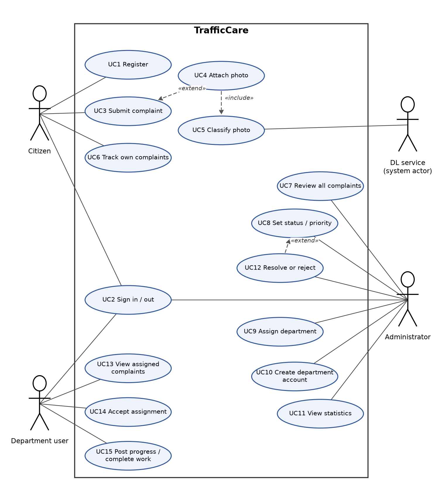

An editable Mermaid version of the same diagram is in `uml/use-case.mmd`.

### 1.1 Use case descriptions

| ID | Use case | Actor | Pre-condition | Main flow | Alternative / exception | Post-condition |
|---|---|---|---|---|---|---|
| UC1 | Register | Citizen | Not signed in | Enter name, e-mail, password → account created | Invalid data → 400; duplicate e-mail → 409 | Citizen account exists |
| UC2 | Sign in / out | All | Account exists | Enter credentials → JWT issued → role dashboard opens; logout clears local session | Wrong credentials → generic 401 | Session started / ended |
| UC3 | Submit complaint | Citizen | Signed in | Choose category, describe, give location, submit | Missing/invalid field → 400 | Complaint `Submitted` |
| UC4 | Attach photo | Citizen | In UC3 | Choose JPEG/PNG ≤ 10 MB | Wrong type/size → 400 | Image stored |
| UC5 | Classify photo | DL service | Image attached | Backend posts image → class + confidence returned | Service down/timeout → AI `Failed`, complaint still saved | AI result stored |
| UC6 | Track own complaints | Citizen | Signed in | View list, status, AI result, progress history | None | none |
| UC7 | Review all complaints | Admin | Signed in as admin | View every complaint with reporter and history | None | none |
| UC8 | Set status / priority | Admin | UC7 | Choose status and/or priority → saved, history entry added | Invalid value → 400 | Status/priority updated |
| UC9 | Assign department | Admin | UC7 | Choose department → assigned, history entry added | No such department → 404 | `Assigned to Department` |
| UC10 | Create department account | Admin | Signed in as admin | Enter name, e-mail, password, department | Duplicate → 409 | Department user exists |
| UC11 | View statistics | Admin | Signed in as admin | See total and count per status | None | none |
| UC12 | Resolve or reject | Admin | Work completed (resolve) or under review (reject) | Set `Resolved` / `Rejected` | None | Complaint closed |
| UC13 | View assigned complaints | Department | Signed in as department | See own department's complaints | None | none |
| UC14 | Accept assignment | Department | Status `Assigned` | Accept → history entry | Not in `Assigned` → 400 | `Accepted by Department` |
| UC15 | Post progress / complete | Department | Accepted | Write message, optionally mark Work Completed | Not accepted → 400 | `Work in Progress` or `Work Completed` |

---

## 2. Domain Class Diagram

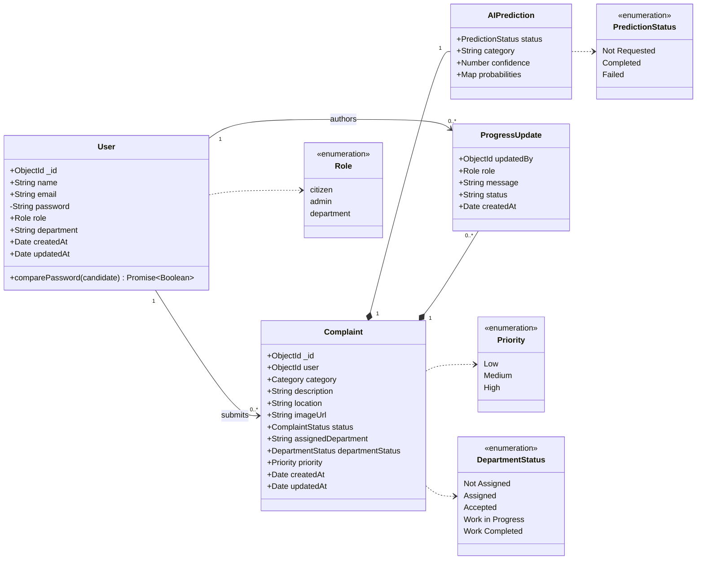

`ComplaintStatus` has nine values (SRS Appendix A) and `Category` has eleven (FR-CMP-02); they are omitted from the drawing for readability.

---

## 3. Backend Design Class Diagram

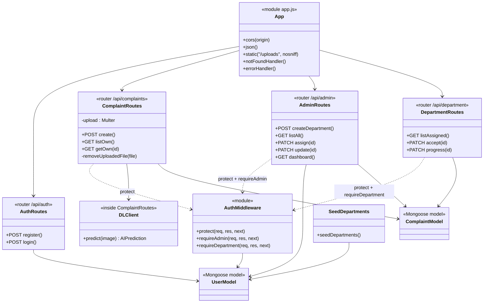

---

## 4. Component Diagram

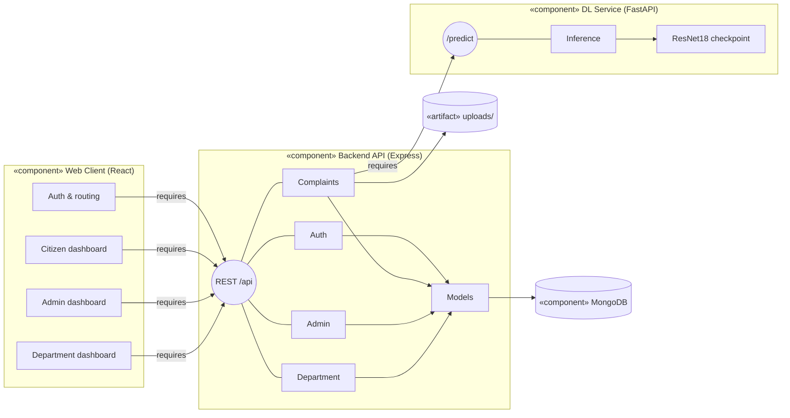

---

## 5. Deployment Diagram

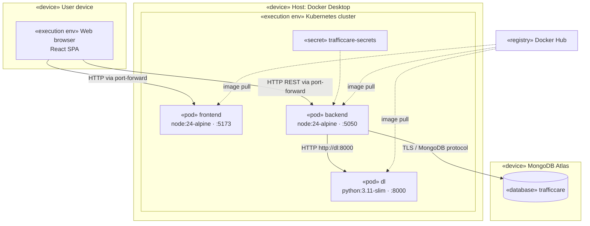

---

## 6. Sequence Diagram: Login

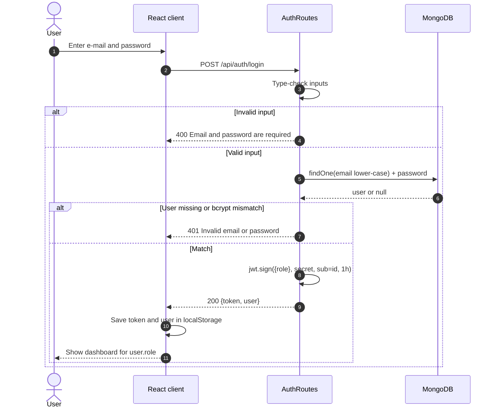

---

## 7. Sequence Diagram: Submit Complaint with Image

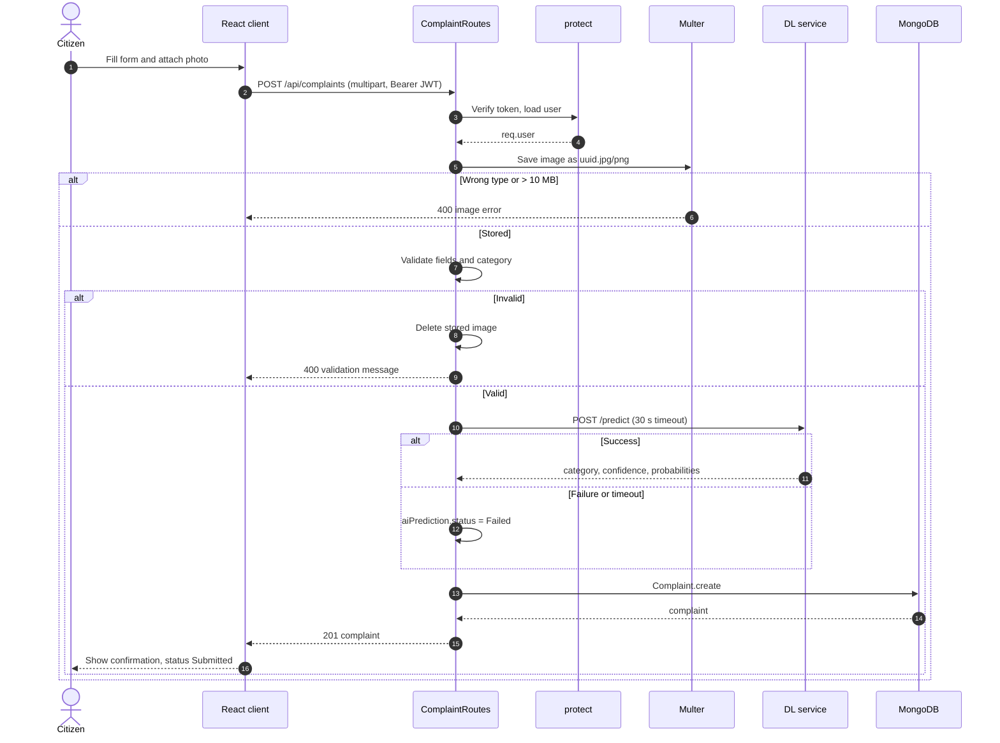

---

## 8. Sequence Diagram: Assign Complaint

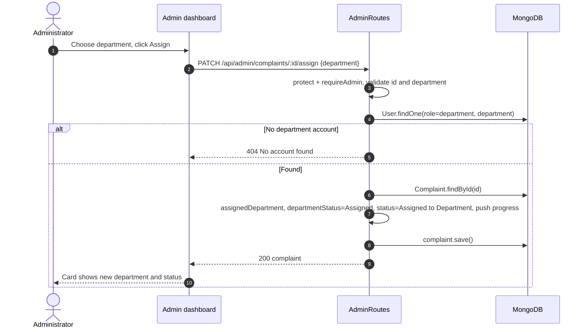

---

## 9. Sequence Diagram: Department Progress and Admin Resolution

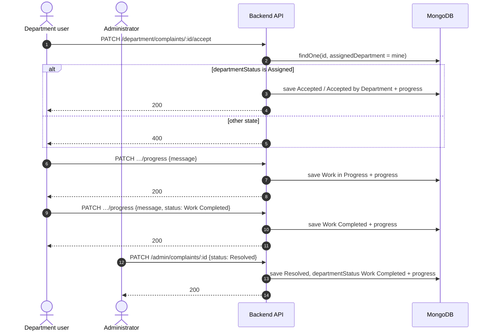

---

## 10. Sequence Diagram: DL Prediction

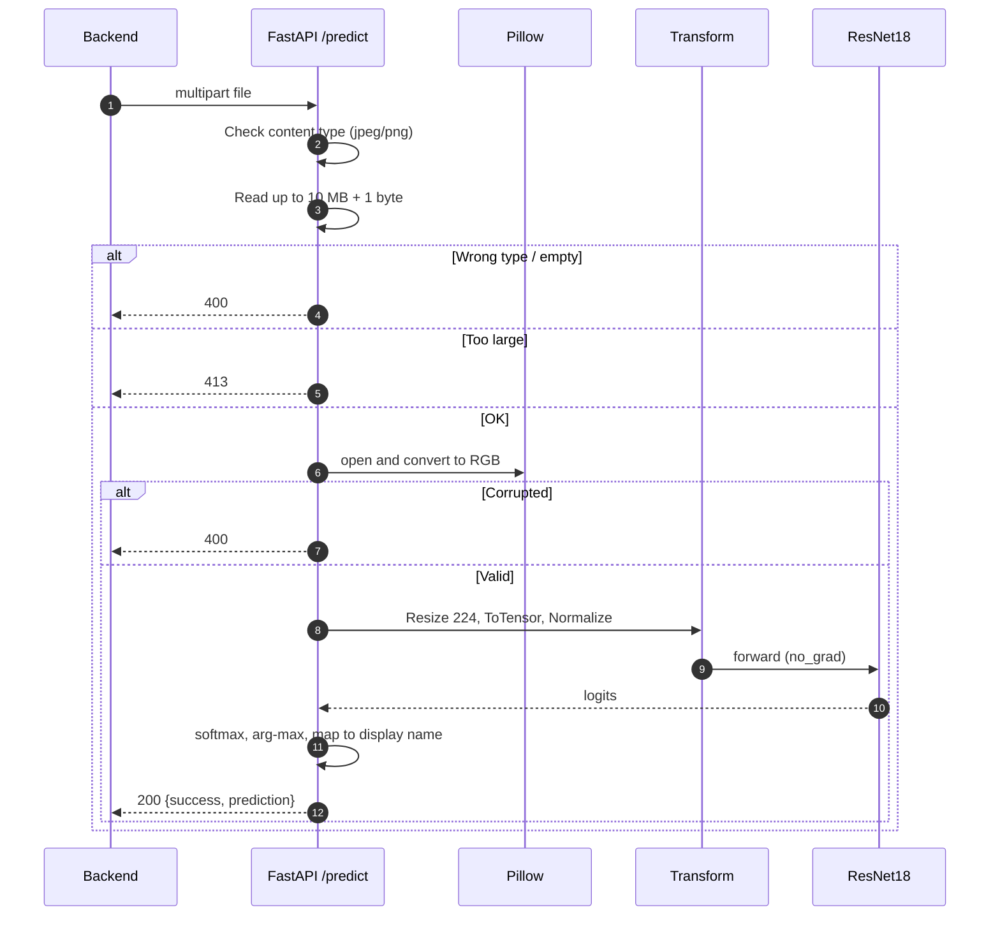

---

## 11. Activity Diagram: Complaint Handling End-to-End

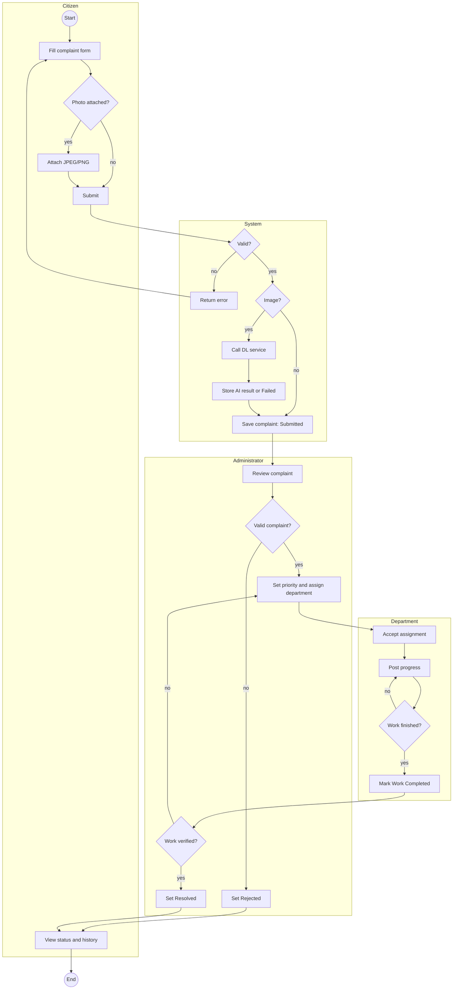

---

## 12. State Machine: Complaint Status

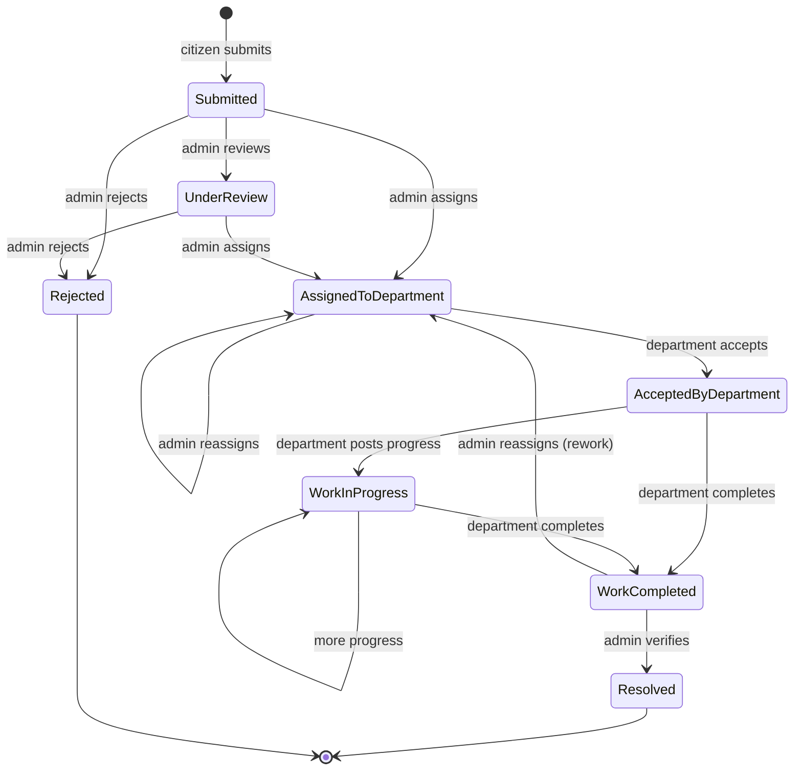

The server does not enforce this order for administrators: an admin may set any of the nine values. The diagram shows the intended workflow (SRS §3.5). The legacy `In Progress` value is not part of the new workflow.

---

## 13. State Machine: Department Status

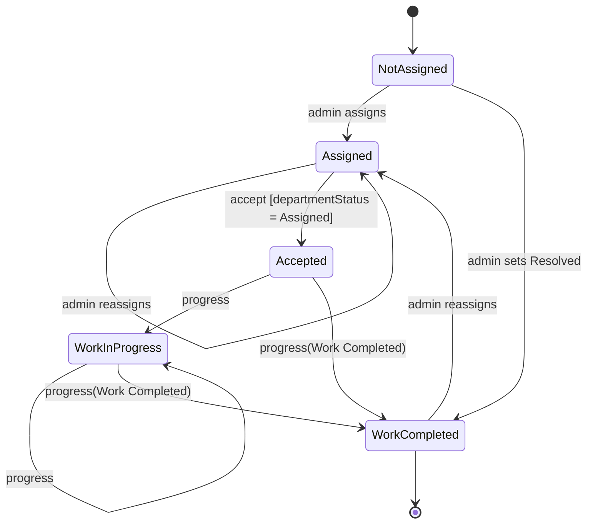

---

## 14. Activity Diagram: ML / DL / QML Experiment Pipeline

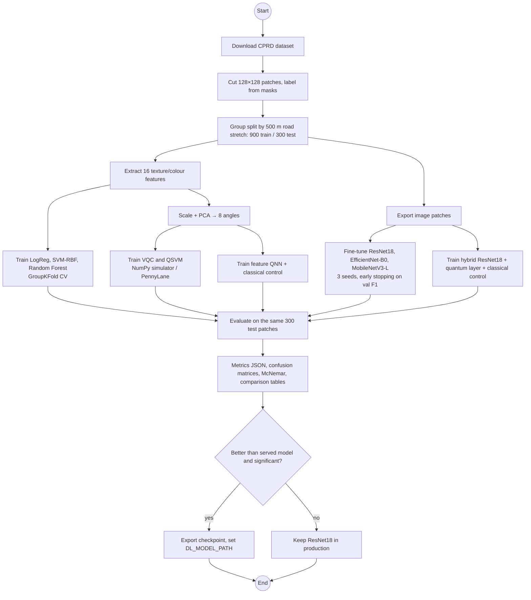
