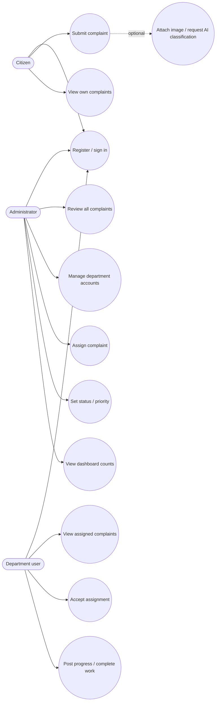
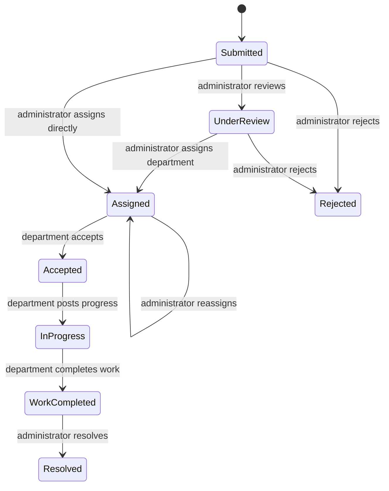
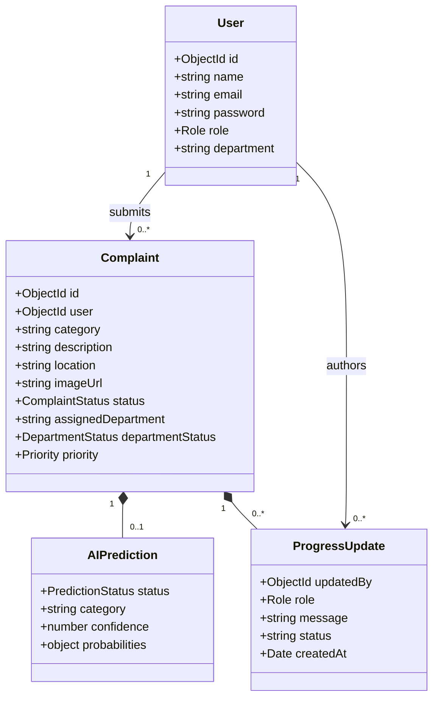

# UML Diagrams — TrafficCare

**Version:** 1.0 · **Date:** 14 November 2026

These diagrams describe the current repository behavior. Editable Mermaid sources are in `uml/`.

## Use case diagram



## Sequence: submit complaint with image

```mermaid
sequenceDiagram
  actor Citizen
  participant UI as React Client
  participant API as Express API
  participant Auth as JWT Middleware
  participant DL as FastAPI / ResNet18
  participant DB as MongoDB
  Citizen->>UI: Enter category, description, location, image
  UI->>API: POST /api/complaints (multipart + bearer JWT)
  API->>Auth: Verify token and load user
  Auth-->>API: Authorized citizen
  API->>API: Validate fields and image constraints
  opt Image attached
    API->>DL: POST /predict (image)
    alt Prediction succeeds
      DL-->>API: category, confidence, probabilities
    else Prediction errors / times out
      DL-->>API: error or no response
      API->>API: Set AI status Failed; continue
    end
  end
  API->>DB: Create complaint with owner, defaults, prediction result
  DB-->>API: Persisted complaint
  API-->>UI: 201 success + complaint
  UI-->>Citizen: Show confirmation and tracking state
```

## State machine: complaint lifecycle



The implementation stores complaint status and department status separately. The diagram summarizes common flow; administrators can update complaint status directly among allowed values.

## Class / domain model



## Sources

- `uml/use-case.mmd`
- `uml/complaint-sequence.mmd`
- `uml/complaint-state.mmd`
- `uml/domain-class.mmd`
