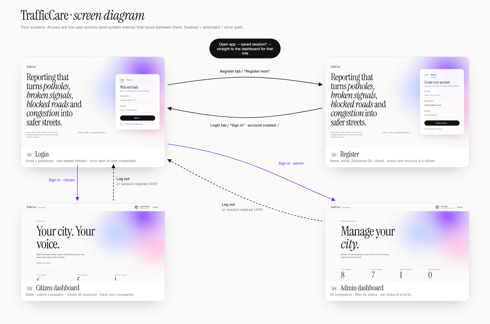
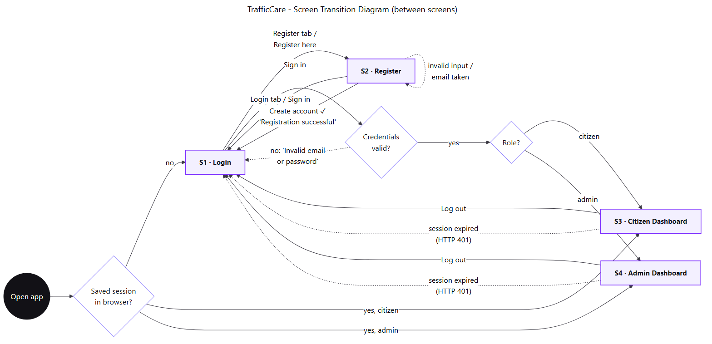
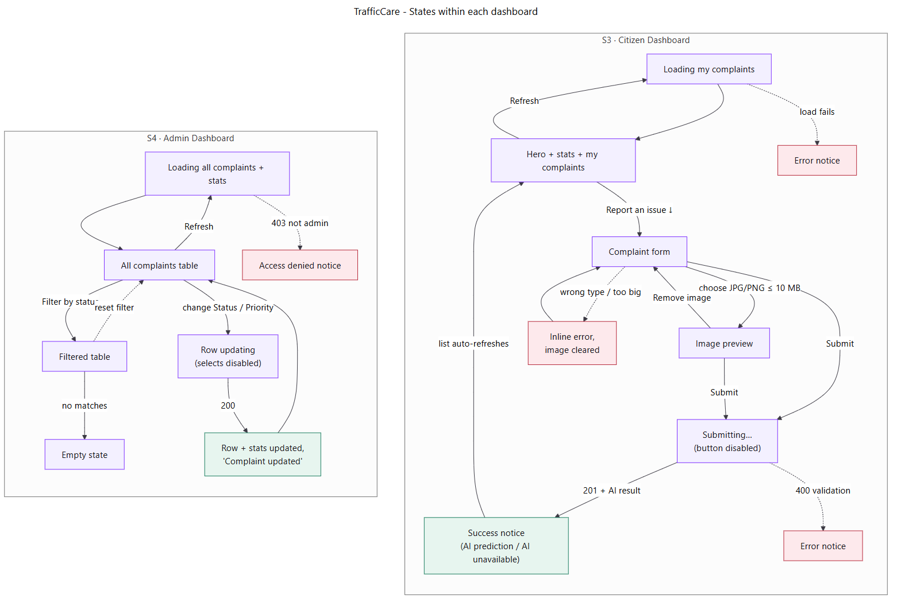
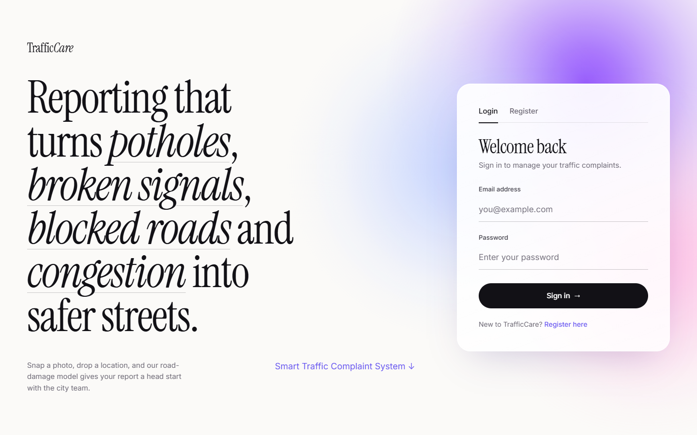
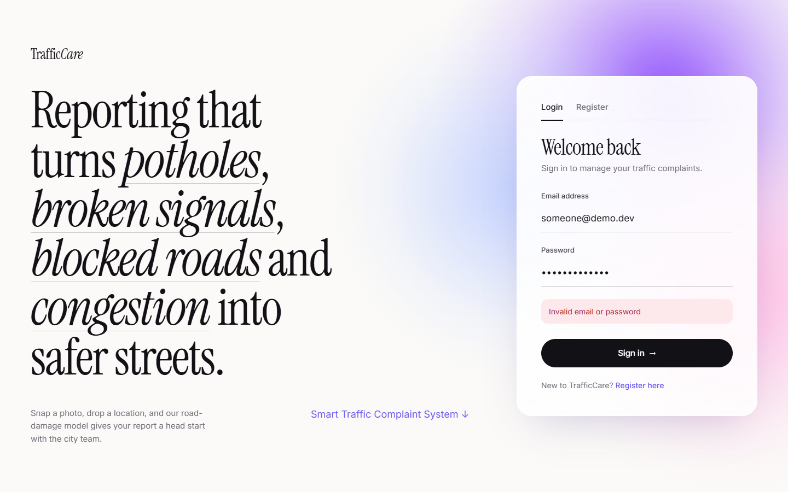
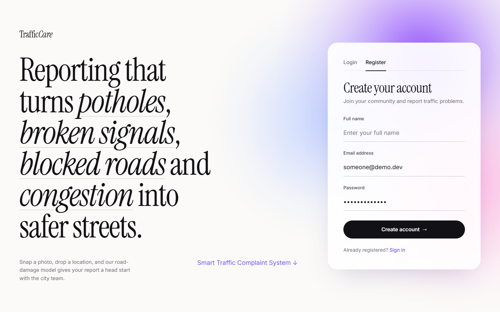
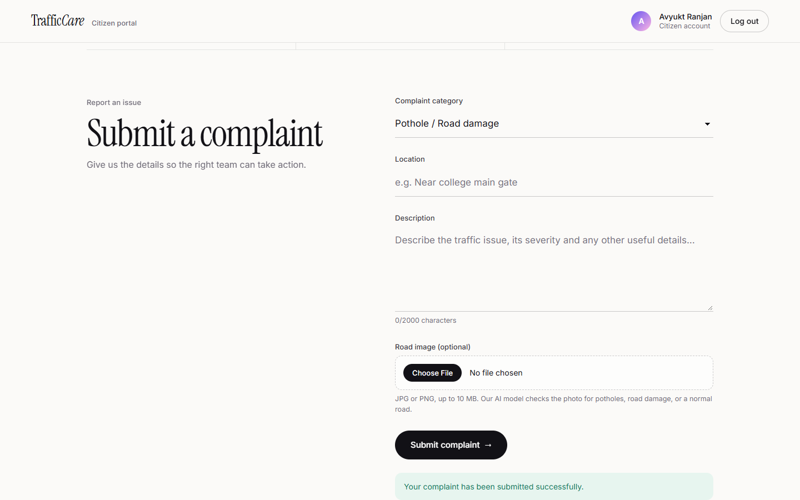
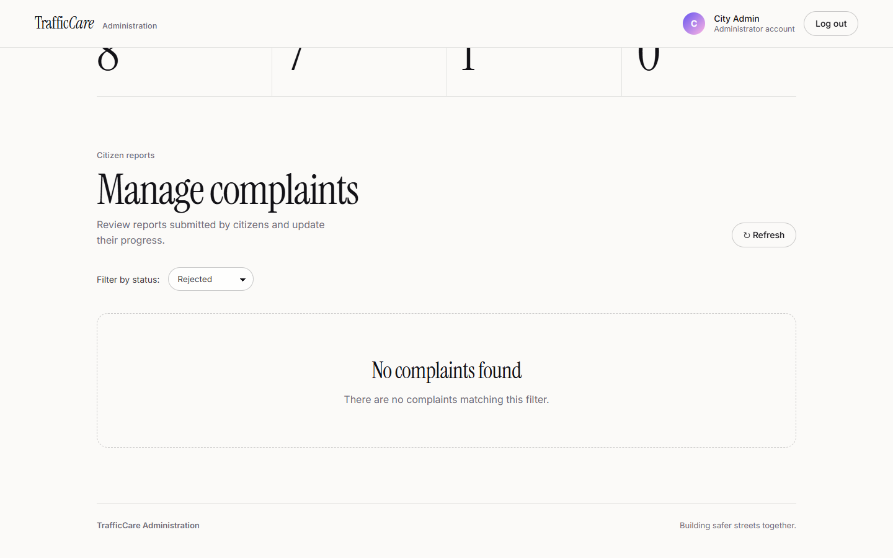
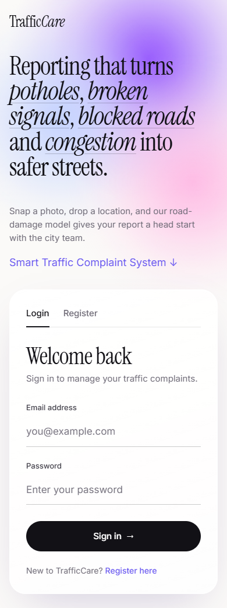

# TrafficCare: UX Design & Evaluation

Smart Traffic Complaint and Monitoring System · UI v2 (editorial redesign) · November 2026

This document covers the user experience of the TrafficCare web app: who it is for, the screens and how users move between them, the design system behind the new interface, how motion and accessibility were handled, and an honest heuristic evaluation with recommendations.

| Artefact | File |
|---|---|
| Screen diagram (real screenshots + transitions) | [`screen-diagram.png`](screen-diagram.png) (source: [`screen-diagram.html`](screen-diagram.html)) |
| Screen transition diagram (between screens) | [`screen-transition-diagram.png`](screen-transition-diagram.png) / [`.svg`](screen-transition-diagram.svg) (source: [`.mmd`](screen-transition-diagram.mmd)) |
| States within each dashboard | [`in-screen-states.png`](in-screen-states.png) / [`.svg`](in-screen-states.svg) (source: [`.mmd`](in-screen-states.mmd)) |
| Screenshots of every screen and state | [`screens/`](screens/) |

---

## 1. Users and goals

| User | Main goal | What success looks like |
|---|---|---|
| **Citizen** | Report a traffic problem quickly, with proof, and know it is being handled | Complaint submitted in under a minute; status visible later without calling anyone |
| **Administrator** (city / traffic team) | See every report, decide what matters, and move it to resolution | Can filter by status, set priority and status in place, and see totals at a glance |

Both roles share one login. The server decides the role (registration always creates a citizen), and the app sends each role to its own dashboard.

## 2. Screen inventory

| ID | Screen | Purpose | Key elements |
|---|---|---|---|
| **S1** | Login | Authenticate | Editorial intro, email + password, error alert, link to Register |
| **S2** | Register | Create a citizen account | Name, email, password (8+ chars), success returns to Login |
| **S3** | Citizen dashboard | Report and track | Greeting hero, 3 stats (total / active / resolved), complaint form with optional photo, AI analysis result, list of own complaints with status pills |
| **S4** | Admin dashboard | Triage and manage | Hero, 4 stats (total / active / resolved / rejected), status filter, table of all complaints with inline status and priority selects, photo and AI analysis per row |

## 3. Screen transitions

**Between screens.** On open, a saved session skips the login and goes straight to the right dashboard. Logging out, or a server reply of *session expired* (HTTP 401), always returns the user to S1.

| From | Event | To |
|---|---|---|
| App start | no saved session | S1 Login |
| App start | saved session, role citizen / admin | S3 / S4 |
| S1 | "Register" tab or "Register here" | S2 |
| S2 | "Login" tab or "Sign in" | S1 |
| S2 | account created | S1 (with "Registration successful! Please log in.") |
| S2 | invalid input / email already used | S2 (error shown) |
| S1 | Sign in, invalid credentials | S1 (error "Invalid email or password") |
| S1 | Sign in, valid, citizen / admin | S3 / S4 |
| S3, S4 | Log out | S1 |
| S3, S4 | any request returns 401 | S1 |

**Within each dashboard.** These are states on a single screen rather than separate pages:

### Screens and states (screenshots)

| | |
|---|---|
| S1 Login  | S1 error state  |
| S2 Register  | S3 submit success  |
| S4 filter → empty state  | Mobile login  |

Full-page captures: [`S3-citizen-dashboard.png`](screens/S3-citizen-dashboard.png), [`S4-admin-dashboard.png`](screens/S4-admin-dashboard.png), [`M3-citizen-mobile.png`](screens/M3-citizen-mobile.png).

## 4. Design system

The visual direction is *editorial and calm*: a warm-white page, very large type, and a single soft gradient "aura". It was inspired by blur-gradient hero designs on Awwwards. Reporting a pothole is a chore, so the interface aims to feel light and trustworthy rather than like a government form.

### 4.1 Typography

| Role | Typeface | Use |
|---|---|---|
| Display | **Instrument Serif** (regular + italic) | Hero headlines (clamped 44–148 px), section titles, stat numbers, complaint titles |
| Interface | **Inter** 400 / 500 / 600 | Labels, body, buttons, tables |

Italic underlined words in the login headline (*potholes*, *broken signals*…) name the actual complaint types, so the type does explanatory work. Stat numbers are set in the display serif at 52–84 px so the dashboard can be read at a glance.

### 4.2 Colour tokens (all checked against WCAG 2.1)

| Token | Value | Used for | Contrast | Result |
|---|---|---|---|---|
| `--ink` | `#121116` on paper `#fbfaf8` | Headings, body | 18.0 : 1 | AA ✔ |
| `--ink-soft` | `#3a3842` | Secondary text | 11.0 : 1 | AA ✔ |
| `--muted` | `#6f6b77` | Captions, hints | 4.98 : 1 | AA ✔ |
| `--lavender` | `#6655f0` | Links ("Register here", "Report an issue") | 4.88 : 1 | AA ✔ |
| Button | white on `#121116` | Primary actions | 18.8 : 1 | AA ✔ |
| Placeholder | `#77737f` on white | Input hints | 4.6 : 1 | AA ✔ |
| Status pills | Resolved / In Progress / Under Review / Rejected / Submitted | Tinted backgrounds | 4.8 / 4.9 / 5.5 / 5.6 / 10.0 : 1 | AA ✔ |

During this evaluation three tokens failed and were fixed. The muted grey was 4.43:1, the lavender link 3.12:1 and the placeholder 2.38:1; each was darkened just enough to pass without changing the look. Status is never shown by colour alone: every pill carries its text label.

### 4.3 Layout

- The content column is at most 1240 px, with fluid side gutters `clamp(16px, 4vw, 56px)`.
- The login page uses two columns (intro and form card) that stack below 900 px.
- On the citizen dashboard, the form section is split: the title sticks on the left while the form scrolls on the right. It becomes one column below 900 px.
- Below 600 px, stats stack vertically, header details collapse to the avatar and Log out, and complaint photos go full width.
- No horizontal scrolling at 390 px, except inside the admin table, which deliberately scrolls on its own.

### 4.4 Components

- **Hairline fields.** Inputs have only a bottom border. On focus, a violet underline grows from the left.
- **Pill buttons.** Primary buttons are black; ghost buttons are outlined. Each primary button has an arrow that nudges right on hover.
- **Status pills.** Coloured dot, tinted background and text label.
- **Editorial complaint rows.** Reference ID, serif title, description, optional photo, AI analysis panel, location and date.
- **Notices.** Green for success and red for errors. Errors use `role="alert"`, successes use `role="status"`.

## 5. Motion

Motion has two jobs here: to show the user what changed, and to make the app feel responsive. It is never decorative at the cost of smoothness.

| Interaction | What happens | Timing |
|---|---|---|
| Page entrance | Headline, text, card and stats rise 28 px and fade in, staggered | 900 ms, 90 ms stagger, ease-out |
| Login ⇄ Register | Tab underline slides; "Full name" field opens / closes; heading, subtitle and button label cross-fade; card height eases (no jump) | 420–520 ms ease-out |
| Error message appears | Row expands smoothly instead of pushing the button down instantly | 460 ms |
| Button hover | Lifts 2 px, soft shadow fades in, arrow nudges right; press scales to 98.5 % | 460 ms / 120 ms |
| Complaint row hover | Row lifts, white rounded surface fades in behind it, photo zooms 3 % | 520 ms / 600 ms |
| Aura | Three gradient orbs drift slowly; paused when scrolled out of view | 20–28 s loops |

**Performance rules followed** (measured in Chrome on the project laptop):

- Only `transform` and `opacity` are animated, so movement stays on the GPU compositor.
- The aura was originally three `filter: blur(70px)` elements under `backdrop-filter` glass, which meant the browser re-blurred large areas every frame. It now uses many-stop radial gradients painted once, and the glass panels are solid. This cut the login page's GPU work per second by about 29 %.
- Lifting elements carry `will-change: transform`. This prevents the text "snap" that happens when Chrome promotes and demotes a layer at the start and end of a hover.
- Measured results: 60 fps with no frames over 20 ms while idle, and 55–56 fps during automated scroll and hover tests.
- Card height during Login → Register passes through 34 intermediate values over about 400 ms instead of jumping 100 px.
- On battery saver, Chrome caps animations at 30 fps. That is a power setting, not an app issue.
- `prefers-reduced-motion: reduce` turns off the drift, entrance, lift and switch animations and smooth scrolling.

## 6. Accessibility checklist

| Check | Status |
|---|---|
| Text contrast ≥ 4.5 : 1 (AA) for all text tokens | ✔ (after fixes in §4.2) |
| Every input has a visible label (not placeholder-only) | ✔ |
| Keyboard: all actions reachable with Tab; visible focus ring (`:focus-visible`, violet) | ✔ |
| Hidden "Full name" field is `disabled` + `inert` while collapsed, so it is skipped by Tab, validation and screen readers | ✔ |
| Errors announced (`role="alert"`), successes announced politely (`role="status"`, `aria-live`) | ✔ |
| Decorative elements (aura, avatar initials, arrows) hidden from assistive tech | ✔ |
| Status conveyed by text, not colour alone | ✔ |
| Reduced-motion preference respected | ✔ |
| Images have alt text; broken thumbnails are hidden instead of showing a broken icon | ✔ |
| Language attribute set (`lang="en"`) | ✔ |

## 7. Heuristic evaluation (Nielsen's 10)

Severity scale: **0** not a problem · **1** cosmetic · **2** minor · **3** major · **4** catastrophic.

| # | Heuristic | Works well | Issue found | Sev. | Recommendation |
|---|---|---|---|---|---|
| 1 | Visibility of system status | Loading text, disabled buttons while submitting, live stats, status pills, AI result message | After submitting, the success notice appears **below** the button and can be below the fold on short screens | 2 | Scroll the notice into view, or use a toast at the top |
| 2 | Match with the real world | Plain categories ("Pothole / Road damage", "Illegal parking"), Indian date format, location as free text | AI labels ("Road Damage", "Normal Road") use different words from the citizen's own categories | 1 | Map AI output to the same category names |
| 3 | User control and freedom | Remove image before submit, filter reset, logout everywhere | A citizen cannot edit or withdraw a complaint; an admin can mark "Rejected" with no undo | 2 | Add withdraw (citizen) and undo or confirm for Rejected (admin) |
| 4 | Consistency and standards | One button style, one field style and one pill style across all screens | None significant | 0 | n/a |
| 5 | Error prevention | Client- and server-side checks: file type and 10 MB, 2000-character limit with live counter, 8+ character password, email format | None significant | 0 | n/a |
| 6 | Recognition rather than recall | Category dropdown, status filter, visible labels, complaint reference IDs | Photo requirements are only in helper text | 1 | Add a drag-and-drop zone that shows the limits |
| 7 | Flexibility and efficiency | Saved session skips login; anchor link jumps to the form | No search or sort in the admin table | 2 | Add search by location / ID and sort by date / priority |
| 8 | Aesthetic and minimalist design | Calm editorial layout; one accent; no clutter | Native file input shows "No file chosen" in the browser's style | 1 | Custom file picker with preview |
| 9 | Recognise, diagnose, recover from errors | Specific messages ("Invalid email or password", "Image must be 10 MB or smaller", length limits) | When a session expires the user is returned to Login **without** saying why | 2 | Show "Your session expired, please sign in again" |
| 10 | Help and documentation | Helper text under the photo field explains what the AI does | No password reset; no admin onboarding (an admin account can only be created in the database) | 3 | Add password reset, and an admin invite or seed flow |

**Summary.** No catastrophic issues. One major gap: account recovery and admin provisioning, which is a product feature rather than a UI defect. The rest are minor polish items that would make the system feel finished.

## 8. Changes made during this evaluation

Fixed in the code:
- **Dark-mode headings:** they were invisible when the OS used dark mode. The app now forces its light palette.
- **Mobile dashboard:** it opened scrolled halfway down after login; it now opens at the top.
- **Sticky header:** dashboard numbers showed through it; it is now solid.
- **Rejected photo:** after a valid photo was chosen, picking an invalid one left the old photo attached.
- **Broken thumbnails:** they showed a broken-image icon and alt text; they are now hidden.
- **Abrupt switches:** Login ⇄ Register and error messages changed instantly; they now animate.
- **Lift on some buttons:** on Log out, Refresh and Remove image, a later rule overrode the transition so the lift snapped; it now eases.
- **Low-contrast colours:** three colour tokens failed WCAG AA and were darkened just enough to pass.

## 9. Future work

1. A toast or scroll-into-view for the submit result. Show the AI prediction **before** final submit so the citizen can confirm the category.
2. A complaint detail view with a status timeline, so citizens can see when an admin changed it.
3. Search and sort in the admin table, plus a card layout for admins on mobile.
4. A session-expired message, password reset, and an admin invite flow.
5. A dark theme. The tokens are already centralised, so this is a token swap plus a second aura palette.
